# Architecture — Simplified DLP Platform

This document describes the system in seven sections: user flows (including the endpoint
summary), system design, the core scan logic, the data model, module structures, the loading
strategy and deployment.

---

## 1. User flows

The two resources have genuinely different flows, so they are documented separately.
Data Types are self-contained; Data Sets always depend on Data Types that already exist.

<details>
<summary><strong>Expand - 12 User Flows Diagrams (Data Types, Data Sets, Scan, Backend endpoints)</strong></summary>

### 1.1 Data Types

**Create** — `POST /api/datatypes`

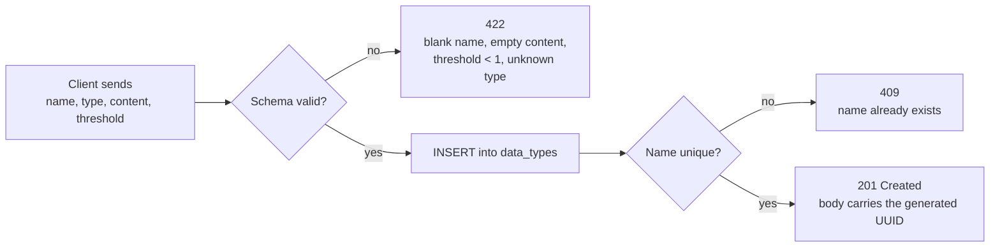

**List** — `GET /api/datatypes?limit=&offset=`

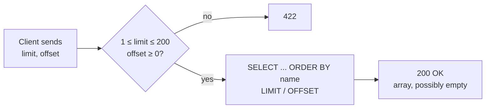

**Read** — `GET /api/datatypes/{id}`

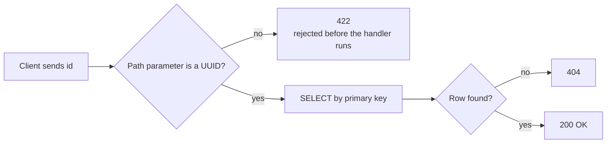

**Update** — `PUT /api/datatypes/{id}`

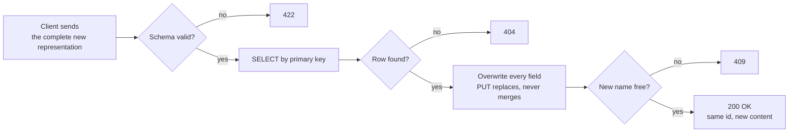

**Delete** — `DELETE /api/datatypes/{id}`

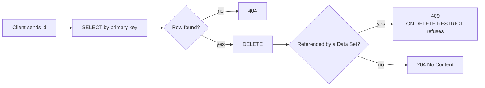

### 1.2 Data Sets

**Create** — `POST /api/datasets`

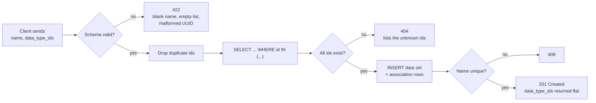

**List** — `GET /api/datasets?limit=&offset=`

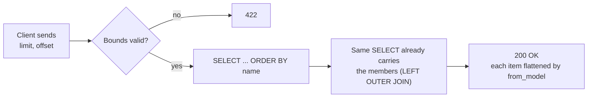

**Read** — `GET /api/datasets/{id}`

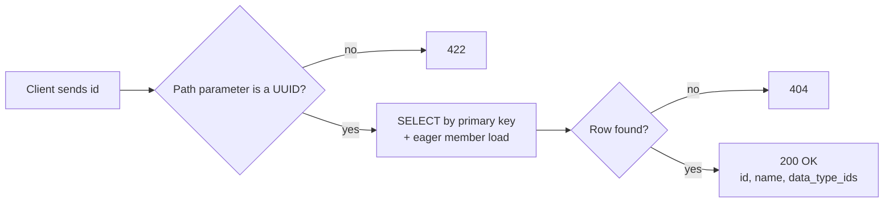

**Update** — `PUT /api/datasets/{id}`

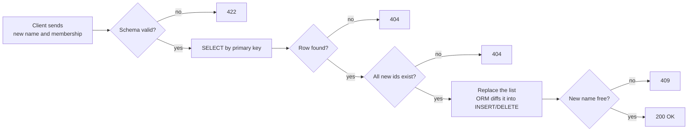

**Delete** — `DELETE /api/datasets/{id}`

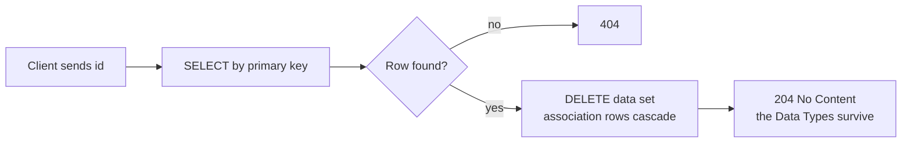

### 1.3 Scan

**Scan** — `POST /api/scan`

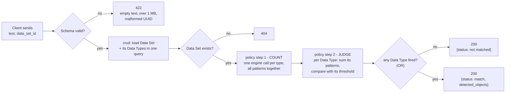

### 1.4 Backend endpoints

Two logical modules, each with full CRUD. The verb decides the operation, the path decides
the identity — no `/create` or `/delete` ever appears in a URL.

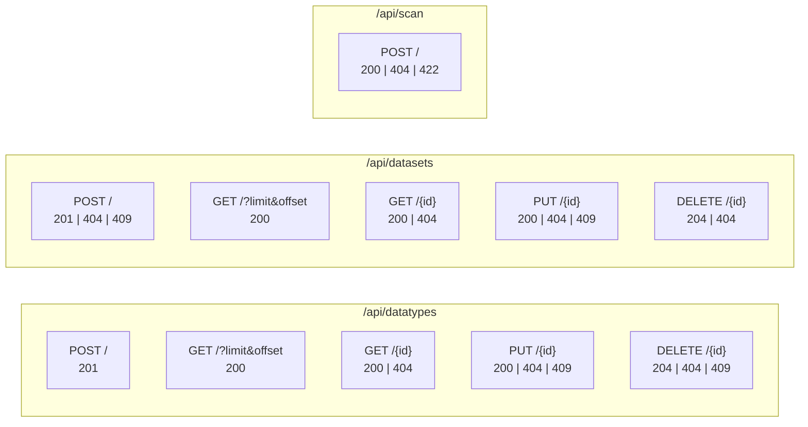

| Status | When it is returned | Who produces it |
|--------|--------------------|-----------------|
| 422 | Body or parameter violates the schema (threshold 0, empty keyword list, malformed UUID) | Pydantic, before the endpoint runs |
| 404 | Valid id with no row, or `data_type_ids` pointing at a missing Data Type | The router, or `MissingDataTypesError` |
| 409 | Duplicate name, or deleting a Data Type that is still in use | Database constraints, via `ConflictError` |
| 500 | A CHECK constraint fired — the schemas failed to catch bad input, i.e. a bug | Re-raised `IntegrityError` |

</details>

---

## 2. System design

The service is organized into four **layers**. Presentation, Business, Persistence and Support.

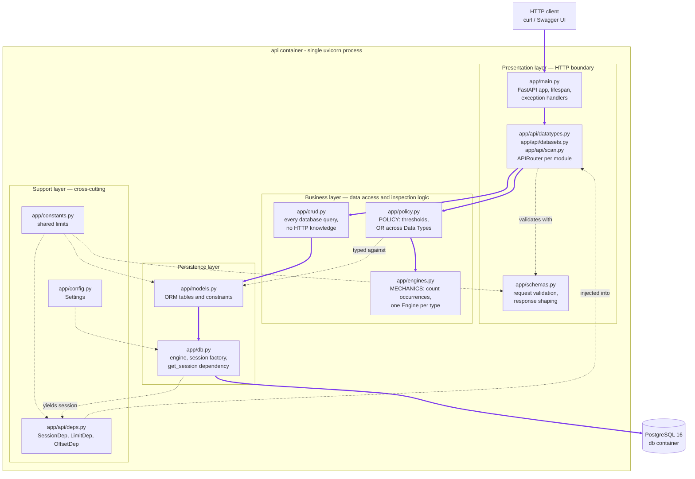

The purple arrows are the paths a request actually walks. A CRUD request follows the spine
`Client → Main → Routers → Crud → Models → Db → PostgreSQL`; a scan request first loads its Data
Set through that spine, then branches at the routers into `Policy → Engines`, which touch no
database at all. Every dashed arrow is a dependency that is reached into sideways.

| Layer | Modules | Role |
|-------|---------|------|
| Presentation | `main.py`, the routers, `schemas.py` | Owns the HTTP contract: routing, status codes, request/response shape |
| Business | `crud.py`, `policy.py`, `engines.py` | Every query and domain rule (conflicts, missing references); the scan verdict (thresholds, OR); and the counting itself — no HTTP knowledge |
| Persistence | `models.py`, `db.py` | The ORM tables, constraints, engine and session factory |
| Support | `deps.py`, `constants.py`, `config.py` | Cross-cutting: dependency injection, shared limits, environment settings — reached into by the other three, never called in sequence |

### Life cycle of a single request

Traced end to end on `POST /api/datatypes`, the write path that exercises every stage. The
sequence below is what the code actually does:

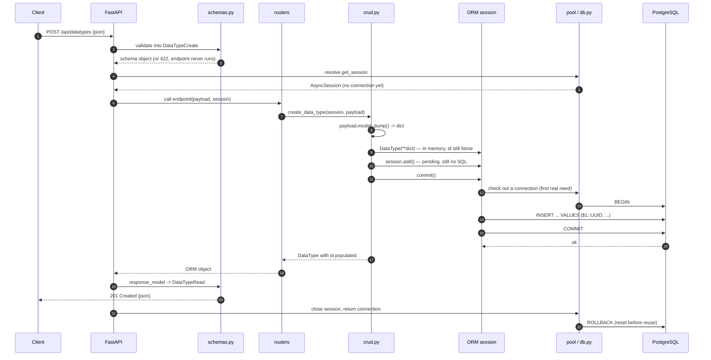

**Phase 1 — HTTP text becomes a validated Python object.**
FastAPI reads the body, parses the JSON into a `dict`, and hands it to Pydantic, which builds a
`DataTypeCreate`. This is where coercion happens (`"keywords"` becomes `InspectionType.KEYWORDS`)
and where every validator in `schemas.py` runs. Invalid input is rejected as 422 **before the
endpoint function is entered at all**.

**Phase 2 — dependencies are resolved.**
FastAPI walks the endpoint signature, sees `SessionDep`, runs `get_session` up to its `yield`, and
passes the resulting `AsyncSession` in as an argument.

**Phase 3 — Pydantic object becomes an ORM object.**
Two lines in `crud.create_data_type` do the whole translation:

```python
data_type = DataType(**payload.model_dump())
session.add(data_type)
```

**Phase 4 — first contact with the database.**
`commit()` is the moment everything deferred becomes real.


**Phase 5 — ORM object becomes the response.**
`crud` returns the live `DataType`, whose attributes are still loaded because the session factory
sets `expire_on_commit=False`.

FastAPI then re-validates that object against `response_model`. For Data Types this is automatic
via `from_attributes`; for Data Sets it is the explicit `DataSetRead.from_model`, because the
stored shape is not the wire shape. Either way `response_model` acts as a whitelist: an attribute
the schema does not declare cannot reach the client.

**Phase 6 — teardown.**
FastAPI resumes `get_session` past its `yield`, the `async with` block closes the session, and the
connection goes back to the pool. The pool issues a `ROLLBACK` on return regardless of outcome, so
no transaction state can leak into whichever request borrows that connection next.

**The read path in one line.** A `GET` skips phase 3 entirely and inverts phase 4: `crud` issues a
`SELECT` (which opens the transaction implicitly, exactly as an `INSERT` would), never calls
`commit`, and the session closes with the pool's `ROLLBACK`.

---

## 3. Core logic - `app/policy.py` and `app/engines.py`

This is the heart of the service: how one scan turns a text and a Data Set into a verdict.

### 3.1 Two questions, two files

A scan asks two different questions, and each has its own file:

| Question | File | Knows about | Never sees |
|----------|------|-------------|------------|
| How often does each pattern occur in the text? (**mechanics**) | `engines.py` | patterns, text | Data Types, thresholds, Data Sets |
| Which Data Types fired? (**policy**) | `policy.py` | Data Types, thresholds, OR | how counting works |

So "where is the logic of X" is always answered by a file name: a change to word boundaries is in
`engines.py`, a change to how thresholds or AND/OR work is in `policy.py`.

### 3.2 The flow of one scan

Every module, class and function a scan passes through, top to bottom, with what goes in and what
comes out of each. Solid arrows are calls, numbered in order; the dashed arrow is inheritance.
`evaluate` works in two steps - **count**, then **judge** - and that order is what keeps the scan to
a single pass over the text, however many Data Types the Data Set holds.

The yellow stickers follow one real scan end to end - the README example: the text
`my ssn, my passport and my visa` against a Data Set with one Data Type, `PII`, holding `ssn`,
`passport`, `visa` with threshold 2. Every value was taken from running the code.

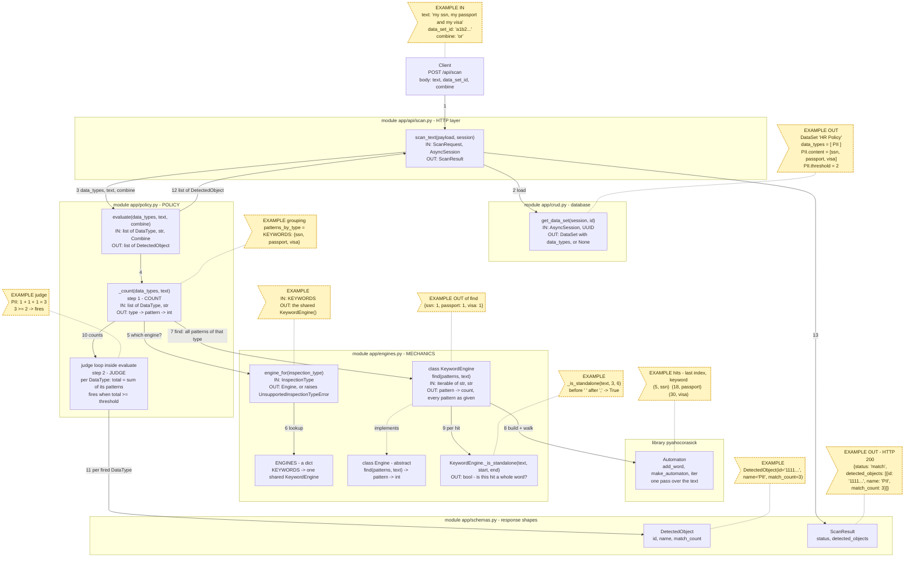

| Step | Module | Function or class | In | Out |
|------|--------|-------------------|----|-----|
| 1 | `api/scan.py` | `scan_text` | `ScanRequest` | `ScanResult` |
| 2 | `crud.py` | `get_data_set` | Data Set id | `DataSet` with `data_types`, or `None` -> 404 |
| 3-4 | `policy.py` | `evaluate`, which calls `_count` | Data Types, text, `combine` | list of `DetectedObject` |
| 5-6 | `engines.py` | `engine_for` and the `ENGINES` dict | `InspectionType` | the engine for that type |
| 7 | `engines.py` | `KeywordEngine.find` | every pattern of the type, text | `{pattern: count}` |
| 8-9 | pyahocorasick, `engines.py` | `Automaton`, `_is_standalone` | lower-cased text | hits, then whole words only |
| 10-11 | `policy.py` | the judge loop in `evaluate` | the counts, each Data Type | a `DetectedObject` per Data Type over its threshold |
| 12-13 | `api/scan.py` | `scan_text` | list of `DetectedObject` | `match` with the list, or `not matched` |

The same scan as a sequence, for a Data Set with two keyword Data Types - `First` with
`[ssn, visa]` and `Second` with `[SSN]` and threshold 2 - and the text `"ssn and SSN"`. This is
exactly the case `test_the_text_is_read_once_for_the_whole_scan` asserts:

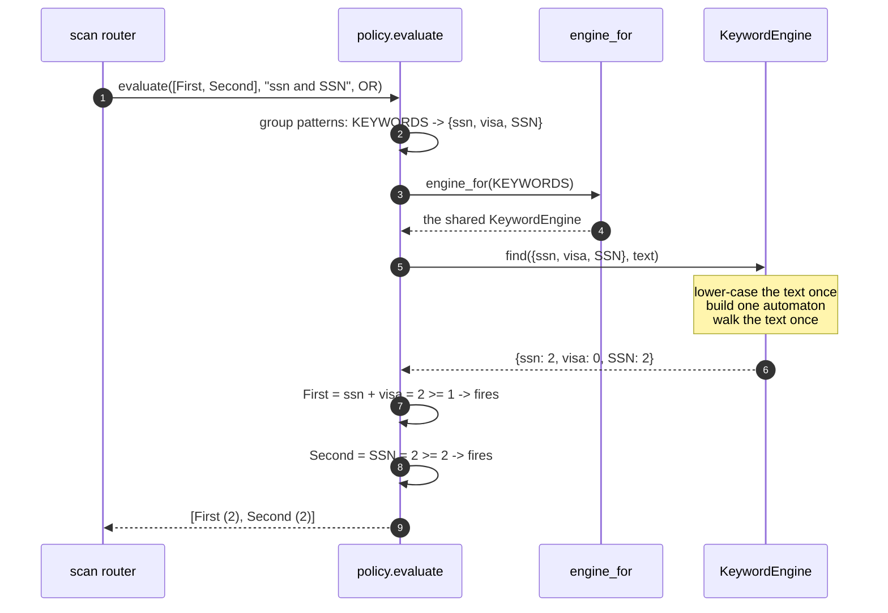

One call to `find` served both Data Types, and each still got its own total. `ssn` and `SSN` are
one keyword for the engine, and the result answers both spellings, because the policy looks each
count up with the Data Type's own `content`.

### 3.3 Classes and design points

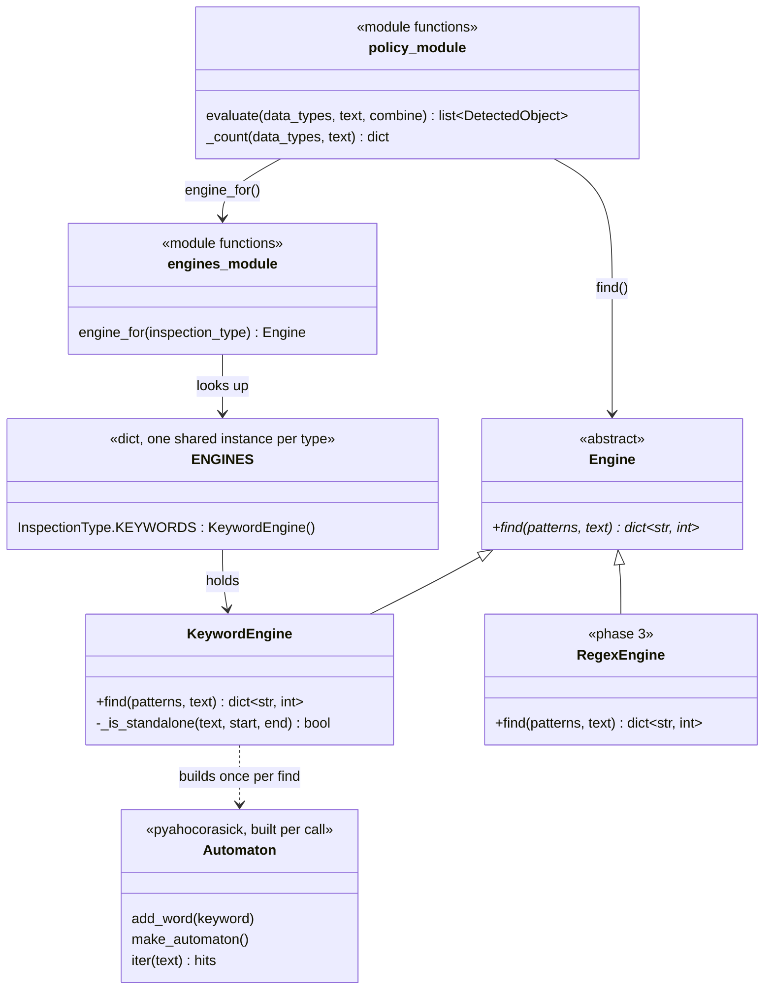

Three design points are worth naming:

* **Strategy.** Every engine is interchangeable behind one method, `find`, and the policy calls
  them all the same way. The base class holds no shared logic: the threshold comparison is policy,
  so it lives in `policy.py`.
* **Stateless engines.** `find` keeps nothing on `self`: input in, dict out. One instance per type
  can therefore be shared by every concurrent request, with no per-scan state to manage.
* **A dict is the registry.** `ENGINES` maps a type to its engine, and `engine_for` wraps the
  lookup so a missing entry is a named `UnsupportedInspectionTypeError` (HTTP 500 - a bug, not bad
  input). A registry class would only pay off with runtime registration (plugins), validation on
  register, or several registries; none of those exists.

**Extension points.** A new inspection type is one `Engine` subclass plus one `ENGINES` entry;
`policy.py` does not change. An AND mode is one branch in `evaluate` on its `combine` argument,
which is already passed through from the request; `engines.py` does not change. The two axes grow
independently - the idea behind the Bridge pattern, achieved by composition without a class
hierarchy.

### 3.4 How keywords are found - Aho-Corasick

`KeywordEngine.find` works in two steps. An Aho-Corasick automaton finds
every place where a keyword occurs as a substring, and `_is_standalone` then keeps only the hits
that are whole words. The automaton is a tree with one node per character, shared by all the
keywords; a space or a `+` is a character like any other, so `new york` and `c++` need no special
case. For the keywords `my`, `ssn`, `and`, `passport`:

```
(root)
  ├─ m ─ y*                              * = a keyword ends here
  ├─ s ─ s ─ n*
  ├─ a ─ n ─ d*
  └─ p ─ a ─ s ─ s ─ p ─ o ─ r ─ t*
```

The text is read once, one character at a time, each character moving one step in the tree.
When no step fits, a precomputed *failure link* jumps to the longest ending of what was just read
that is also the beginning of some keyword - from `pass` to `ss`, the start of `ssn` - so the text
is never re-read. The cost is O(text length + total keyword length + number of hits): the number
of keywords does not multiply the length of the text.

The automaton knows nothing about words, which is why `_is_standalone` stays. In `my passn` it
reports `ssn` at index 5; the character before it is `a`, so the hit is discarded.

### 3.5 Performance

`tests/test_performance.py` scans the largest text the API accepts - 1,000,000 characters of
random words with 1,000 planted sensitive keywords - against growing Data Sets. Each test asserts
the exact verdict and a time budget of roughly 10x the measured time, so a slow CI machine passes
while an accidental change of complexity fails. `pytest -m performance` prints this table at the
end of the run (one local run; the numbers move by a few milliseconds between runs):

| Scenario | Size | Time |
|----------|------|------|
| Small policy: 1 Data Type x 5 keywords | 5 keywords | 6.4 ms |
| Department: 10 x 50 | 500 keywords | 9.4 ms |
| Enterprise: 50 x 200 | 10,000 keywords | 17.4 ms |
| Validation maximum per type: 20 x 1000 | 20,000 keywords | 31.8 ms |
| 50 Data Types sharing the same 4 frequent keywords | 903 hits per type | 8.0 ms |
| End to end over HTTP and PostgreSQL: 5 Data Sets x 20 types x 200 keywords | load + scan | ~30 ms |

Growing the Data Set 4,000-fold - from 5 keywords to 20,000 - costs about 5x, because the text is
read once whatever the number of keywords; the remaining growth is building the automaton and
lower-casing the patterns. The shared-keywords row shows the other half of the design: 50 Data
Types watching the same keywords cost one pass, not fifty.

Two other ways to find the keywords were measured and not used. Splitting the text into words and
looking keywords up in a dictionary costs a fixed 40 ms per 1 MB whatever the keywords are, and
needs a second code path for `credit card` or `c++`. One regex alternation of all keywords took
148 ms with 400 keywords, and reports non-overlapping matches only, so `york` inside `new york` is
not counted. The automaton is rebuilt on every call; building it for 400 keywords takes 0.09 ms,
so it is not cached.

---

## 4. Data model

The relationship between Data Sets and Data Types is many-to-many, so it is implemented with an
association table rather than a single foreign key.

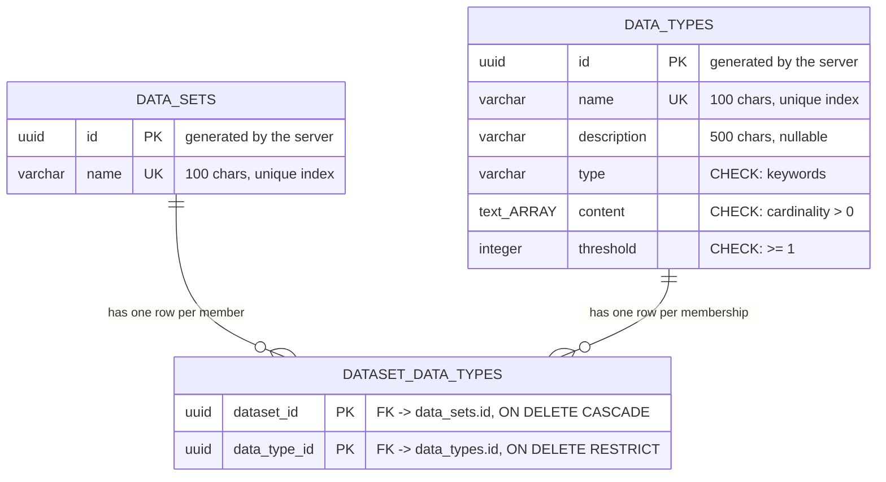

Both relationship labels describe the **same** association table, read from its two ends - there
is no second relationship hiding here. A row in `DATASET_DATA_TYPES` says "this Data Set includes
this Data Type"; looking at it from the Data Set you call it a member, looking at it from the Data
Type you call it a membership.

The association table has a **composite primary key** over both columns. That serves two purposes
at once: it identifies the row, and it makes linking the same Data Type to the same Data Set twice
impossible at the database level.

The two delete policies express a business decision:

- Deleting a **Data Set** removes only its memberships (`CASCADE`), because links are worthless
  without the set that owns them.
- Deleting a **Data Type** that is in use is refused (`RESTRICT`) and surfaces as 409, because a
  security policy should not silently empty out when one component is removed.

---

## 5. Module structure

The scan core (`policy.py`, `engines.py`) has its own section - [section 3](#3-core-logic---apppolicypy-and-appenginespy).

### 5.1 `app/models.py`

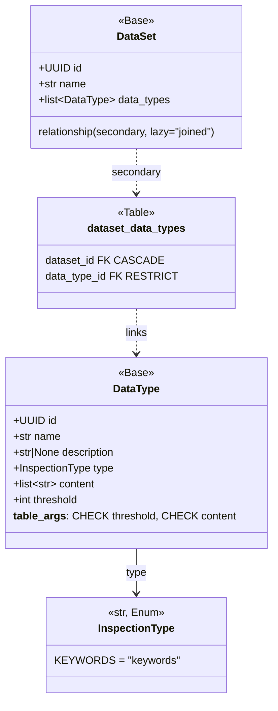

### 5.2 `app/schemas.py`

Each resource follows the same three-way split: `*Create` and `*Update` describe what may come
in, `*Read` describes what goes out. `*Base` holds the fields and validators shared by the write
schemas, so a rule is written once.

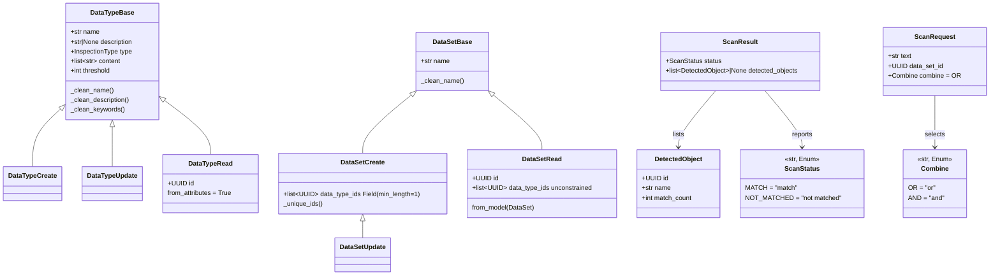

Both resources now share the same `*Base` shape, but they draw the line in different places, and
the reason is worth stating precisely: **a constraint may be inherited by the read schema only
when it is also an invariant of the stored row.**

`DataTypeBase` holds every field, `content` and its `min_length=1` included, and `DataTypeRead`
inherits all of it. That is safe because the database enforces the same rule -
`CHECK (cardinality(content) > 0)` - so a Data Type with no keywords cannot exist to be read back.

`DataSetBase` holds only `name`. `data_type_ids` is declared twice on purpose: `DataSetCreate`
constrains it with `Field(min_length=1)` because a Data Set with no members is a pointless
*request*, while `DataSetRead` leaves it unconstrained because nothing in the database prevents
such a *row*. Inheriting the request's constraint would turn a plain `GET` of a member-less Data
Set into a 500.

`DataSetRead` is built by `from_model` rather than `from_attributes`, because the ORM
exposes `data_types` (objects) while the contract requires `data_type_ids` (a flat array).

---

## 6. Eager loading strategy

`DataSet.data_types` is declared `lazy="joined"`. Some form of eager loading is not optional in
this service: touching a lazily-loaded collection would emit IO from an already-returned async
context and raise `MissingGreenlet`. The choice is therefore *which* eager strategy, and it was
made by measurement rather than by default.

Both endpoints now issue exactly **one** statement. 
1. Reading one Data Set:

```sql
SELECT data_sets.id, data_sets.name, data_types_1.id, data_types_1.name, ...
FROM data_sets
LEFT OUTER JOIN (dataset_data_types AS dataset_data_types_1
                 JOIN data_types AS data_types_1
                   ON data_types_1.id = dataset_data_types_1.data_type_id)
  ON data_sets.id = dataset_data_types_1.dataset_id
WHERE data_sets.id = $1::UUID
ORDER BY data_types_1.name
```

2. Listing a few Datasets:

```sql
SELECT anon_1.id, anon_1.name, data_types_1.id, ...
FROM (SELECT data_sets.id, data_sets.name
      FROM data_sets ORDER BY data_sets.name
      LIMIT $1 OFFSET $2) AS anon_1
LEFT OUTER JOIN (dataset_data_types AS dataset_data_types_1
                 JOIN data_types AS data_types_1
                   ON data_types_1.id = dataset_data_types_1.data_type_id)
  ON anon_1.id = dataset_data_types_1.dataset_id
ORDER BY anon_1.name, data_types_1.name
```

The alternative, `lazy="selectin"`, splits this into two statements: one for the parents, then one
for the members keyed on `WHERE parent_id IN (...)`. Its advantage is that parent columns travel
the wire once instead of once per member. 

```sql
-- 1
SELECT data_sets.id, data_sets.name
FROM data_sets ORDER BY data_sets.name
LIMIT $1 OFFSET $2                         -- params (0,2)     

-- 2
SELECT data_sets_1.id, data_types.* ...
FROM data_sets AS data_sets_1 JOIN ... JOIN ...
WHERE data_sets_1.id IN ($1, $2)                -- The 2 params from Query 1
ORDER BY data_types.name
```

**Why `joined` duplicates the parent and `selectin` does not.** A SQL result set is always one
flat rectangle. `joined` asks for parents and members in the same rectangle, so each row is one
(parent, member) pair and the parent columns are repeated on every member row. Take two Data
Sets, `PII` with three members and `Finance` with two:

```
 data_sets.id | data_sets.name | data_types.id | data_types.name | content
--------------+----------------+---------------+-----------------+---------------------
 aaaa         | PII            | t1            | email           | {mail, address, ..}
 aaaa         | PII            | t2            | phone           | {phone, mobile, ..}
 aaaa         | PII            | t3            | ssn             | {ssn, social, ..}
 bbbb         | Finance        | t4            | iban            | {iban, swift, ..}
 bbbb         | Finance        | t5            | credit card     | {visa, card, ..}
 └───────── duplicated ────────┘
```

The ORM collapses this back on arrival: it sees `aaaa` three times, builds one `DataSet`, and
appends three `DataType` objects to its `data_types` list.

`selectin` asks for two rectangles, so the parent columns appear only in the first one:

```
Query 1 - parents, each sent once       Query 2 - members of (aaaa, bbbb)

 id   | name                             data_sets.id | data_types.id | name        | content
------+---------                        --------------+---------------+-------------+-----------
 aaaa | PII                              aaaa         | t1            | email       | {mail, ..}
 bbbb | Finance                          aaaa         | t2            | phone       | {phone, ..}
                                         aaaa         | t3            | ssn         | {ssn, ..}
                                         bbbb         | t4            | iban        | {iban, ..}
                                         bbbb         | t5            | credit card | {visa, ..}
                                         └─ key only ─┘
```

Query 2 still repeats the parent `id` on every row, because the ORM needs it to know which
`DataSet` each member belongs to. `selectin` therefore does not remove the duplication; it
shrinks it to the key and drops every other parent column. The cost of `joined` grows with
parent row width times member count, while the cost of `selectin` is one fixed extra round trip.

Measured on this schema, that advantage does not pay for
the extra round trip:

| Scenario | `selectin` | `joined` |
|----------|-----------|----------|
| One Data Set, 5 members | 1.46 ms | **0.81 ms** |
| List of 30, 5 members each | 4.24 ms | **1.98 ms** |
| List of 50, 20 members each | 16.43 ms | **11.39 ms** |
| List of 200, 20 members each | 86.48 ms | **53.00 ms** |

The reason is the shape of these rows, not the row count. A `data_sets` row is `id` + `name`,
about 29 bytes, while a `data_types` row carries the keyword array. Over 200 Data Sets with 20
members each, duplicating the parent costs 116 KB against 1.99 MB of member data - **6%** - and
saves a full round trip. The trade-off reverses when the parent is the wide side: replaying the
same query with a 2 KB parent payload, `joined` took 20.7 ms against 12.7 ms for `selectin`'s two
statements combined.

---

## 7. Deployment

The stack is two long-running containers plus one on-demand test container, all described by
one `docker-compose.yml` and built from one multi-stage `Dockerfile`.

```mermaid
flowchart LR
    Host["host<br/>curl, browser, pytest, psql"]
    subgraph Net ["compose network - Docker DNS resolves service names"]
        API["api container<br/>target: runtime<br/>uvicorn on 0.0.0.0:8000<br/>user: appuser"]
        TEST["test container<br/>target: test, profile: test<br/>pytest -v, then removed"]
        DB[("db container<br/>postgres:16-alpine<br/>databases: dlp, dlp_test")]
        API -->|"db:5432 / dlp"| DB
        TEST -->|"db:5432 / dlp_test"| DB
    end
    Host -->|"localhost:8000<br/>published port"| API
    Host -->|"localhost:5432<br/>published port"| DB
    DB -.->|"named volume"| V[("dlp_pgdata<br/>survives down")]
```

**Who is `localhost`.** The word always means "this machine", so its meaning depends on who asks.
For the host it is the host; inside the `test` container it is the `test` container itself, where
nothing listens on 5432. Containers therefore reach each other **by service name**: compose puts
every service on one network and runs a DNS server on it, so `db` resolves to the database
container's address. The host has no such DNS entry; it reaches the database through the
published port `"5432:5432"`, which forwards `localhost:5432` on the host into the `db` container.

### The Dockerfile stages

```
base     python:3.12-slim + requirements.txt      shared by both stages below
test     base + requirements-dev.txt + app/ + tests/ + pytest.ini   CMD pytest -v
runtime  base + app/ + appuser                    CMD uvicorn - the image that ships
```

Docker builds only the stage it is asked for and the stages that one starts `FROM`. A runtime
build never executes the test stage (verified with `--progress=plain`: only `base` and `runtime`
steps appear), so pytest never reaches the shipped image. The compose file names the stage of each
service (`target: runtime`, `target: test`) instead of relying on "the last stage in the file",
so a stage appended later cannot silently replace the production image.

`.dockerignore` decides what is sent to the builder, not what lands in an image: `tests/` is
sent because the test stage copies it, and only a `COPY` puts a file into an image.

Four decisions in the image are worth naming:

* **Layer order.** `requirements.txt` is copied and installed before `app/` is copied. Docker
  invalidates every layer after the first changed one, so with this order a code edit reuses the
  cached `pip install`; reversed, every edit would reinstall all dependencies. Verified: after
  touching `app/main.py`, the rebuild reports `CACHED` for the pip layer.
* **Runtime dependencies only in the shipped image.** `requirements.txt` holds what the service
  runs on; `requirements-dev.txt` pulls it in and adds pytest, pytest-asyncio and httpx, and is
  installed only in the test stage. Verified: `import pytest` fails inside the runtime image.
* **Non-root.** The runtime stage creates `appuser` and switches to it. Containers run as root by
  default, which means a process that escapes starts with root on whatever it reaches. The test
  stage stays root: it is thrown away after one run and exposes no port.
* **`--host 0.0.0.0`.** uvicorn defaults to `127.0.0.1`, which inside a container is the
  container's own loopback. The published port would then map to a socket nothing listens on.

Three decisions in the compose file matter as much:

* **`depends_on: condition: service_healthy`** makes the API and the tests wait for PostgreSQL to
  accept connections, not merely to start. `create_all` runs in the lifespan, so an API that boots
  too early dies on a refused connection.
* **`DATABASE_URL` and `TEST_DATABASE_URL` point at `db:5432`.** The defaults in `app/config.py`
  and `tests/conftest.py` stay `localhost`, so running on the host needs no configuration.
* **`profiles: ["test"]`** keeps the test service out of a plain `docker compose up`; it starts
  only when named: `docker compose run --rm --build test`.

Both long-running containers declare a health check, so `docker compose ps` reports readiness
rather than mere liveness. The API check uses `urllib` from the standard library, which avoids
adding `curl` to the image for one line of work.

What is deliberately **not** here: a migration step (`create_all` runs in the lifespan; a real
deployment would run Alembic first), a lock file for transitive dependencies (only direct
dependencies are pinned), and any secret management (the database password is a literal in the
compose file, which is fine for a local stack and would not be in production).
