# Architecture — Simplified DLP Platform

This document describes the system at five levels: user flows, endpoints, system design,
data model, and the internal structure of the model and schema modules.

The state described is the end of **iteration 1** (Data Type and Data Set management).
The "Extension points" section explains what changes in the following iterations.

---

## 1. User flows

The two resources have genuinely different flows, so they are documented separately.
Data Types are self-contained; Data Sets always depend on Data Types that already exist.

### 1.1 Data Types

**Create** — `POST /api/datatypes`

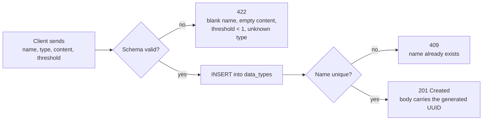

**List** — `GET /api/datatypes?limit=&offset=`

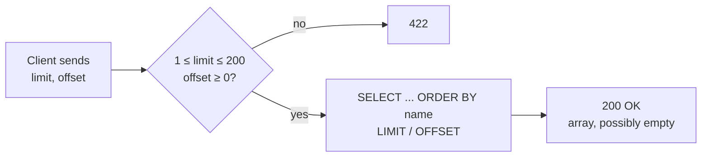

**Read** — `GET /api/datatypes/{id}`

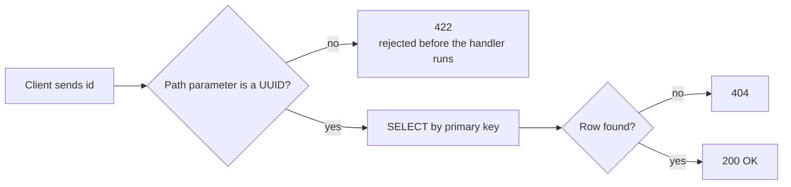

**Update** — `PUT /api/datatypes/{id}`

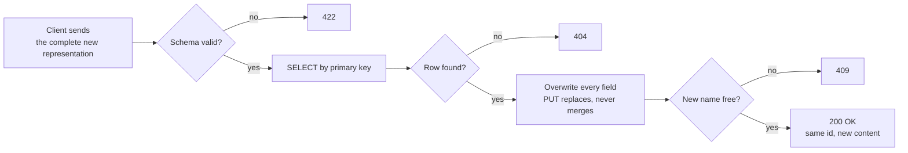

**Delete** — `DELETE /api/datatypes/{id}`

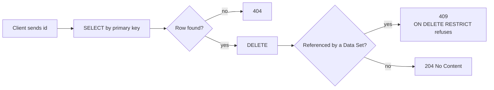

### 1.2 Data Sets

**Create** — `POST /api/datasets`

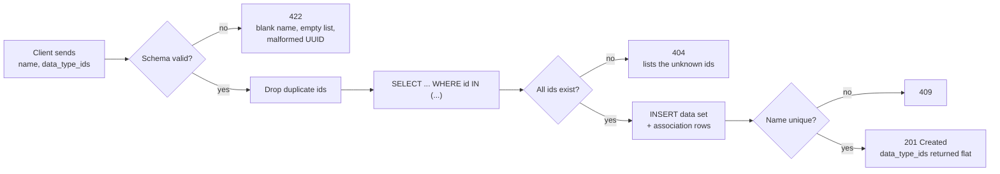

**List** — `GET /api/datasets?limit=&offset=`

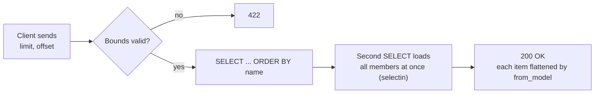

**Read** — `GET /api/datasets/{id}`

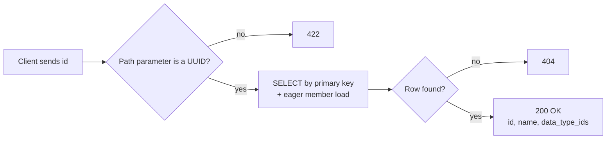

**Update** — `PUT /api/datasets/{id}`

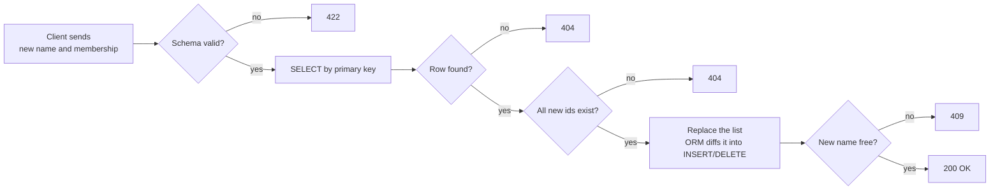

**Delete** — `DELETE /api/datasets/{id}`

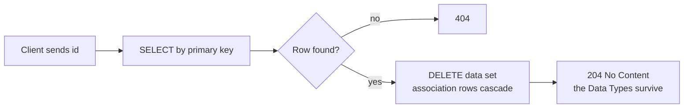

### 1.3 Scan

**Scan** — `POST /api/scan`

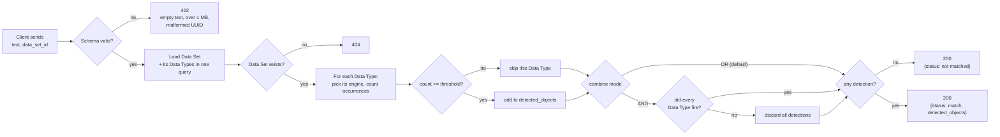

---

## 2. Backend endpoints

Two logical modules, each with full CRUD. The verb decides the operation, the path decides
the identity — no `/create` or `/delete` ever appears in a URL.

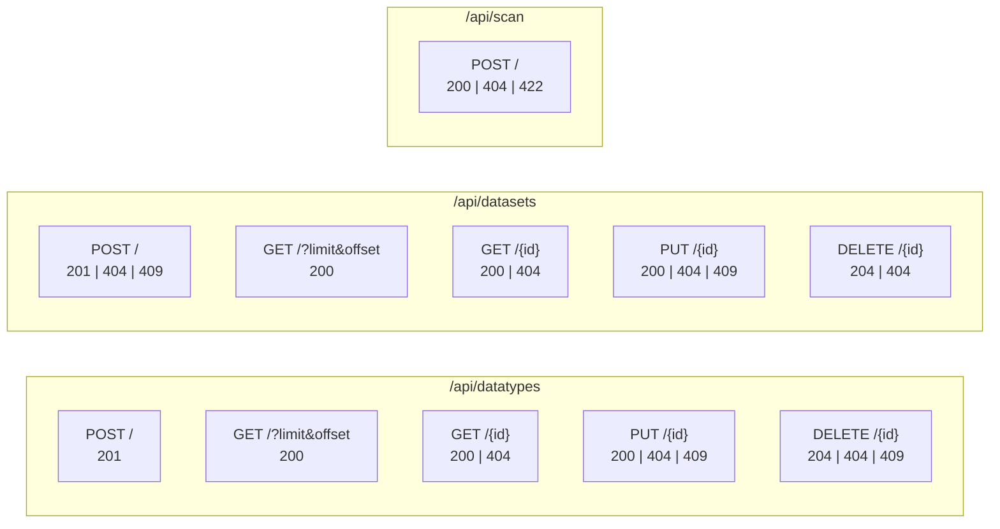

| Status | When it is returned | Who produces it |
|--------|--------------------|-----------------|
| 422 | Body or parameter violates the schema (threshold 0, empty keyword list, malformed UUID) | Pydantic, before the endpoint runs |
| 404 | Valid id with no row, or `data_type_ids` pointing at a missing Data Type | The router, or `MissingDataTypesError` |
| 409 | Duplicate name, or deleting a Data Type that is still in use | Database constraints, via `ConflictError` |
| 500 | A CHECK constraint fired — the schemas failed to catch bad input, i.e. a bug | Re-raised `IntegrityError` |

---

## 3. System design

The service is organized into four **layers**. Presentation, Business and Persistence sit in a
single vertical stack — the main spine, request in, query out, top to bottom. Support is drawn
as a column running alongside that whole stack rather than a fourth rung under it, because
`deps.py`, `constants.py` and `config.py` are cross-cutting: every other layer reaches into them
sideways, none of them calls the next in sequence. Grouping the three into one rubric also cuts
down the clutter of having them scattered as separate boxes around the diagram.

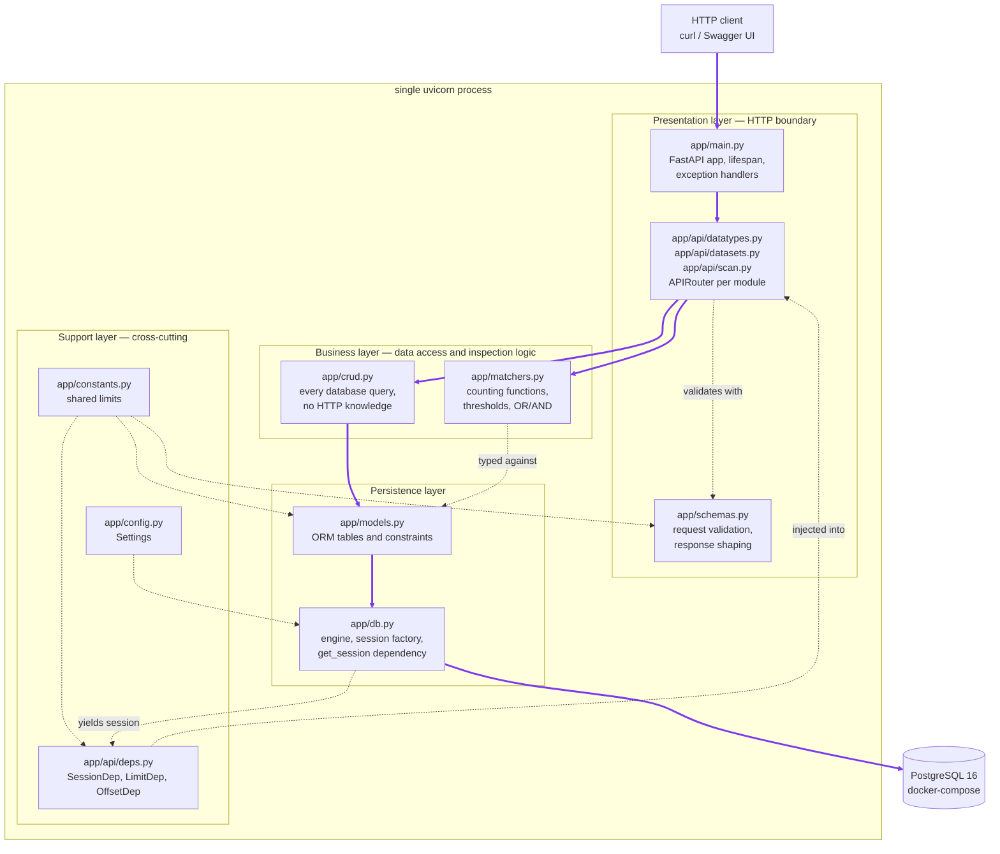

The purple arrows are the paths a request actually walks. A CRUD request follows the spine
`Client → Main → Routers → Crud → Models → Db → PostgreSQL`; a scan request branches at the
routers into `Matchers` instead, because the Data Types it inspects were already loaded by
`crud`. Every dashed arrow is a dependency that is reached into sideways — the Support layer, the
schemas, and the ORM classes `matchers` is merely typed against — not a step in any request path.

| Layer | Modules | Role |
|-------|---------|------|
| Presentation | `main.py`, the routers, `schemas.py` | Owns the HTTP contract: routing, status codes, request/response shape |
| Business | `crud.py`, `matchers.py` | Every query and domain rule (conflicts, missing references), plus the whole inspection logic (counting, thresholds, OR/AND) — no HTTP knowledge |
| Persistence | `models.py`, `db.py` | The ORM tables, constraints, engine and session factory |
| Support | `deps.py`, `constants.py`, `config.py` | Cross-cutting: dependency injection, shared limits, environment settings — reached into by the other three, never called in sequence |

Life cycle of a single request:

1. The JSON body is parsed into a Pydantic schema (`*Create`/`*Update`). Invalid input stops
   here as 422.
2. FastAPI injects an `AsyncSession` through the `get_session` dependency (exposed to the
   routers as `SessionDep`).
3. The router calls a `crud` function, which runs the query and commits.
4. The ORM object(s) `crud` returns are rebuilt into the response schema (`*Read`) — either
   automatically, through `response_model` and `from_attributes` (`DataTypeRead`), or
   explicitly, through `from_model` (`DataSetRead`, since the wire shape is not the storage
   shape) — or a domain exception is converted to a status code by an exception handler instead.
5. The `*Read` schema is serialized to JSON and sent as the response body.
6. The session closes and returns its connection to the pool, even if the request failed.

---

## 4. Data model

The relationship between Data Sets and Data Types is many-to-many, so it is implemented with an
association table rather than a single foreign key. The full reasoning is in `QA.md`, Q8.

The diagram below is a Mermaid **`erDiagram`** — an entity-relationship diagram. It is not an
error report; `erDiagram` is simply Mermaid's keyword for this diagram type. `PK` marks a primary
key, `FK` a foreign key and `UK` a unique key.

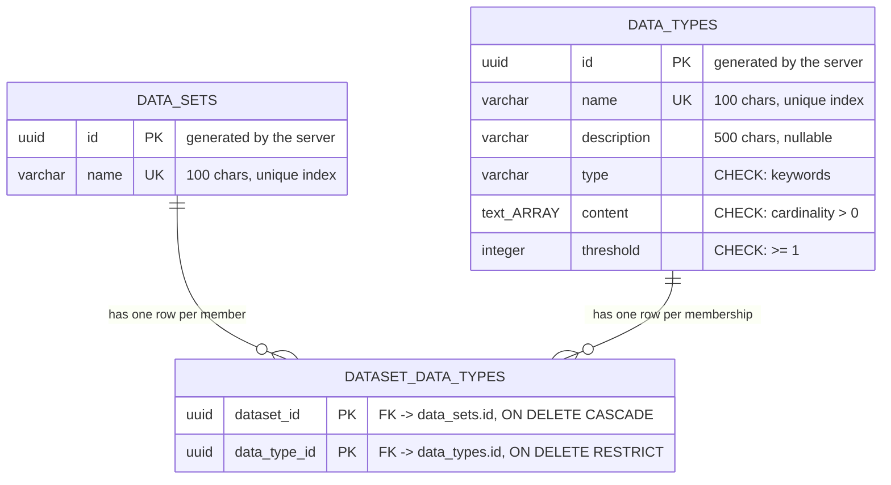

Both relationship labels describe the **same** association table, read from its two ends - there
is no second relationship hiding here. A row in `DATASET_DATA_TYPES` says "this Data Set includes
this Data Type"; looking at it from the Data Set you call it a member, looking at it from the Data
Type you call it a membership. The earlier wording ("contains" / "is referenced by") suggested two
different things and was simply confusing.

There is deliberately **no direct line** between `DATA_SETS` and `DATA_TYPES`. That is how a
many-to-many relationship is drawn: it cannot exist as one foreign key, so it is decomposed into
two one-to-many relationships that meet at the link table.

Reading the crow's-foot notation: `||--o{` means "exactly one on the left, zero or more on the
right". One Data Type may appear in zero, one or many association rows, and so may one Data Set —
which together is exactly a many-to-many relationship.

The association table has a **composite primary key** over both columns. That serves two purposes
at once: it identifies the row, and it makes linking the same Data Type to the same Data Set twice
impossible at the database level.

The two delete policies express a business decision:

- Deleting a **Data Set** removes only its memberships (`CASCADE`), because links are worthless
  without the set that owns them.
- Deleting a **Data Type** that is in use is refused (`RESTRICT`) and surfaces as 409, because a
  security policy should not silently empty out when one component is removed.

---

## 5. Module structure

### 5.1 `app/models.py`

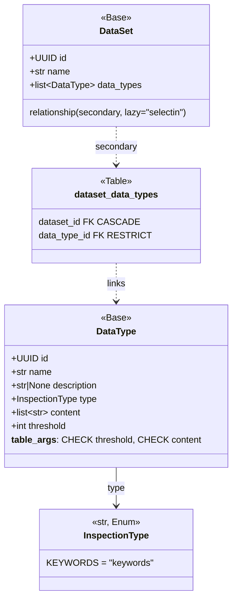

### 5.2 `app/schemas.py`

Each resource follows the same three-way split: `*Create` and `*Update` describe what may come
in, `*Read` describes what goes out. `*Base` holds the fields and validators shared by the write
schemas, so a rule is written once.

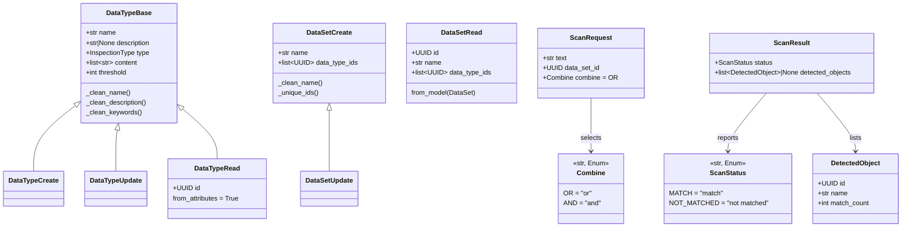

The scan schemas break the `*Create` / `*Read` pattern on purpose: a scan creates nothing and
reads no stored row, so its request and response are named after the operation instead of a
resource. Two details carry real behaviour. `detected_objects` is nullable and the route is
declared with `response_model_exclude_none`, which is what makes a miss serialize as exactly
`{"status": "not matched"}` rather than carrying an empty array. And `combine` defaults to `OR`,
so the field is optional and a client that never heard of it behaves exactly as the specification
requires.

Note the asymmetry. `DataTypeRead` inherits from the base and is built straight from the ORM
object via `from_attributes`, because the stored shape and the wire shape are identical.
`DataSetRead` does **not** inherit: the ORM exposes `data_types` (objects) while the API contract
requires `data_type_ids` (a flat array), so `from_model` performs that translation explicitly.

Two module-level helpers are shared by all validators: `_require_text` trims a mandatory string
and rejects a blank one, `_optional_text` trims an optional string and collapses a blank one to
`None`. `_dedupe` removes repeats while preserving order.

### 5.3 `app/matchers.py`

The whole inspection logic is one module of plain functions. It separates **mechanics** (how many
times did a rule fire) from **policy** (is that enough, and how do the rules combine) - with a
function per logic and a dispatch dict, and no classes at all.

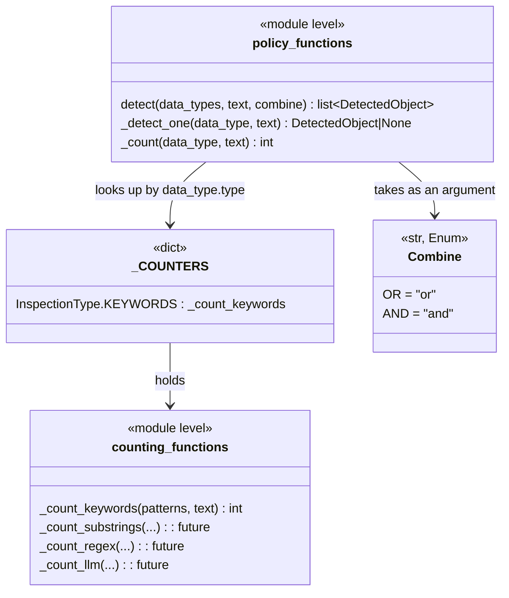

Adding an inspection logic is two lines: a function with the signature
`(patterns: list[str], text: str) -> int`, and one entry in `_COUNTERS`. There is no protocol to
implement, no base class to inherit, no class to instantiate and no file to create.

Why the counting functions return a **number** and not a boolean: the threshold comparison is
policy and belongs to `detect`, and the number is needed anyway - it is reported back as
`match_count`.

Why `combine` is an argument of `detect` rather than state on an object: the module holds no state
at all, so there is nothing an object would carry. Passing it per call keeps OR/AND an open
argument all the way up to the API request. An empty result always means "not matched", in either
mode, so no caller has to know which mode was used.

### Whole-word counting without regex

The counting rule is expressed with plain string comparison rather than a compiled pattern:

1. Both the text and the keyword are lower-cased once - that is the entire case-insensitivity rule.
2. `str.find` walks the text, returning each occurrence left to right.
3. Each occurrence is kept only if `_is_standalone` accepts it: the characters immediately before
   and after must not be letters or digits (`str.isalnum()`).

This is shorter to read than an escaped alternation, and it removes three classes of problem
outright rather than defending against them:

| Case | Why plain comparison handles it |
|------|-------------------------------|
| `a.b` must not match `axb` | `str.find` is literal; there are no metacharacters to escape |
| `c++` must match standalone but not inside `c++11` | The character after the hit is a digit, which extends the token |
| user-supplied keywords as a ReDoS vector | No pattern is ever compiled from user input |
| `pass` must not match `password` | The neighbouring character is a letter, so the token continues |

The underscore is deliberately **not** a word character here, which is the one place this rule
departs from a regex `\b`. For a DLP service snake_case is a separator, not glue: `ssn_number`,
`passport_id` and `credit_card_number` are precisely the field names sensitive data travels
under, and missing `ssn` inside `ssn_number` would be a detection failure. A letter is a
different case entirely - `password` is its own word, not `pass` with a separator attached.

One deliberate semantic difference from an alternation pattern: **each keyword is counted
independently**. Keywords that overlap on the same span - `credit` and `credit card` over
"my credit card" - contribute one occurrence each, where a single alternation would have counted
one. A keyword that is merely a prefix of a longer one is still never double counted, because the
boundary check rejects it.

There is no cache. Nothing is precomputed, so there is nothing to invalidate and no stale rule can
ever be served.

Counting is **synchronous**. Keyword matching is pure CPU work and a pointless `await` is noise.
An LLM engine would be IO-bound; at that point the counting functions become `async def` and
`_count` gains an `await` - one line per engine, decided deliberately rather than pre-emptively.

---

## 6. Data conversion pipeline

A value crosses two translation boundaries on its way in and two on its way out. Knowing which
component owns which conversion is what makes a serialization bug findable.

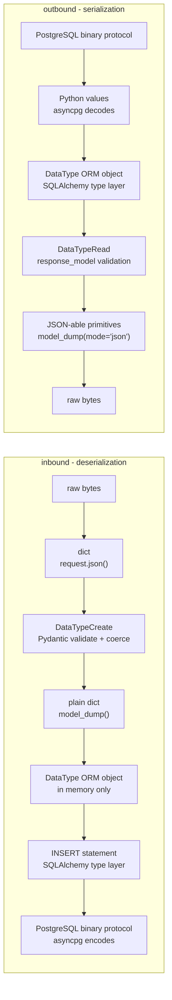

What each boundary actually converts:

| Boundary | Owner | Example |
|----------|-------|---------|
| JSON text to Python object | Pydantic | `"2"` becomes `2`, a string becomes `uuid.UUID`, `"keywords"` becomes `InspectionType.KEYWORDS` |
| Python object to SQL value | SQLAlchemy type layer | `uuid.UUID` becomes a `uuid` column, `list[str]` becomes `text[]`, the enum becomes a VARCHAR through `values_callable` |
| SQL value to Python object | SQLAlchemy type layer | the reverse, driven by the `Mapped[...]` annotations |
| Python object to JSON text | Pydantic | `uuid.UUID` becomes a string, the enum becomes `"keywords"` |

Two properties of the outbound path are easy to miss:

* `response_model` runs a **second validation pass**. It is not decoration - it is a whitelist.
  Any attribute the ORM object carries that the schema does not declare is dropped, which is what
  stops an internal column from leaking into a response by accident.
* `DataSetRead` breaks out of this pipeline on purpose. `from_attributes` matches schema fields to
  ORM attributes **by name**, and the ORM has no `data_type_ids` attribute at all - it has
  `data_types`, a list of objects. `from_model` is the explicit translation that bridges the gap.

---

## 7. Extension points

The project is designed so that adding inspection types requires no rewrite:

- `type` is an `InspectionType` enum with a single member. Adding `substring`, `regex`, `pattern`
  or `llm` means adding a member.
- `crud.py` contains no matching logic at all, so the engine can be replaced without touching a
  single query.
- The `_COUNTERS` dict in `app/matchers.py` maps `InspectionType -> counting function`. Adding an
  engine is: one enum member, one function, one dict entry. No caller changes. Concretely, a regex
  engine would read the same `content` column and reuse the same threshold and combine logic; an
  LLM engine would additionally need the configuration column described below.
- The `type` column is stored as VARCHAR with a CHECK constraint (`native_enum=False`) rather
  than a native PostgreSQL ENUM, so adding a value is a constraint change and not an `ALTER TYPE`.
- An LLM-based engine would additionally need a configuration column (for example `config JSONB`)
  holding the prompt and model. It was left out for minimality; it is a one-column addition.
