# Architecture — Simplified DLP Platform

This document describes the system at five levels: user flows (including the endpoint
summary), system design, data model, core module structures and loading strategy.

---

## 1. User flows

The two resources have genuinely different flows, so they are documented separately.
Data Types are self-contained; Data Sets always depend on Data Types that already exist.

<details>
<summary><strong>Expand - 12 User Flows Diagrams (Data Types, Data Sets, Scan, Backend endpoints)</strong></summary>

### 1.1 Data Types

**Create** — `POST /api/datatypes`

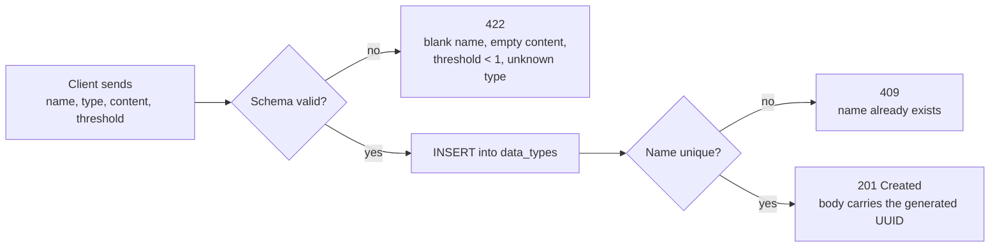

**List** — `GET /api/datatypes?limit=&offset=`

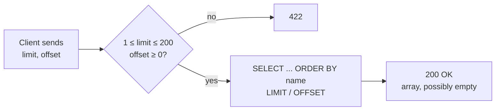

**Read** — `GET /api/datatypes/{id}`

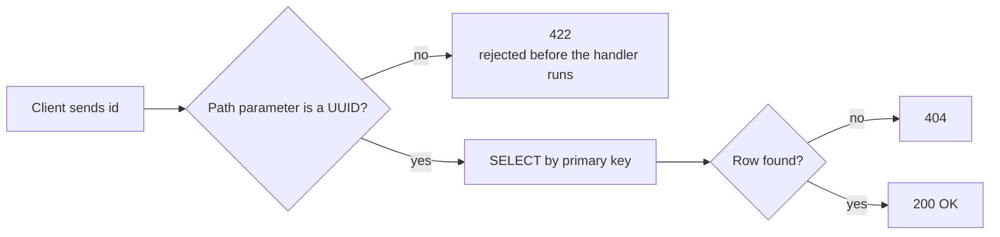

**Update** — `PUT /api/datatypes/{id}`

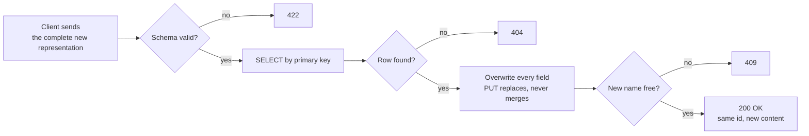

**Delete** — `DELETE /api/datatypes/{id}`

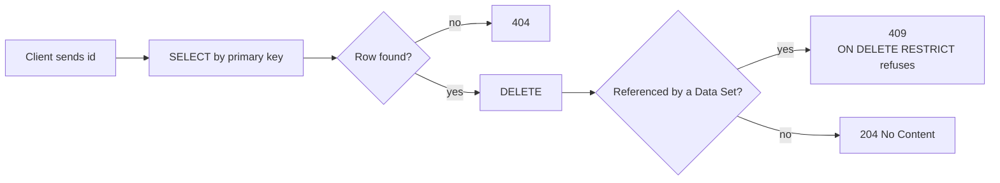

### 1.2 Data Sets

**Create** — `POST /api/datasets`

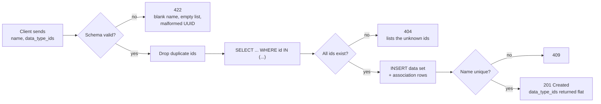

**List** — `GET /api/datasets?limit=&offset=`

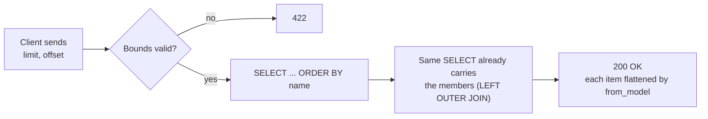

**Read** — `GET /api/datasets/{id}`

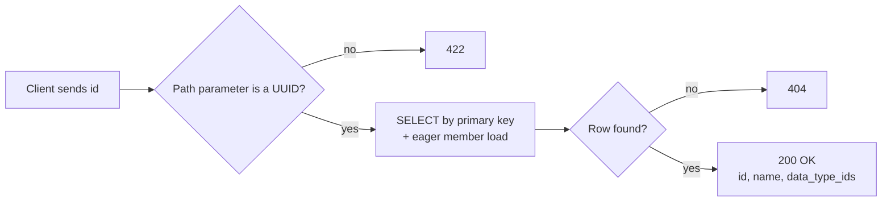

**Update** — `PUT /api/datasets/{id}`

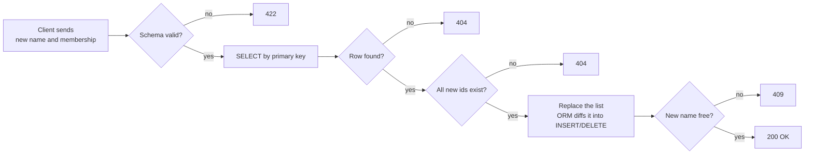

**Delete** — `DELETE /api/datasets/{id}`

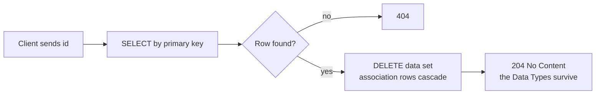

### 1.3 Scan

**Scan** — `POST /api/scan`

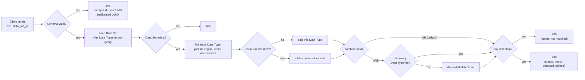

### 1.4 Backend endpoints

Two logical modules, each with full CRUD. The verb decides the operation, the path decides
the identity — no `/create` or `/delete` ever appears in a URL.

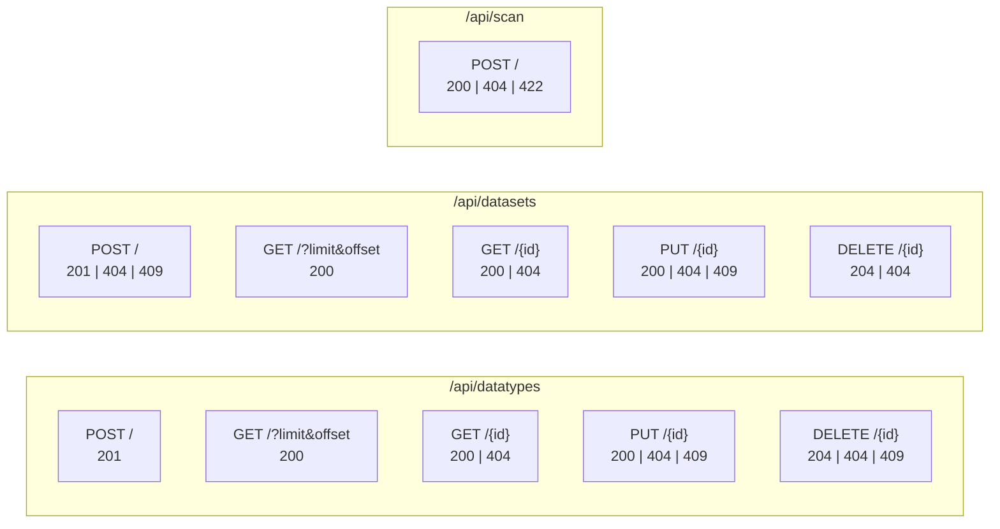

| Status | When it is returned | Who produces it |
|--------|--------------------|-----------------|
| 422 | Body or parameter violates the schema (threshold 0, empty keyword list, malformed UUID) | Pydantic, before the endpoint runs |
| 404 | Valid id with no row, or `data_type_ids` pointing at a missing Data Type | The router, or `MissingDataTypesError` |
| 409 | Duplicate name, or deleting a Data Type that is still in use | Database constraints, via `ConflictError` |
| 500 | A CHECK constraint fired — the schemas failed to catch bad input, i.e. a bug | Re-raised `IntegrityError` |

</details>

---

## 2. System design

The service is organized into four **layers**. Presentation, Business, Persistence and Support.

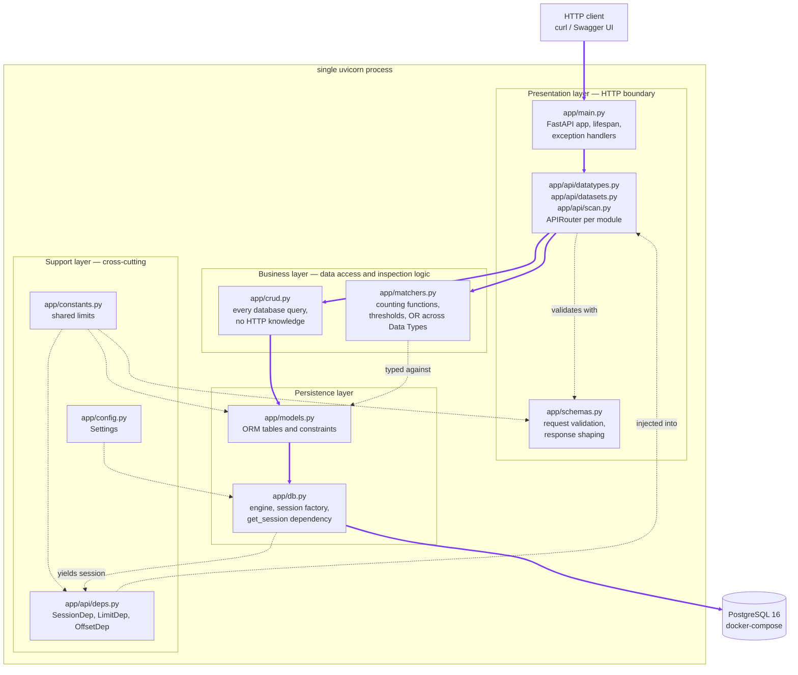

The purple arrows are the paths a request actually walks. A CRUD request follows the spine
`Client → Main → Routers → Crud → Models → Db → PostgreSQL`; a scan request branches at the
routers into `Matchers` instead, because the Data Types it inspects were already loaded by
`crud`. Every dashed arrow is a dependency that is reached into sideways.

| Layer | Modules | Role |
|-------|---------|------|
| Presentation | `main.py`, the routers, `schemas.py` | Owns the HTTP contract: routing, status codes, request/response shape |
| Business | `crud.py`, `matchers.py` | Every query and domain rule (conflicts, missing references), plus the whole inspection logic (counting, thresholds, OR/AND) — no HTTP knowledge |
| Persistence | `models.py`, `db.py` | The ORM tables, constraints, engine and session factory |
| Support | `deps.py`, `constants.py`, `config.py` | Cross-cutting: dependency injection, shared limits, environment settings — reached into by the other three, never called in sequence |

### Life cycle of a single request

Traced end to end on `POST /api/datatypes`, the write path that exercises every stage. The
sequence below is what the code actually does:

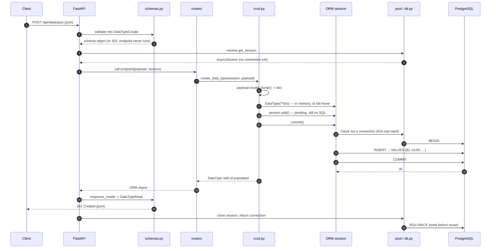

**Phase 1 — HTTP text becomes a validated Python object.**
FastAPI reads the body, parses the JSON into a `dict`, and hands it to Pydantic, which builds a
`DataTypeCreate`. This is where coercion happens (`"keywords"` becomes `InspectionType.KEYWORDS`)
and where every validator in `schemas.py` runs. Invalid input is rejected as 422 **before the
endpoint function is entered at all**.

**Phase 2 — dependencies are resolved.**
FastAPI walks the endpoint signature, sees `SessionDep`, runs `get_session` up to its `yield`, and
passes the resulting `AsyncSession` in as an argument.

**Phase 3 — Pydantic object becomes an ORM object.**
Two lines in `crud.create_data_type` do the whole translation:

```python
data_type = DataType(**payload.model_dump())
session.add(data_type)
```

**Phase 4 — first contact with the database.**
`commit()` is the moment everything deferred becomes real.


**Phase 5 — ORM object becomes the response.**
`crud` returns the live `DataType`, whose attributes are still loaded because the session factory
sets `expire_on_commit=False`.

FastAPI then re-validates that object against `response_model`. For Data Types this is automatic
via `from_attributes`; for Data Sets it is the explicit `DataSetRead.from_model`, because the
stored shape is not the wire shape. Either way `response_model` acts as a whitelist: an attribute
the schema does not declare cannot reach the client.

**Phase 6 — teardown.**
FastAPI resumes `get_session` past its `yield`, the `async with` block closes the session, and the
connection goes back to the pool. The pool issues a `ROLLBACK` on return regardless of outcome, so
no transaction state can leak into whichever request borrows that connection next.

**The read path in one line.** A `GET` skips phase 3 entirely and inverts phase 4: `crud` issues a
`SELECT` (which opens the transaction implicitly, exactly as an `INSERT` would), never calls
`commit`, and the session closes with the pool's `ROLLBACK`.

---

## 3. Data model

The relationship between Data Sets and Data Types is many-to-many, so it is implemented with an
association table rather than a single foreign key.

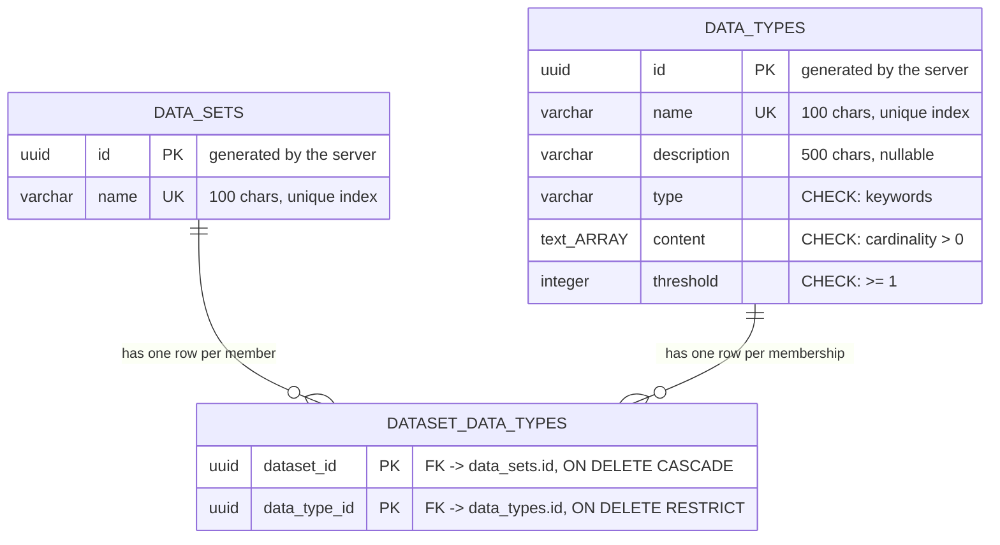

Both relationship labels describe the **same** association table, read from its two ends - there
is no second relationship hiding here. A row in `DATASET_DATA_TYPES` says "this Data Set includes
this Data Type"; looking at it from the Data Set you call it a member, looking at it from the Data
Type you call it a membership.

The association table has a **composite primary key** over both columns. That serves two purposes
at once: it identifies the row, and it makes linking the same Data Type to the same Data Set twice
impossible at the database level.

The two delete policies express a business decision:

- Deleting a **Data Set** removes only its memberships (`CASCADE`), because links are worthless
  without the set that owns them.
- Deleting a **Data Type** that is in use is refused (`RESTRICT`) and surfaces as 409, because a
  security policy should not silently empty out when one component is removed.

---

## 4. Module structure

### 4.1 `app/models.py`

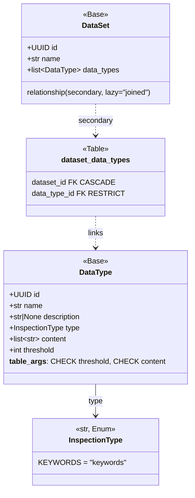

### 4.2 `app/schemas.py`

Each resource follows the same three-way split: `*Create` and `*Update` describe what may come
in, `*Read` describes what goes out. `*Base` holds the fields and validators shared by the write
schemas, so a rule is written once.

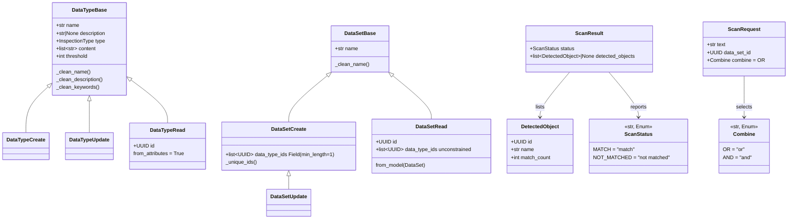

Both resources now share the same `*Base` shape, but they draw the line in different places, and
the reason is worth stating precisely: **a constraint may be inherited by the read schema only
when it is also an invariant of the stored row.**

`DataTypeBase` holds every field, `content` and its `min_length=1` included, and `DataTypeRead`
inherits all of it. That is safe because the database enforces the same rule -
`CHECK (cardinality(content) > 0)` - so a Data Type with no keywords cannot exist to be read back.

`DataSetBase` holds only `name`. `data_type_ids` is declared twice on purpose: `DataSetCreate`
constrains it with `Field(min_length=1)` because a Data Set with no members is a pointless
*request*, while `DataSetRead` leaves it unconstrained because nothing in the database prevents
such a *row*. Inheriting the request's constraint would turn a plain `GET` of a member-less Data
Set into a 500.

`DataSetRead` is built by `from_model` rather than `from_attributes`, because the ORM
exposes `data_types` (objects) while the contract requires `data_type_ids` (a flat array).


### 4.3 `app/matchers.py`

The whole inspection logic is one module of plain functions. It separates **mechanics** (how many
times did a rule fire) from **policy** (is that enough, and how do the rules combine) - with a
function per logic and a dispatch dict, and no classes at all.

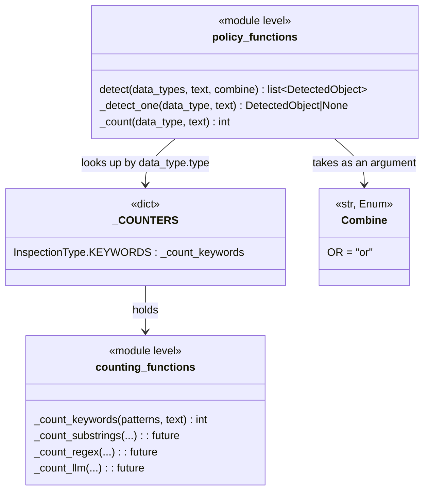

## 5 Eager loading strategy

`DataSet.data_types` is declared `lazy="joined"`. Some form of eager loading is not optional in
this service: touching a lazily-loaded collection would emit IO from an already-returned async
context and raise `MissingGreenlet`. The choice is therefore *which* eager strategy, and it was
made by measurement rather than by default.

Both endpoints now issue exactly **one** statement. 
1. Reading one Data Set:

```sql
SELECT data_sets.id, data_sets.name, data_types_1.id, data_types_1.name, ...
FROM data_sets
LEFT OUTER JOIN (dataset_data_types AS dataset_data_types_1
                 JOIN data_types AS data_types_1
                   ON data_types_1.id = dataset_data_types_1.data_type_id)
  ON data_sets.id = dataset_data_types_1.dataset_id
WHERE data_sets.id = $1::UUID
ORDER BY data_types_1.name
```

2. Listing a few Datasets:

```sql
SELECT anon_1.id, anon_1.name, data_types_1.id, ...
FROM (SELECT data_sets.id, data_sets.name
      FROM data_sets ORDER BY data_sets.name
      LIMIT $1 OFFSET $2) AS anon_1
LEFT OUTER JOIN (dataset_data_types AS dataset_data_types_1
                 JOIN data_types AS data_types_1
                   ON data_types_1.id = dataset_data_types_1.data_type_id)
  ON anon_1.id = dataset_data_types_1.dataset_id
ORDER BY anon_1.name, data_types_1.name
```

The alternative, `lazy="selectin"`, splits this into two statements: one for the parents, then one
for the members keyed on `WHERE parent_id IN (...)`. Its advantage is that parent columns travel
the wire once instead of once per member. 

```sql
-- 1
SELECT data_sets.id, data_sets.name
FROM data_sets ORDER BY data_sets.name
LIMIT $1 OFFSET $2                         -- params (0,2)     

-- 2
SELECT data_sets_1.id, data_types.* ...
FROM data_sets AS data_sets_1 JOIN ... JOIN ...
WHERE data_sets_1.id IN ($1, $2)                -- The 2 params from Query 1
ORDER BY data_types.name
```

Measured on this schema, that advantage does not pay for
the extra round trip:

| Scenario | `selectin` | `joined` |
|----------|-----------|----------|
| One Data Set, 5 members | 1.46 ms | **0.81 ms** |
| List of 30, 5 members each | 4.24 ms | **1.98 ms** |
| List of 50, 20 members each | 16.43 ms | **11.39 ms** |
| List of 200, 20 members each | 86.48 ms | **53.00 ms** |

The reason is the shape of these rows, not the row count. A `data_sets` row is `id` + `name`,
about 29 bytes, while a `data_types` row carries the keyword array. Over 200 Data Sets with 20
members each, duplicating the parent costs 116 KB against 1.99 MB of member data - **6%** - and
saves a full round trip. The trade-off reverses when the parent is the wide side: replaying the
same query with a 2 KB parent payload, `joined` took 20.7 ms against 12.7 ms for `selectin`'s two
statements combined.
