# Architecture — Simplified DLP Platform

This document describes the system at five levels: user flows (including the endpoint
summary), system design, data model, core module structures and loading strategy.

---

## 1. User flows

The two resources have genuinely different flows, so they are documented separately.
Data Types are self-contained; Data Sets always depend on Data Types that already exist.

<details>
<summary><strong>Expand - 12 User Flows Diagrams (Data Types, Data Sets, Scan, Backend endpoints)</strong></summary>

### 1.1 Data Types

**Create** — `POST /api/datatypes`

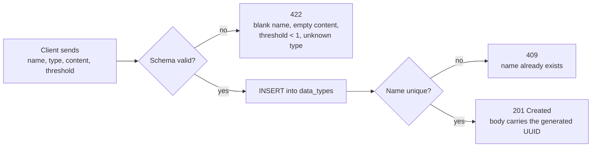

**List** — `GET /api/datatypes?limit=&offset=`

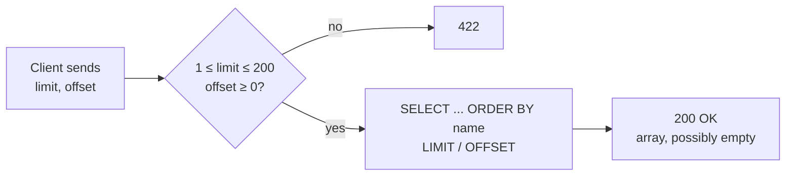

**Read** — `GET /api/datatypes/{id}`

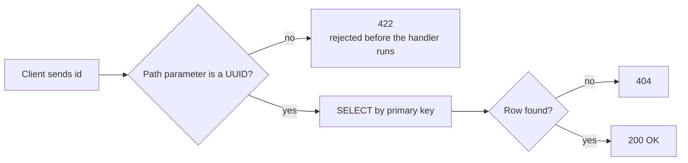

**Update** — `PUT /api/datatypes/{id}`

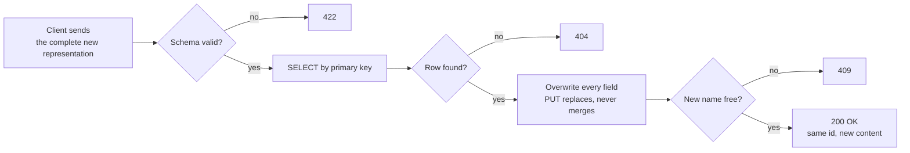

**Delete** — `DELETE /api/datatypes/{id}`

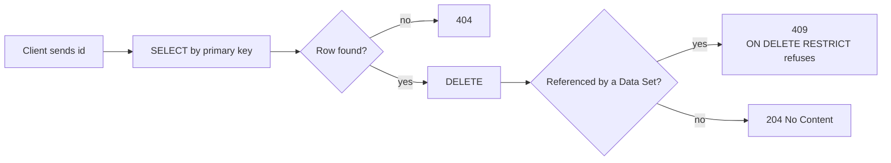

### 1.2 Data Sets

**Create** — `POST /api/datasets`

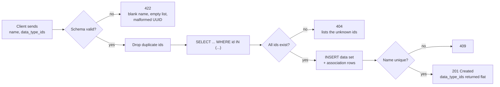

**List** — `GET /api/datasets?limit=&offset=`

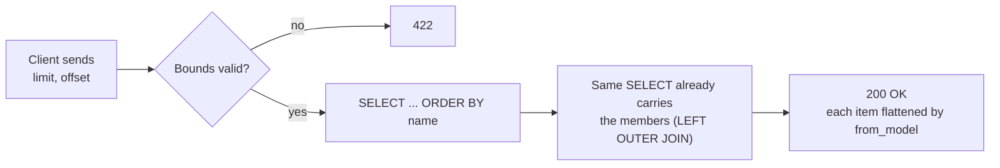

**Read** — `GET /api/datasets/{id}`

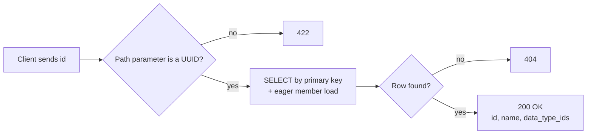

**Update** — `PUT /api/datasets/{id}`

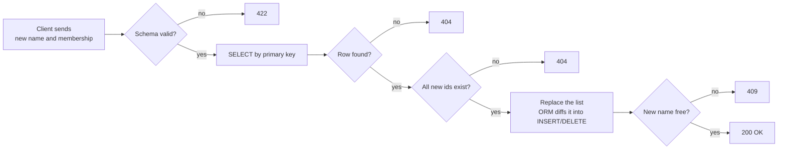

**Delete** — `DELETE /api/datasets/{id}`

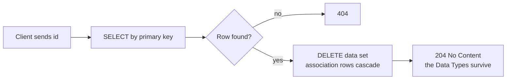

### 1.3 Scan

**Scan** — `POST /api/scan`

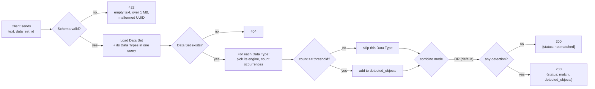

### 1.4 Backend endpoints

Two logical modules, each with full CRUD. The verb decides the operation, the path decides
the identity — no `/create` or `/delete` ever appears in a URL.

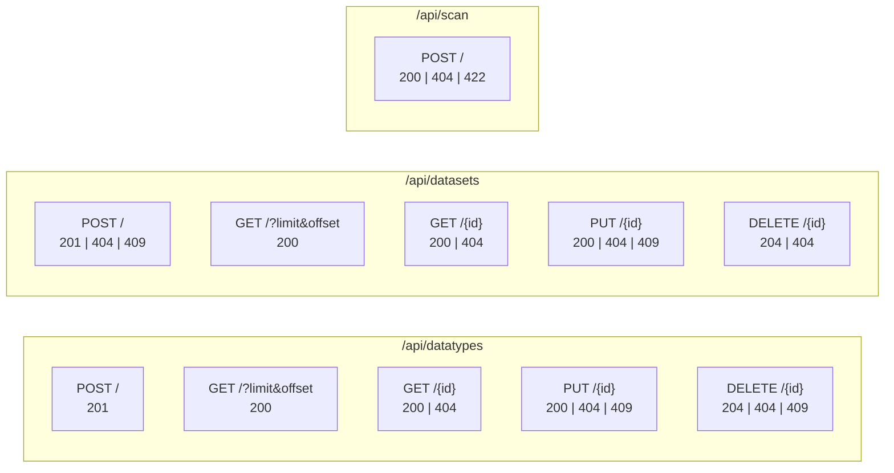

| Status | When it is returned | Who produces it |
|--------|--------------------|-----------------|
| 422 | Body or parameter violates the schema (threshold 0, empty keyword list, malformed UUID) | Pydantic, before the endpoint runs |
| 404 | Valid id with no row, or `data_type_ids` pointing at a missing Data Type | The router, or `MissingDataTypesError` |
| 409 | Duplicate name, or deleting a Data Type that is still in use | Database constraints, via `ConflictError` |
| 500 | A CHECK constraint fired — the schemas failed to catch bad input, i.e. a bug | Re-raised `IntegrityError` |

</details>

---

## 2. System design

The service is organized into four **layers**. Presentation, Business, Persistence and Support.


The purple arrows are the paths a request actually walks. A CRUD request follows the spine
`Client → Main → Routers → Crud → Models → Db → PostgreSQL`; a scan request branches at the
routers into `Matchers` instead, because the Data Types it inspects were already loaded by
`crud`. Every dashed arrow is a dependency that is reached into sideways.

| Layer | Modules | Role |
|-------|---------|------|
| Presentation | `main.py`, the routers, `schemas.py` | Owns the HTTP contract: routing, status codes, request/response shape |
| Business | `crud.py`, `matchers.py` | Every query and domain rule (conflicts, missing references), plus the whole inspection logic (counting, thresholds, OR/AND) — no HTTP knowledge |
| Persistence | `models.py`, `db.py` | The ORM tables, constraints, engine and session factory |
| Support | `deps.py`, `constants.py`, `config.py` | Cross-cutting: dependency injection, shared limits, environment settings — reached into by the other three, never called in sequence |

### Life cycle of a single request

Traced end to end on `POST /api/datatypes`, the write path that exercises every stage. The
sequence below is what the code actually does:

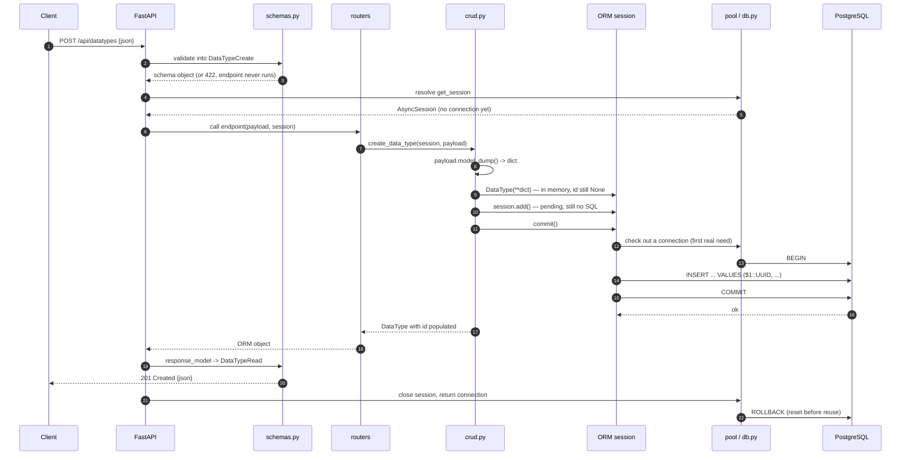

**Phase 1 — HTTP text becomes a validated Python object.**
FastAPI reads the body, parses the JSON into a `dict`, and hands it to Pydantic, which builds a
`DataTypeCreate`. This is where coercion happens (`"keywords"` becomes `InspectionType.KEYWORDS`)
and where every validator in `schemas.py` runs. Invalid input is rejected as 422 **before the
endpoint function is entered at all**.

**Phase 2 — dependencies are resolved.**
FastAPI walks the endpoint signature, sees `SessionDep`, runs `get_session` up to its `yield`, and
passes the resulting `AsyncSession` in as an argument.

**Phase 3 — Pydantic object becomes an ORM object.**
Two lines in `crud.create_data_type` do the whole translation:

```python
data_type = DataType(**payload.model_dump())
session.add(data_type)
```

**Phase 4 — first contact with the database.**
`commit()` is the moment everything deferred becomes real.


**Phase 5 — ORM object becomes the response.**
`crud` returns the live `DataType`, whose attributes are still loaded because the session factory
sets `expire_on_commit=False`.

FastAPI then re-validates that object against `response_model`. For Data Types this is automatic
via `from_attributes`; for Data Sets it is the explicit `DataSetRead.from_model`, because the
stored shape is not the wire shape. Either way `response_model` acts as a whitelist: an attribute
the schema does not declare cannot reach the client.

**Phase 6 — teardown.**
FastAPI resumes `get_session` past its `yield`, the `async with` block closes the session, and the
connection goes back to the pool. The pool issues a `ROLLBACK` on return regardless of outcome, so
no transaction state can leak into whichever request borrows that connection next.

**The read path in one line.** A `GET` skips phase 3 entirely and inverts phase 4: `crud` issues a
`SELECT` (which opens the transaction implicitly, exactly as an `INSERT` would), never calls
`commit`, and the session closes with the pool's `ROLLBACK`.

---

## 3. Data model

The relationship between Data Sets and Data Types is many-to-many, so it is implemented with an
association table rather than a single foreign key.

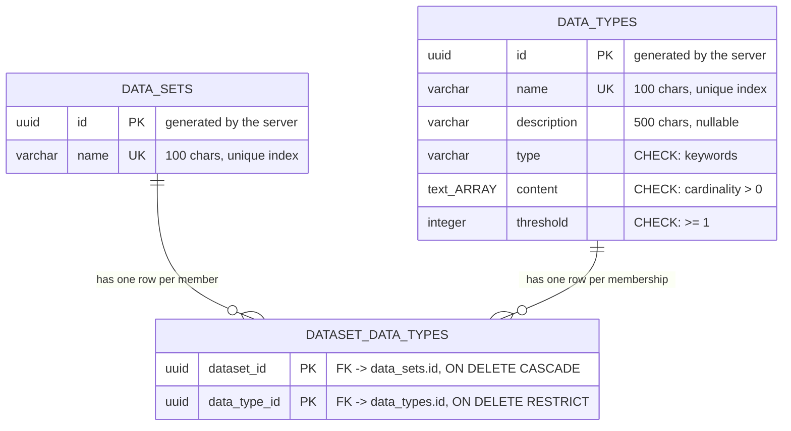

Both relationship labels describe the **same** association table, read from its two ends - there
is no second relationship hiding here. A row in `DATASET_DATA_TYPES` says "this Data Set includes
this Data Type"; looking at it from the Data Set you call it a member, looking at it from the Data
Type you call it a membership.

The association table has a **composite primary key** over both columns. That serves two purposes
at once: it identifies the row, and it makes linking the same Data Type to the same Data Set twice
impossible at the database level.

The two delete policies express a business decision:

- Deleting a **Data Set** removes only its memberships (`CASCADE`), because links are worthless
  without the set that owns them.
- Deleting a **Data Type** that is in use is refused (`RESTRICT`) and surfaces as 409, because a
  security policy should not silently empty out when one component is removed.

---

## 4. Module structure

### 4.1 `app/models.py`

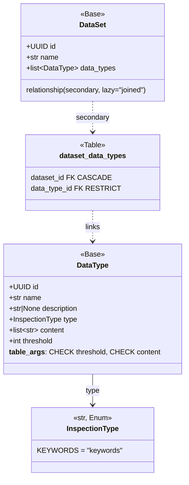

### 4.2 `app/schemas.py`

Each resource follows the same three-way split: `*Create` and `*Update` describe what may come
in, `*Read` describes what goes out. `*Base` holds the fields and validators shared by the write
schemas, so a rule is written once.


Both resources now share the same `*Base` shape, but they draw the line in different places, and
the reason is worth stating precisely: **a constraint may be inherited by the read schema only
when it is also an invariant of the stored row.**

`DataTypeBase` holds every field, `content` and its `min_length=1` included, and `DataTypeRead`
inherits all of it. That is safe because the database enforces the same rule -
`CHECK (cardinality(content) > 0)` - so a Data Type with no keywords cannot exist to be read back.

`DataSetBase` holds only `name`. `data_type_ids` is declared twice on purpose: `DataSetCreate`
constrains it with `Field(min_length=1)` because a Data Set with no members is a pointless
*request*, while `DataSetRead` leaves it unconstrained because nothing in the database prevents
such a *row*. Inheriting the request's constraint would turn a plain `GET` of a member-less Data
Set into a 500.

`DataSetRead` is built by `from_model` rather than `from_attributes`, because the ORM
exposes `data_types` (objects) while the contract requires `data_type_ids` (a flat array).


### 4.3 `app/matchers.py`

One matcher class per inspection type. The module separates **mechanics** (how many times did a
rule fire) from **policy** (is that enough, and how are the rules combined), and the class
hierarchy is drawn along exactly that line.

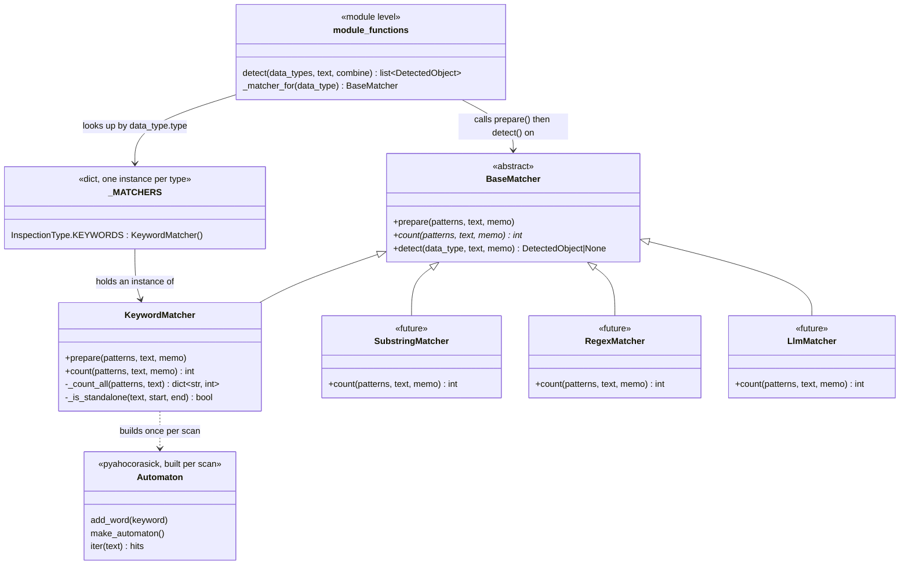

**How keywords are found.** `KeywordMatcher` works in two steps. An Aho-Corasick automaton finds
every place where a keyword occurs as a substring, and `_is_standalone` then keeps only the hits
that are whole words. The automaton is a tree with one node per character, shared by all the
keywords; a space or a `+` is a character like any other, so `new york` and `c++` need no special
case. For the keywords `my`, `ssn`, `and`, `passport`:

```
(root)
  ├─ m ─ y*                              * = a keyword ends here
  ├─ s ─ s ─ n*
  ├─ a ─ n ─ d*
  └─ p ─ a ─ s ─ s ─ p ─ o ─ r ─ t*
```

The text is read once, one character at a time, each character moving one step in the tree.
When no step fits, a precomputed *failure link* jumps to the longest ending of what was just read
that is also the beginning of some keyword - from `pass` to `ss`, the start of `ssn` - so the text
is never re-read. The cost is O(text length + total keyword length + number of hits): the number
of keywords does not multiply the length of the text.

The automaton knows nothing about words, which is why `_is_standalone` stays. In `my passn` it
reports `ssn` at index 5; the character before it is `a`, so the hit is discarded.

**One pass per scan.** `detect` first hands each engine all of its patterns through `prepare`.
`KeywordMatcher.prepare` lower-cases the text, builds one automaton from the keywords of every
Data Type, reads the text once, and leaves a `keyword -> count` dict in the scan's `memo`. `count`
then only adds up the entries of one Data Type. The `memo` is an argument rather than an
attribute because the matchers in `_MATCHERS` are singletons shared by all requests - state on
`self` would leak from one scan into the next. `prepare` is optional: an engine that does not
override it simply does all its work in `count`.

Measured on a 1 MB text (best of 7 runs), against the previous one-`str.find`-pass-per-keyword
implementation. The two were also compared on 30,000 random scans and returned identical results.

| Scenario | `str.find` per keyword | Aho-Corasick |
|----------|------------------------|--------------|
| 1 Data Type, 4 keywords that occur often | 23.5 ms | 23.6 ms |
| 20 Data Types, 5 keywords each, none in the text | 54.0 ms | **3.4 ms** |
| 20 Data Types, 20 keywords each, none in the text | 217.1 ms | **3.4 ms** |
| 20 Data Types sharing the same 4 frequent keywords | 526.0 ms | **23.9 ms** |
| 5 Data Types, 1000 keywords each (the validation maximum) | 2946.5 ms | **4.9 ms** |

The first row shows where there is no gain: with few keywords and many hits, the time is spent on
the per-hit boundary check, which both versions perform. The automaton is rebuilt on every scan;
building it for 400 keywords takes 0.09 ms, so it is not cached.

Two alternatives were measured and rejected. Splitting the text into words and looking keywords
up in a dictionary costs a fixed 40 ms per 1 MB whatever the keywords are, and needs a second code
path for `credit card` or `c++`. One regex alternation of all keywords took 148 ms with 400
keywords, and reports non-overlapping matches only, so `york` inside `new york` is not counted.

## 5 Eager loading strategy

`DataSet.data_types` is declared `lazy="joined"`. Some form of eager loading is not optional in
this service: touching a lazily-loaded collection would emit IO from an already-returned async
context and raise `MissingGreenlet`. The choice is therefore *which* eager strategy, and it was
made by measurement rather than by default.

Both endpoints now issue exactly **one** statement. 
1. Reading one Data Set:

```sql
SELECT data_sets.id, data_sets.name, data_types_1.id, data_types_1.name, ...
FROM data_sets
LEFT OUTER JOIN (dataset_data_types AS dataset_data_types_1
                 JOIN data_types AS data_types_1
                   ON data_types_1.id = dataset_data_types_1.data_type_id)
  ON data_sets.id = dataset_data_types_1.dataset_id
WHERE data_sets.id = $1::UUID
ORDER BY data_types_1.name
```

2. Listing a few Datasets:

```sql
SELECT anon_1.id, anon_1.name, data_types_1.id, ...
FROM (SELECT data_sets.id, data_sets.name
      FROM data_sets ORDER BY data_sets.name
      LIMIT $1 OFFSET $2) AS anon_1
LEFT OUTER JOIN (dataset_data_types AS dataset_data_types_1
                 JOIN data_types AS data_types_1
                   ON data_types_1.id = dataset_data_types_1.data_type_id)
  ON anon_1.id = dataset_data_types_1.dataset_id
ORDER BY anon_1.name, data_types_1.name
```

The alternative, `lazy="selectin"`, splits this into two statements: one for the parents, then one
for the members keyed on `WHERE parent_id IN (...)`. Its advantage is that parent columns travel
the wire once instead of once per member. 

```sql
-- 1
SELECT data_sets.id, data_sets.name
FROM data_sets ORDER BY data_sets.name
LIMIT $1 OFFSET $2                         -- params (0,2)     

-- 2
SELECT data_sets_1.id, data_types.* ...
FROM data_sets AS data_sets_1 JOIN ... JOIN ...
WHERE data_sets_1.id IN ($1, $2)                -- The 2 params from Query 1
ORDER BY data_types.name
```

**Why `joined` duplicates the parent and `selectin` does not.** A SQL result set is always one
flat rectangle. `joined` asks for parents and members in the same rectangle, so each row is one
(parent, member) pair and the parent columns are repeated on every member row. Take two Data
Sets, `PII` with three members and `Finance` with two:

```
 data_sets.id | data_sets.name | data_types.id | data_types.name | content
--------------+----------------+---------------+-----------------+---------------------
 aaaa         | PII            | t1            | email           | {mail, address, ..}
 aaaa         | PII            | t2            | phone           | {phone, mobile, ..}
 aaaa         | PII            | t3            | ssn             | {ssn, social, ..}
 bbbb         | Finance        | t4            | iban            | {iban, swift, ..}
 bbbb         | Finance        | t5            | credit card     | {visa, card, ..}
 └───────── duplicated ────────┘
```

The ORM collapses this back on arrival: it sees `aaaa` three times, builds one `DataSet`, and
appends three `DataType` objects to its `data_types` list.

`selectin` asks for two rectangles, so the parent columns appear only in the first one:

```
Query 1 - parents, each sent once       Query 2 - members of (aaaa, bbbb)

 id   | name                             data_sets.id | data_types.id | name        | content
------+---------                        --------------+---------------+-------------+-----------
 aaaa | PII                              aaaa         | t1            | email       | {mail, ..}
 bbbb | Finance                          aaaa         | t2            | phone       | {phone, ..}
                                         aaaa         | t3            | ssn         | {ssn, ..}
                                         bbbb         | t4            | iban        | {iban, ..}
                                         bbbb         | t5            | credit card | {visa, ..}
                                         └─ key only ─┘
```

Query 2 still repeats the parent `id` on every row, because the ORM needs it to know which
`DataSet` each member belongs to. `selectin` therefore does not remove the duplication; it
shrinks it to the key and drops every other parent column. The cost of `joined` grows with
parent row width times member count, while the cost of `selectin` is one fixed extra round trip.

Measured on this schema, that advantage does not pay for
the extra round trip:

| Scenario | `selectin` | `joined` |
|----------|-----------|----------|
| One Data Set, 5 members | 1.46 ms | **0.81 ms** |
| List of 30, 5 members each | 4.24 ms | **1.98 ms** |
| List of 50, 20 members each | 16.43 ms | **11.39 ms** |
| List of 200, 20 members each | 86.48 ms | **53.00 ms** |

The reason is the shape of these rows, not the row count. A `data_sets` row is `id` + `name`,
about 29 bytes, while a `data_types` row carries the keyword array. Over 200 Data Sets with 20
members each, duplicating the parent costs 116 KB against 1.99 MB of member data - **6%** - and
saves a full round trip. The trade-off reverses when the parent is the wide side: replaying the
same query with a 2 KB parent payload, `joined` took 20.7 ms against 12.7 ms for `selectin`'s two
statements combined.

---

## 6 Deployment

The stack is two containers described by one `docker-compose.yml`.

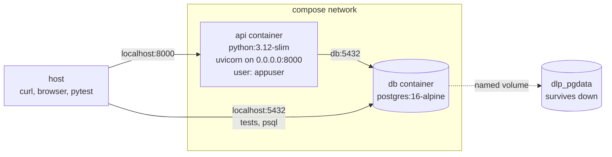

Four decisions in the image are worth naming:

* **Layer order.** `requirements.txt` is copied and installed before `app/` is copied. Docker
  invalidates every layer after the first changed one, so with this order a code edit reuses the
  cached `pip install`; reversed, every edit would reinstall all dependencies. Verified: after
  touching `app/main.py`, the rebuild reports `CACHED` for the pip layer.
* **Runtime dependencies only.** `requirements.txt` holds what the service runs on; when developing or testing locally we use
  `requirements-dev.txt` instead - which pulls it in and adds pytest and httpx
* **Non-root.** The image creates `appuser` and switches to it. Containers run as root by
  default, which means a process that escapes starts with root on whatever it reaches.
* **`--host 0.0.0.0`.** uvicorn defaults to `127.0.0.1`, which inside a container is the
  container's own loopback. The published port would then map to a socket nothing listens on.

Two decisions in the compose file matter as much:

* **`depends_on: condition: service_healthy`** makes the API wait for PostgreSQL to accept
  connections, not merely to start. This is what the `pg_isready` health check was always for:
  `create_all` runs in the lifespan, so an API that boots too early dies on a refused connection.
* **`DATABASE_URL` is overridden to `db:5432`.** Inside the compose network the service name is
  the hostname; `localhost` would point the API at itself. The default in `app/config.py` stays
  `localhost`, so local development needs no configuration.

Both containers declare a health check, so `docker compose ps` reports readiness rather than mere
liveness. The API check uses `urllib` from the standard library, which avoids adding `curl` to the
image for one line of work.

What is deliberately **not** here: a multi-stage build (nothing is compiled, so there is no build
stage to discard), a migration step (`create_all` runs in the lifespan; a real deployment would
run Alembic first), and any secret management (the database password is a literal in the compose
file, which is fine for a local stack and would not be in production).
