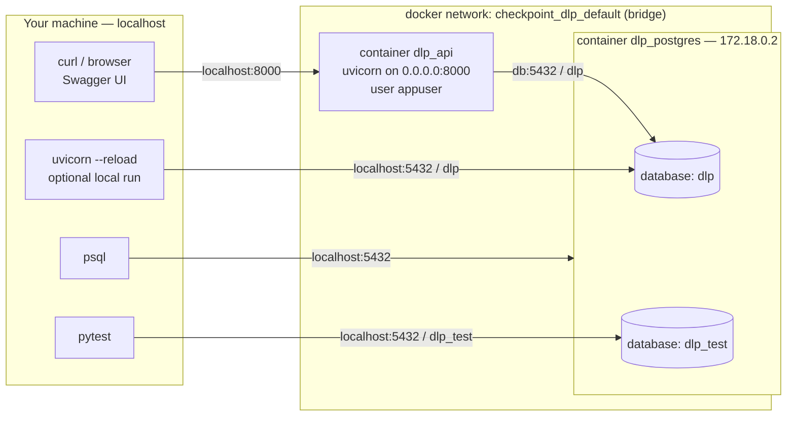

# שאלות ותשובות – פרויקט DLP

קובץ אגרגטיבי של השאלות שנשאלו במהלך הפיתוח, התשובות שניתנו, וההקשר שלהן לקוד.
שאלות שסומנו בדגל `-ignore` אינן מתועדות כאן.

---

## סבב 1 – שאלות טרום-ארכיטקטורה (2026-08-19)

### ש1. האם שלוש פעולות CUD לכל ישות עדיין נחשבות "אנדפוינט אחד"?

תשובה קצרה: המסמך אינו דורש שלושה *endpoints* אלא שלושה *logical API modules*. מודול = משאב
(resource) = נתיב בסיס אחד. הפעולות על המשאב מובעות באמצעות HTTP verbs, ולא באמצעות נתיבים
נוספים. לכן CRUD מלא על `/api/datatypes` הוא עדיין מודול אחד.

הכלל שמאחורי זה: הפעולה נקבעת על ידי ה-verb, והזהות נקבעת על ידי ה-path. הנתיב מתאר *דבר*,
לא *פעולה*.

מיפוי REST סטנדרטי (זהה עבור datatypes ועבור datasets):

| פעולה | Verb | Path | סטטוס מוצלח |
|-------|------|------|-------------|
| יצירה | POST | `/api/datatypes` | 201 Created |
| רשימה | GET | `/api/datatypes` | 200 OK |
| קריאה בודדת | GET | `/api/datatypes/{id}` | 200 OK |
| עדכון (החלפה מלאה) | PUT | `/api/datatypes/{id}` | 200 OK |
| מחיקה | DELETE | `/api/datatypes/{id}` | 204 No Content |

בפריימוורק FastAPI כל שורה בטבלה היא *path operation*, וכולן מקובצות תחת
`APIRouter(prefix="/api/datatypes", tags=["datatypes"])`. בממשק Swagger זה מוצג כקבוצה אחת —
בדיוק ה"מודול" שהמסמך מבקש.

חלופות שקיימות בעולם, כדי להכיר את המפה:

1. גישת **RPC-style** – נתיבים כמו `POST /api/datatypes/create`, `/update`, `/delete`. פשוטה
   ונפוצה מאוד בשירותים פנימיים וב-gRPC. המחיר: מאבדת את סמנטיקת HTTP (idempotency, caching,
   קודי סטטוס משמעותיים), ובראיון היא נקראת כ"לא REST".
2. גישת **endpoint יחיד עם action בגוף הבקשה** – למשל `POST /api/datatypes` עם
   `{"action": "delete"}`. אנטי-פטרן כאן, כי כל ה-validation נדחס לסכימה אחת ענקית.
3. גישת **GraphQL** – endpoint אחד, הלקוח בוחר אילו שדות לקבל. Overkill למודל של שתי ישויות.
4. גישת **Batch בסגנון Google AIP** – למשל `POST /api/datatypes:batchCreate`. רלוונטית רק אם
   נדרשים עדכונים המוניים.

המלצה: להשתמש ב-REST קלאסי לפי הטבלה, ולבחור **PUT ולא PATCH**. הסיבה: ל-DataType יש חמישה
שדות בלבד, ולכן החלפה מלאה נותנת סכימת validation אחת במקום שתיים. בגישת PATCH כל שדה הופך
ל-Optional, ואז נדרשת הבחנה בין "שדה שלא נשלח" לבין "שדה שנשלח כ-null". הבחירה גם עקבית עם
דגש המינימליות של הפרויקט.

החלטה פתוחה שנרשמה: מחיקת DataType שמשויך ל-DataSet — האם לחסום (409 Conflict), לנתק אותו
מה-DataSet, או לבצע soft-delete. ההכרעה תתקבל בשלב מודל הנתונים.

---

### ש2. מה משמעות keyword-based inspection, whole-word matching ו-OR logic across Data Types?

בבדיקה מסוג **keyword-based inspection** ה-DataType מחזיק רשימת מילים בשדה `content`, והבדיקה
היא ספירת ההופעות של המילים הללו בטקסט. זו הצורה הבסיסית ביותר של inspection.

השדה `type` מוגדר כ-ENUM למרות שיש בו ערך אחד בלבד, כי בעולם ה-DLP האמיתי קיימים סוגי בדיקה
נוספים: regex/pattern (למשל מספר כרטיס אשראי בתוספת בדיקת Luhn), dictionary עם משקלים,
EDM (Exact Data Match מול מסד נתונים של רשומות אמיתיות), fingerprinting של מסמכים, ומסווגי ML.
ה-ENUM הוא נקודת ההרחבה — וזה בדיוק מה שהמשפט "At the moment, only keyword-based" מרמז עליו.

בהתאמת **whole-word** נספרת התאמה רק כאשר המילה עומדת כמילה שלמה, כלומר משני צדדיה מופיעים
תווים שאינם תווי-מילה. להלן דוגמאות עבור ה-keyword `pass`:

| מקרה | טקסט | whole-word | substring |
|------|------|-----------|-----------|
| מילה עצמאית | `pass` | ✅ | ✅ |
| מילה מוכלת | `password` | ❌ | ✅ |
| מילה עם פיסוק | `Pass,` | ✅ | ✅ |
| מילה בסוגריים | `(pass)` | ✅ | ✅ |
| מילה אחרי קו תחתון | `my_pass` | ❌ | ✅ |
| מילה עם תחילית | `bypass` | ❌ | ✅ |

הרעיון ב-regex הוא `\bpass\b`. הסימן `\b` מייצג **גבול**: מיקום שבו בצד אחד יש תו-מילה
(`[A-Za-z0-9_]`) ובצד השני אין. שים לב שהמקרה `my_pass` אינו מתאים, כי `_` נחשב תו-מילה ולכן
אין שם גבול.

הסיבה שהדרישה הזו קיימת: false positives הם הבעיה מספר 1 במוצרי DLP. התאמת substring הייתה
מסמנת את המילה "classification" בגלל ה-keyword "class", ואז אף אחד לא סומך על המערכת.

בלוגיקת **OR across Data Types** ה-DataSet מכיל כמה DTs, כל DT מוערך באופן עצמאי ומחזיר ערך
בוליאני, ולבסוף `status = match` אם **לפחות אחד** מהם התאים.

להלן דוגמה עבור DataSet המכיל את `DT_A = (["ssn","passport"], threshold=2)` ואת
`DT_B = (["salary"], threshold=1)`:

| מקרה | טקסט | DT_A | DT_B | תוצאה |
|------|------|------|------|-------|
| רק DT_B התאים | `"my salary is high"` | ❌ | ✅ | match |
| רק DT_A התאים | `"ssn and passport"` | ✅ | ❌ | match |
| אף אחד לא התאים | `"passport only"` | ❌ | ❌ | not matched |

שים לב ש-`detected_objects` מכיל את **כל** ה-DTs שהתאימו, ולא רק את הראשון. אילו הלוגיקה הייתה
AND, שתי השורות הראשונות היו מסתיימות ב-`not matched`.

---

### ש3. מה משמעות `keyword count >= threshold`?

ההבנה נכונה: ה-DataType מסומן כ"הופר" רק אם מספר ההתאמות גדול או שווה ל-threshold. ה-threshold
הוא מנגנון הרגישות — הוא מבדיל בין אזכור מקרי של מילה לבין מסמך שבאמת עוסק בנושא הרגיש.

קיימת כאן עמימות מהותית שהמסמך אינו פותר, וצריך להכריע בה — לספור **מה** בדיוק:

- אפשרות **(א) – סך ההופעות**: כל הופעה של כל keyword, כולל חזרות.
- אפשרות **(ב) – keywords ייחודיים**: כמה מילים *שונות* מהרשימה הופיעו לפחות פעם אחת.

הדוגמה הבאה ממחישה את ההבדל:

```
content   = ["ssn", "passport", "visa"]
threshold = 2
text      = "passport, passport, passport"

(א) count = 3  =>  match
(ב) count = 1  =>  not matched
```

המלצה: לבחור באפשרות (א), סך ההופעות. שתי סיבות: זו ברירת המחדל בכלי DLP מסחריים
("minimum occurrences" במילון), והיא קוראת נכון את הדוגמה במסמך שבה `match_count: 3` מופיע עבור
DataType יחיד. יתרון נוסף: ה-`match_count` שמוחזר בתשובה הוא בדיוק אותו מספר ששימש להכרעה, ולכן
אין חוסר עקביות בין הקריטריון לבין הפלט.

מכאן נגזר גם כלל validation: `threshold >= 1`. עם `threshold = 0` כל טקסט, כולל מחרוזת ריקה,
היה מוגדר כהפרה.

---

### ש4. האם כדאי multiprocessing לסריקה, או ש-async מספיק?

תחילה יש לסווג את העומס. בכל בקשת scan קיימים שני חלקים שונים לחלוטין:

1. טעינת ה-DataSet וה-DataTypes ממסד הנתונים — עומס מסוג IO-bound, שבו התהליך *ממתין* על socket
   ואינו עובד.
2. הרצת מנוע ההתאמה (regex על הטקסט) — עומס מסוג CPU-bound, שבו התהליך באמת שורף CPU.

לכל אחד מהם מתאים פתרון קונקורנטיות אחר, והבלבול ביניהם הוא הטעות הקלאסית.

להלן מה שכל כלי באמת נותן:

| כלי | מה הוא פותר | מה הוא לא פותר |
|-----|-------------|----------------|
| אסינכרוניות (`async`/await) | הרבה המתנות IO במקביל על thread יחיד | אינו נותן שום מקביליות CPU |
| תהליכונים (Threads) | מונע חסימה של ה-event loop | מחסום ה-GIL: מודול `re` אינו משחרר אותו, ולכן אין מקביליות CPU אמיתית |
| תהליכים (Processes) | מקביליות CPU אמיתית | עלות IPC: pickle של הטקסט ושל התוצאה במעבר בין תהליכים |

פרט חשוב ב-FastAPI, שהוא גם משפט מצוין לראיון: אם ה-route מוגדר כ-`async def` הוא רץ **על**
ה-event loop, וכל חסימה בתוכו מקפיאה את כל השרת עבור כל המשתמשים. אם הוא מוגדר כ-`def` רגיל,
FastAPI מריץ אותו אוטומטית ב-threadpool (מנגנון anyio, כ-40 threads), ולכן הוא אינו חוסם.

הסיבה ש-multiprocessing per-request הוא כמעט תמיד טעות כאן: ה-context switch עצמו אינו העלות
האמיתית, אלא ה-**IPC** — סריאליזציה של הטקסט, שליחה דרך pipe, ודה-סריאליזציה בצד השני. עבור טקסט
בגודל כמה KB מדובר בעשרות עד מאות מיקרו-שניות, כלומר יותר מזמן ההתאמה עצמו. במילים אחרות,
משלמים מחיר כדי להאט.

להלן הסדר הנכון לתקוף את הבעיה:

1. תחילה **למדוד**. בלי מספר, כל אופטימיזציה היא ניחוש.
2. אחר כך **אלגוריתם**, וזהו הרווח הגדול ביותר. במקום K חיפושים נפרדים (`O(K·N)`), אפשר regex
   אחד מאוחד לכל DataType, או **Aho–Corasick** (`pyahocorasick`) שעושה מעבר יחיד `O(N + matches)`
   על הטקסט עבור *כל* המילים יחד. בנוסף כדאי cache של ה-pattern המקומפל לכל DataType, עם
   invalidation בעדכון. עבור טקסט של 10KB מול 100 מילים מדובר בהרבה פחות ממילישנייה, וזה בדרך
   כלל מייתר את שאלת המקביליות לגמרי.
3. לאחר מכן **מקביליות ברמת הבקשה ולא ברמת הסריקה**: להריץ N תהליכי worker
   (`uvicorn --workers N` או gunicorn), כאשר לכל אחד event loop משלו. מערכת ההפעלה מחלקת ביניהם
   את הבקשות, ולכן מתקבלת מקביליות CPU אמיתית בלי IPC של payload כלל. זוהי הצורה האידיומטית
   לסקיילינג של FastAPI, והיא עונה בדיוק על השאלה "מה קורה כשיש כמה משתמשים".
4. רק אם סריקה *בודדת* חוצה כ-100ms כדאי לשקול **ProcessPoolExecutor**.
5. ולבסוף **תור אסינכרוני** (Celery/arq) — רלוונטי אם סריקות הופכות לארוכות, אך מחוץ לסקופ כאן
   מכיוון שהמסמך דורש scan סינכרוני.

המסקנה לשאלה: כן, async מספיק — אך לא משום שהוא מאיץ את הסריקה, אלא משום שהוא פותר את החלק
הנכון (ה-IO מול מסד הנתונים), בעוד המקביליות ברמת ה-CPU מגיעה מריבוי workers. בנוסף נדרשת
**הגבלת גודל הטקסט בקלט** (למשל 1MB), שכן זו ההגנה האמיתית בפרודקשן: טקסט ענק הוא וקטור DoS.

הערה אחרונה: צוואר הבקבוק הסביר יותר במערכת הזו הוא מסד הנתונים (שאילתה בכל scan), ולא ה-regex.

---

## סבב 2 – מקביליות, אלגוריתמים ומודל נתונים (2026-08-19)

### ש5. האם ריבוי workers סותר את הדרישה ל-scan סינכרוני?

אין סתירה, והסיבה היא שהמונחים "סינכרוני" ו"אסינכרוני" מתייחסים לשלוש רמות שונות לחלוטין
שנוטים לבלבל ביניהן:

| רמה | משמעות "סינכרוני" | משמעות "אסינכרוני" |
|-----|-------------------|--------------------|
| חוזה ה-API (מול הלקוח) | הלקוח שולח בקשה ומקבל את התוצאה באותה תשובת HTTP | השרת מחזיר `202 Accepted` עם `job_id`, והלקוח עושה polling או מקבל webhook |
| מודל התכנות (בתוך הקוד) | פונקציה מסוג `def` שחוסמת עד שתסתיים | פונקציה מסוג `async def` שמוותרת על השליטה בזמן המתנה |
| טופולוגיית ההרצה (deployment) | תהליך יחיד | ריבוי תהליכי worker |

הדרישה במסמך, "A synchronous scan endpoint returning immediate results", מגבילה **רק את הרמה
הראשונה**: אסור להחזיר מזהה עבודה ולדרוש מהלקוח לחזור ולשאול. אין בה שום אמירה על מספר
התהליכים בשרת.

מבחינת הלקוח, כל בקשה בודדת מטופלת מתחילתה ועד סופה בתוך worker אחד, והתוצאה חוזרת בגוף אותה
תשובת HTTP. ריבוי ה-workers משפיע רק על כמה בקשות **שונות** מטופלות בו-זמנית, ולא על אופן
הטיפול בבקשה בודדת.

אנלוגיה שמסבירה זאת: בנק עם חמישה פקידים במקום אחד עדיין נותן שירות "מיידי" — הלקוח אינו מקבל
מספר תור וחוזר מחר. הוא פשוט מגיע לפקיד פנוי מהר יותר.

הסתירה האמיתית הייתה נוצרת רק אילו היינו דוחפים את הסריקה לתור עבודות ומחזירים `job_id` —
כלומר שינוי ברמה הראשונה. ריבוי workers, לעומת זאת, הוא שינוי ברמה השלישית בלבד.

---

### ש6. כיצד עובדים האלגוריתמים לחיפוש מילים, והאם הם רלוונטיים כאן?

להלן שלוש הרמות, מהנאיבית למתקדמת.

בגישה **הנאיבית** מריצים חיפוש נפרד לכל keyword: עבור K מילים וטקסט באורך N מתקבל `O(K·N)`,
כלומר K מעברים נפרדים על הטקסט. בפייתון זה גם אומר K קריאות נפרדות למנוע ה-regex, כל אחת עם
overhead משלה.

```python
for kw in keywords:                        # K איטרציות
    count += len(re.findall(rf"\b{kw}\b", text))   # כל אחת סורקת את כל הטקסט
```

בגישת **regex מאוחד** בונים ביטוי אחד עם alternation, ומריצים מעבר יחיד:

```python
pattern = re.compile(r"\b(?:ssn|passport|visa)\b", re.IGNORECASE)
count = sum(1 for _ in pattern.finditer(text))     # מעבר יחיד על הטקסט
```

מבחינה תיאורטית מנוע ה-regex של פייתון הוא backtracking, ולכן במקרה הגרוע הסיבוכיות עדיין
`O(K·N)`. אך מבחינה מעשית הרווח גדול: הלולאה כולה רצה ברמת C במקום בפייתון, והמנוע מבצע
אופטימיזציות של חיפוש התו הראשון (memchr) כדי לדלג במהירות על אזורים לא רלוונטיים.

בגישת **Aho–Corasick** בונים מבנה נתונים מקדים: trie של כל המילים, ובנוסף "failure links" —
מצביע מכל צומת לצומת שמייצג את הסיומת הארוכה ביותר שהיא גם תחילית חוקית של מילה אחרת. זו הכללה
של אלגוריתם KMP למספר מילים בו-זמנית.

```
המילים: he, she, his, hers

        (root)
        /    \
       h      s
       |      |
       e*     h
      /  \    |
     r    i   e*        (* = סוף מילה)
     |    |
     s*   s*

קישור כשל: הצומת "sh->e" מפנה גם ל-"h->e", ולכן הטקסט "ushers" מזהה גם she וגם he וגם hers
```

היתרון: מעבר **יחיד** על הטקסט, בסיבוכיות `O(N + מספר ההתאמות)` — כלומר **בלתי תלויה במספר
המילים K**. העלות: בנייה מקדימה של `O(סכום אורכי המילים)`, שמתבצעת פעם אחת ונשמרת ב-cache.

לגבי הרלוונטיות למקרה שלנו — התשובה הכנה היא ש-Aho–Corasick **אינו נדרש כאן**, משלוש סיבות:

1. סדרי הגודל קטנים: DataType טיפוסי מכיל עשרות מילים וטקסט של כמה KB. ההפרש בין הגישות הוא
   מיקרו-שניות.
2. הספרייה `pyahocorasick` היא תלות בינארית נוספת, שסותרת את דגש המינימליות.
3. האלגוריתם מחזיר התאמות substring בלבד, ולכן היינו צריכים לממש בעצמנו את בדיקת גבולות המילה
   בכל offset שהוא מחזיר — קוד נוסף ומקור נוסף לבאגים.

המלצה: להשתמש ב-**regex מאוחד אחד לכל DataType**, מקומפל ושמור ב-cache. זו נקודת האיזון בין
ביצועים לפשטות. שלוש נקודות מימוש קריטיות:

- יש להפעיל `re.escape()` על כל keyword לפני החיבור, אחרת מילה שמכילה תו מיוחד (למשל `c++`)
  תשבור את הביטוי או תשנה את משמעותו. זו גם פרצת ReDoS אם המילים מגיעות מקלט משתמש.
- כדאי למיין את המילים מהארוכה לקצרה בתוך ה-alternation. במקרה שלנו `\b` ממילא מגן על הנכונות,
  אבל זו הרגלה טובה שמונעת התאמות חלקיות בביטויים מורכבים יותר.
- יש להכריע במפורש לגבי `re.IGNORECASE`. המסמך אינו מציין, וההמלצה היא כן — DLP שמפספס את
  "PASSWORD" חסר ערך.

הערה לסיום: אילו הדרישה הייתה 10,000 מילים ל-DataType (מילון רפואי, רשימת שמות עובדים),
Aho–Corasick היה מנצח באופן מוחלט. זהו בדיוק סוג ההחלטה שתלוי בסדר הגודל ולא ב"מה יותר מתוחכם".

---

### ש7. כיצד לממש Rate Limit בצורה הפשוטה ביותר?

תחילה כדאי להכיר את שלושת האלגוריתמים המרכזיים:

| אלגוריתם | אופן הפעולה | חיסרון |
|----------|-------------|--------|
| חלון קבוע (Fixed window) | מונה לכל צירוף (לקוח, דקה), מתאפס בתחילת כל דקה | פרץ כפול בגבול החלון: 10 בקשות ב-12:00:59 ועוד 10 ב-12:01:01 |
| יומן חלון נע (Sliding log) | שמירת חותמות זמן של כל בקשה, וזריקת ישנות | זיכרון גדל ליניארית עם מספר הבקשות |
| דלי אסימונים (Token bucket) | דלי בקיבולת C שמתמלא בקצב R לשנייה; כל בקשה צורכת אסימון | אין; זהו הסטנדרט התעשייתי |

המלצה: **token bucket** כ-dependency של FastAPI. הוא דורש כ-25 שורות, מחזיק שני מספרים בלבד לכל
לקוח (מספר אסימונים וחותמת זמן אחרונה), ומאפשר פרצים קצרים תוך שמירה על קצב ממוצע.

עקרון החישוב, בלי לולאת רקע כלשהי: בכל בקשה מחשבים כמה זמן עבר מאז הבקשה הקודמת, מוסיפים
`elapsed * rate` אסימונים (עד תקרת הקיבולת), ואם נותר לפחות אסימון אחד — מחסירים אותו ומאשרים.
אחרת מחזירים `429 Too Many Requests` עם כותרת `Retry-After`.

חלופות שקיימות בעולם:

1. ספריית **slowapi** – עטיפה של `limits`, בשימוש דקורטור `@limiter.limit("10/minute")`.
   הפתרון המהיר ביותר, אך מוסיף תלות ומסתיר את הלוגיקה שאותה נרצה להסביר בראיון.
2. אחסון ב-**Redis** – הכרחי ברגע שיש יותר מ-worker אחד (ראה האזהרה למטה).
3. הגבלה ב-**reverse proxy** – למשל `limit_req` ב-nginx או API Gateway בענן. זו התשובה הנכונה
   בפרודקשן אמיתית, כי היא חוסמת את התעבורה לפני שהיא בכלל מגיעה לאפליקציה.

אזהרה חשובה שמתחברת לשאלה ש5: מונה בזיכרון הוא **לכל תהליך בנפרד**. אם מריצים 4 workers,
ההגבלה בפועל הופכת ל-4 פעמים מהמוצהר, מפני שכל תהליך מחזיק מונה משלו. פתרון: אחסון משותף
(Redis) או הגבלה בשכבת ה-proxy. עבור הפרויקט הזה מספיק לתעד את המגבלה במפורש.

---

### ש8. כיצד לשמור את מודל הנתונים של DataTypes ו-DataSets?

תחילה יש לזהות את **סוג הקשר**, וזו הנקודה שמכריעה את השאלה. הקשר בין DataSet ל-DataType הוא
**many-to-many**: DataSet מכיל כמה DataTypes, ואותו DataType יכול להשתייך לכמה DataSets.

מכאן שהאפשרות ששקלת — שמירת `dataset_id` כ-FK בטבלת ה-DataTypes — אינה רק פחות יעילה, אלא
**מודלת את הקשר הלא נכון**. היא מייצגת one-to-many, ולכן היא כופה שכל DataType שייך ל-DataSet
אחד לכל היותר. זה שובר את הרעיון המרכזי של הדרישה, שבה DataTypes הם אבני בניין לשימוש חוזר:
"Sensitive Keywords" אמור להיות שימושי גם ב-"HR Policy" וגם ב-"Finance Policy".

להלן שלוש האפשרויות:

| אפשרות | מבנה | יתרונות | חסרונות |
|--------|------|---------|---------|
| עמודת מערך | `datasets.data_type_ids UUID[]` | קריאה בשאילתה אחת; זהה לחוזה ה-JSON | אין שלמות רפרנציאלית — מחיקת DT משאירה מזהה מת; שאילתה הפוכה דורשת אינדקס GIN; אינו נייד ל-SQLite |
| עמודת JSON | `datasets.data_type_ids JSON` | נייד לכל DB | כל חסרונות המערך, בלי אופרטורים יעילים |
| טבלת קישור | `dataset_data_types(dataset_id, data_type_id)` | שלמות רפרנציאלית דו-כיוונית; `ON DELETE` מגדיר את מדיניות המחיקה; שאילתות יעילות לשני הכיוונים; נייד לחלוטין | JOIN נוסף; צריך להרכיב את מערך המזהים בשכבת ה-API |

המלצה: **טבלת קישור (association table)**, שהיא הצורה הנורמלית והתקנית.

הנימוק המרכזי: היא מעבירה את אכיפת התקינות למסד הנתונים. עם עמודת מערך, שום דבר לא מונע הכנסת
מזהה של DataType שאינו קיים, או מחיקת DataType שמשאירה מזהה מת בתוך DataSet — והקוד ייאלץ להתגונן
מכך בכל שאילתה. עם טבלת קישור, מפתח זר פשוט לא ייתן לזה לקרות.

בונוס: טבלת הקישור פותרת גם את ההחלטה הפתוחה מש1. הגדרת `ON DELETE RESTRICT` על
`data_type_id` חוסמת מחיקת DataType שנמצא בשימוש (מחזיר 409), בעוד `ON DELETE CASCADE` מנתק
אותו אוטומטית מכל ה-DataSets. זו החלטה של שורה אחת בסכימה במקום לוגיקה ידנית.

נקודה חשובה להפרדה מושגית: **צורת האחסון אינה צורת החוזה**. ה-API ימשיך להחזיר בדיוק
`{"name": ..., "data_type_ids": [...]}` כפי שהמסמך דורש, גם כשמתחת לפני השטח יושבת טבלת קישור.
בפריימוורק SQLAlchemy זה מתקבל כמעט בחינם באמצעות `relationship(secondary=...)`, ובזרימת
ה-scan נטענים ה-DataSet וכל ה-DataTypes שלו בפנייה אחת למסד הנתונים באמצעות `selectinload`.

---

## סבב 3 – הכרעות איטרציה 1 והקשרן לקוד (2026-08-19)

סבב זה מתעד את ההחלטות שהתקבלו בפועל בזמן המימוש, ואת המיקום שלהן בקוד.

### הכרעות שהתקבלו מול המשתמש

| נושא | ההכרעה | מימוש |
|------|--------|-------|
| מסד נתונים | PostgreSQL מההתחלה, דרך docker-compose, עם דרייבר asyncpg | `docker-compose.yml`, `app/config.py` |
| מחיקת Data Type בשימוש | חסימה והחזרת 409 | `ON DELETE RESTRICT` ב-`app/models.py`, `ConflictError` ב-`app/crud.py` |
| יצירת סכימה | `create_all` ב-lifespan; Alembic מתועד כשדרוג פרודקשן | `app/main.py` |
| עדכון | PUT כהחלפה מלאה, ולא PATCH | `DataTypeUpdate` ו-`DataSetUpdate` ב-`app/schemas.py` |

### שאלות מימוש שהוכרעו תוך כדי כתיבה

**מדוע `expire_on_commit=False` ב-session factory?**
כברירת מחדל SQLAlchemy מסמן את כל התכונות כ"פגות" אחרי `commit`, וקריאה חוזרת שלהן מפעילה
שאילתת רענון. בקוד אסינכרוני הרענון הזה היה קורה בזמן סריאליזציית התשובה, מחוץ להקשר
האסינכרוני, וזורק `MissingGreenlet`. המימוש ב-`app/db.py`.

**מדוע `lazy="selectin"` על הקשר `DataSet.data_types`?**
השדה הזה לא מייצג עמודה רגילה, אלא קשר (Relationship) לטבלה אחרת בשם DataType.secondary=dataset_data_types: זה קשר מסוג Many-to-Many (רבים לרבים). זה אומר שDataSet אחד יכול להכיל הרבה DataTypes, וDataType אחד יכול להיות שייך להרבה DataSets. הקשר הזה מנוהל דרך טבלת קישור אמצעית (Association table) שנקראת dataset_data_types.order_by=DataType.name: בכל פעם שתבקש את הרשימה הזו, היא תחזור אליך מסודרת באופן אוטומטי לפי ה-א' ב' של שמות סוגי הנתונים.מה עושה ה-lazy="selectin"? (לפי ה-Docstring)כפי שדיברנו בשאלה הקודמת, בקוד אסינכרוני (Async), אסור לאובייקט לרוץ לדאטה-בייס בשלב מאוחר יותר בלי await.בלי ההגדרה הזו (ברירת המחדל): SQLAlchemy היה מביא רק את ה-id וה-name. כשהיית מנסה לגשת ל-data_set.data_types, הוא היה מנסה לעשות פנייה חבויה וסינכרונית לדאטה-בייס כדי להביא את הרשימה, והיה קורס עם השגיאה המפורסמת MissingGreenlet.עם lazy="selectin" (טעינה נלהבת / Eager Loading): ברגע שאתה מבקש את ה-DataSet, SQLAlchemy מבצע מיד, באותו רגע אסינכרוני, שאילתת SELECT נוספת ומביא את כל ה-data_types הקשורים מראש. כשהמידע מגיע לפייתון, הרשימה כבר מלאה ומוכנה בזיכרון, ואין שום סכנת קריסה.הבונוס הנוסף הוא שזה מונע את בעיית ה-N+1 (מצב שבו המערכת עושה שאילתה נפרדת לכל שורה ושורה, מה שמאיט מאוד את השרת).

**כיצד מובחנת הפרת ייחודיות מהפרת מפתח זר?**
שתיהן מגיעות כ-`IntegrityError`. במקום לפענח את קוד השגיאה של PostgreSQL, כל קריאה ל-`_commit`
ב-`app/crud.py` מעבירה הודעת conflict מתאימה להקשר שלה — שם כפול ביצירה, "בשימוש" במחיקה.
זו הפשטה מכוונת: יש רק סוג חריגה אחד, וההודעה היא שמבדילה.

**היכן נמצאת המרת השגיאות ל-HTTP?**
ב-`app/main.py` רשומים שני `exception_handler` — אחד ל-`ConflictError` (409) ואחד
ל-`MissingDataTypesError` (404). כך אף אנדפוינט אינו זקוק ל-try/except משלו, ושכבת ה-crud
נשארת נקייה מ-HTTP.

**מדוע `Field(min_length=1)` אינו מספיק לשם?**
מפני שהוא מקבל מחרוזת של רווחים בלבד. הבדיקה האמיתית נעשית ב-`_require_text` שב-
`app/schemas.py`, שמבצע `strip` ורק אז דוחה.

**מדוע `native_enum=False` בעמודת `type`?**
טיפוס ENUM מקומי של PostgreSQL דורש `ALTER TYPE` כדי להוסיף ערך. מכיוון שבדיוק זו ההרחבה
המתוכננת (substring / regex / pattern / LLM), נבחר VARCHAR עם אילוץ CHECK, ששינויו זול יותר.

### מה נדחה בכוונה לאיטרציות הבאות

- מנגנון Rate Limit (סבב 2, ש7) — לפי בקשת המשתמש.
- מנוע ההתאמה ורישום ה-matchers — איטרציה 2.
- **טסט מדידת זמנים (benchmark)** שיכריע אם נדרש מעבר ל-multiprocessing — איטרציה 3, לפי
  הניתוח בסבב 1 ש4. הכלל שנקבע: לא מבצעים אופטימיזציה בלי מדידה.
- Dockerfile לשירות עצמו ו-Alembic — איטרציה 3.
## סבב 4 – שאלות סינטקס על המימוש הקיים (2026-08-19)

### קובץ app/api/datatypes.py ו-app/api/datasets.py — הראוטרים

#### ש9. מה זה `tags` ב-`APIRouter`?

תשובה: `tags=["Data Types"]` הוא פרמטר **תיעודי בלבד**, ואין לו שום השפעה על ניתוב או על
לוגיקה. בפריימוורק FastAPI כל ה-tags נאספים אל תוך סכימת ה-OpenAPI, ומשמשים את Swagger UI
(הכתובת `/docs`) כדי לקבץ ולקפל endpoints תחת כותרת אחת בממשק. לכן כל הפעולות של
`/api/datatypes` מופיעות תחת הקבוצה "Data Types" ולא מפוזרות ברשימה שטוחה אחת עם כל שאר
ה-API.

ניתן להוסיף tags גם ברמת path operation בודדת (`@router.get(..., tags=[...])`), והם
מצטרפים ל-tags של הראוטר. חלופה שקיימת: לוותר על tags לגמרי, אבל אז ב-Swagger עם עשרות
endpoints מקבלים רשימה אחת ארוכה שקשה להתמצא בה — זהו בדיוק הטרייד-אוף בין פשטות לבין
נוחות שימוש בתיעוד.

#### ש10. מה מייצג `status_code` ב-`@router.post`?

תשובה: `status_code=status.HTTP_201_CREATED` קובע איזה קוד סטטוס HTTP FastAPI יחזיר
כאשר path operation זו מסתיימת **בהצלחה** (ללא חריגה) — כלומר הוא מחליף את ברירת המחדל,
שהיא 200 עבור כל endpoint. `status.HTTP_201_CREATED` הוא רק קבוע קריא (equal ל-`201`),
מיובא מ-`fastapi.status`, שנועד להחליף מספר "קסם" בשם משמעותי.

חשוב להבחין: זהו קוד ה**הצלחה** בלבד. שגיאות (404, 409, 422) לא נקבעות כאן אלא במקום
שבו הן נזרקות בפועל — `HTTPException` בראוטר, או ה-`exception_handler`-ים ב-`app/main.py`.
הסמנטיקה של 201 היא "נוצר משאב חדש", ולכן היא מתאימה ל-`POST` שיוצר רשומה, לעומת
`DELETE` שמחזיר 204 (הצלחה בלי תוכן להחזיר) ו-`GET`/`PUT` שמחזירים 200 כברירת מחדל
(ראה גם את מיפוי ה-verbs וה-status codes בטבלה שבש1).

---

### קובץ app/schemas.py

#### ש3. מה זה `@field_validator`? מה המבנה של `@field_validator("data_type_ids") @classmethod`? איך הבדיקות רצות בפועל?

תשובה: `field_validator` הוא דקורטור של Pydantic v2 שרושם פונקציה כ"בודק" (validator) עבור
שדה ספציפי — השם שמועבר לו (`"data_type_ids"`) הוא שם השדה שעליו הבודק יופעל. הדקורטור
`@classmethod` מתחתיו נדרש כי Pydantic קורא לפונקציה הזו ברמת ה-**class**, לפני שקיים
מופע (instance) בכלל — בדיוק כמו כל classmethod רגיל שמקבל `cls` ולא `self`.

סדר ההרצה בפועל, כשמגיעה בקשת HTTP:

1. FastAPI מקבל JSON, וקורא ל-`DataSetCreate(**json)`.
2. Pydantic עובר שדה-שדה, ותחילה מבצע **type coercion** לפי ה-annotation — למשל
   `list[uuid.UUID]` הופך כל מחרוזת ברשימה לאובייקט `UUID` אמיתי, וזורק `ValidationError`
   אם מחרוזת אינה UUID תקין.
3. רק **אחרי** שהטיפוס תקין, Pydantic מריץ את ה-`field_validator`-ים הרשומים לאותו שדה,
   לפי סדר ההגדרה במחלקה.
4. הבודק **חייב להחזיר ערך** — הערך המוחזר הוא זה שנשמר בפועל בשדה, לא הערך המקורי.
   לדוגמה ב-`_unique_ids`, הרשימה המקורית מוחלפת ברשימה המדוללת (`_dedupe`).
5. אם הבודק זורק `ValueError`, Pydantic עוטף אותה ל-`ValidationError`, ו-FastAPI תופס
   אותה ברמת המסגרת ומחזיר `422 Unprocessable Entity` עם פירוט השדה והשגיאה — בלי שקוד
   ה-endpoint ירוץ בכלל.

דוגמה קונקרטית מהקובץ: `_clean_keywords` מקבל את הרשימה **אחרי** שכל איבר בה כבר אומת
כמחרוזת, מבצע `strip` על כל keyword, זורק `ValueError` על מחרוזת ריקה, ולבסוף מפעיל
`_dedupe` — כל זה קורה בזמן בניית האובייקט, לפני שהוא בכלל מגיע לקוד ב-`crud.py`.

#### ש8. הקובץ `schemas.py` מגדיר לפיידאנטיק ברמת הבקנד, והקובץ `models.py` מגדיר ל-DB?

תשובה: ההבחנה נכונה, וכדאי לחדד אותה. הקובץ `schemas.py` מגדיר את **חוזה ה-API**
(request/response contract) — מה מותר ללקוח לשלוח ומה השרת מחזיר, כולל כל ה-validation
שרץ בגבול ה-HTTP. הקובץ `models.py` מגדיר את **הצורה הפיזית במסד הנתונים** — טבלאות,
עמודות, אילוצים, וקשרים.

ההפרדה בין השניים היא **מכוונת ולא טכנית בלבד**: היא מאפשרת לחוזה ה-API להישאר יציב גם
כשהאחסון משתנה מתחת. הדוגמה הכי ברורה בקוד עצמו: `DataSetRead` מציג `data_type_ids` כרשימת
מזהים שטוחה, בעוד שבפועל ב-`models.py` אין בכלל עמודה כזו — יש טבלת קישור. `from_model`
הוא בדיוק נקודת התרגום בין שתי הצורות (ראו גם ש15).

הכלל הכללי לפרודקשן: אסור להחזיר אובייקט ORM ישירות כתשובת API, כי זה חושף את מבנה ה-DB
ללקוח ומצמיד את שני הצדדים זה לזה בטעות.

#### ש9 (המשך). למה עוזרת השורה `model_config = ConfigDict(from_attributes=True)`? איפה קוראים ל-`DataTypeRead`?

תשובה: כברירת מחדל Pydantic v2 בונה מודל **רק** מ-`dict` (או ממיפוי דמוי-dict) — כלומר
`DataTypeRead(**{"name": ..., ...})`. אובייקט ORM של SQLAlchemy אינו dict, אלא אובייקט
עם attributes רגילים (`data_type.name`, `data_type.id` וכו'). ההגדרה
`ConfigDict(from_attributes=True)` אומרת ל-Pydantic: "מותר גם לבנות אותי מאובייקט כלשהו
על ידי קריאת ה-attributes שלו עם `getattr`, לא רק מ-dict".

לגבי מיקום הקריאה בפועל: ב-`app/api/datatypes.py` ה-endpoints (כמו `create_data_type`)
מחזירים את אובייקט ה-`DataType` **הגולמי** מ-ORM, ומצהירים `response_model=DataTypeRead`.
FastAPI הוא זה שמפעיל בפועל, מאחורי הקלעים, את `DataTypeRead.model_validate(data_type)`
כדי לסרייל את התשובה — וזה בדיוק מה ש-`from_attributes=True` מאפשר. שימו לב שב-`DataSetRead`
**אין** את ההגדרה הזו, כי שם הבנייה נעשית ידנית ומפורשת דרך `from_model` (ולא ממופה
attribute-by-attribute, כי `data_type_ids` לא attribute קיים על ה-ORM).

---

### קובץ app/models.py

#### ש5. ברייקדאון ל-`SAEnum(InspectionType, native_enum=False, length=20, values_callable=...)`

תשובה, פרמטר-פרמטר:

| פרמטר | תפקיד |
|-------|-------|
| `InspectionType` | מחלקת ה-Enum של Python שממנה SQLAlchemy קורא את החברים האפשריים |
| `native_enum=False` | לא ליצור טיפוס `ENUM` מקומי של PostgreSQL; לאחסן כ-`VARCHAR` עם אילוץ `CHECK` (פירוט מלא בש13) |
| `length=20` | מכיוון ש-`native_enum=False` הופך את העמודה בפועל ל-`VARCHAR`, נדרש אורך מפורש בדיוק כמו בכל עמודת `String` — 20 תווים משאירים מקום לערכים עתידיים ארוכים מ-`"keywords"` (8 תווים) |
| `values_callable=lambda enum: [member.value for member in enum]` | קובע אילו מחרוזות נשמרות בפועל ב-DB ובייצוג ה-JSON |

הנקודה החשובה ביותר היא הפרמטר האחרון: כברירת מחדל SQLAlchemy שומר enum לפי ה-`.name`
של החבר (`"KEYWORDS"`), לא לפי ה-`.value` (`"keywords"`). מכיוון ש-`InspectionType` יורש
גם מ-`str`, אנחנו רוצים ש-DB, JSON ו-Python יסכימו על אותה מחרוזת lowercase — לכן
`values_callable` דורס את ברירת המחדל ומורה ל-SQLAlchemy להשתמש ב-`.value` של כל חבר.

#### ש13. "העמודה `type` מאוחסנת כ-VARCHAR עם CHECK ולא כ-ENUM מקומי" — מה זה אומר בפועל?

תשובה: טיפוס `ENUM` מקומי של PostgreSQL הוא טיפוס נתונים לכל דבר ברמת ה-DB (נוצר עם
`CREATE TYPE ... AS ENUM (...)`), ולהוסיף לו ערך דורש פקודת DDL ייעודית —
`ALTER TYPE ... ADD VALUE`. זו פעולה כבדה יחסית ברמת סכמה, ובגרסאות ישנות של PostgreSQL
אפילו לא ניתן היה להריץ אותה בתוך טרנזקציה רגילה.

לעומת זאת, `VARCHAR` עם אילוץ `CHECK (type IN ('keywords', ...))` הוא עמודת טקסט רגילה,
שרק "שומרים עליה" באמצעות אילוץ ברמת הטבלה. הוספת ערך חדש היא אז `ALTER TABLE ... DROP
CONSTRAINT` ואז `ADD CONSTRAINT` עם הרשימה המורחבת — שינוי זול וסטנדרטי, לא שינוי טיפוס.

הסיבה שההבדל הזה משנה כאן באופן קונקרטי: הפרויקט מתוכנן מראש כך שיתווספו סוגי בדיקה
נוספים (substring, regex, pattern, LLM) בלי לשכתב את המודל — ולכן נבחרה מראש הצורה שבה
ההרחבה זולה יותר.

#### ש6. ברייקדאון להערה ול-`lazy="selectin"` על `DataSet.data_types`

תשובה: תחילה חשוב להבין מהי אסטרטגיית טעינה (loading strategy) — כשיש `relationship`,
SQLAlchemy צריך להחליט **מתי** ו**איך** לטעון את האובייקטים המקושרים.

| אסטרטגיה | איך היא פועלת |
|----------|----------------|
| `lazy="select"` (ברירת מחדל) | שאילתה נפרדת נורית רק כשנוגעים ב-attribute בפועל, אובייקט אחד בכל פעם — מקור קלאסי לבעיית N+1 |
| `lazy="joined"` | `JOIN` יחיד באותה שאילתה — round-trip אחד, אך מסוכן ל-one-to-many כי הוא מכפיל שורות (cartesian) |
| `lazy="selectin"` | שאילתה **נוספת אחת** מסוג `SELECT ... WHERE dataset_id IN (...)` שמכסה את **כל** השורות ההוריות שכבר נטענו יחד |

השורה בקוד בוחרת ב-`selectin`, ומטרתה כפולה: **(א)** מונעת את השגיאה `MissingGreenlet`.
בקוד אסינכרוני, טעינה עצלה (lazy) דורשת I/O — כלומר שאילתה חדשה — אבל אם הנגיעה ב-
`data_set.data_types` קורית מחוץ להקשר אסינכרוני (למשל בזמן שה-router כבר מחזיר תשובה
ו-Pydantic מסרייל אותה), אין היכן להריץ את ה-`await` הזה, וזה בדיוק מה שזורק את השגיאה.
**(ב)** פותרת בעיית N+1: ברשימת Data Sets, במקום שאילתה נפרדת לכל שורה, יש שאילתה אחת
נוספת שמכסה את כולן יחד.

פרט אחרון בשורה: `order_by=DataType.name` קובע שהרשימה שתחזור תמיד תהיה ממוינת לפי שם —
לא לפי סדר הכנסה מקרי ב-DB — כדי שתשובת ה-API תהיה דטרמיניסטית בין קריאה לקריאה.

#### ש7. למה אין `relationship` על `DataType` בכיוון ל-`dataset_data_types`, ול-`DataSet` יש?

תשובה: `relationship` מוצהר רק בכיוון שבו הקוד באמת צריך לנווט. בפרויקט הזה יש רק צורך
אחד בפועל: "בהינתן DataSet, הבא את ה-DataTypes שלו" (זרימת scan עתידית,
`DataSetRead.from_model`). אין שום מקום בקוד שצריך "בהינתן DataType, הבא את כל
ה-DataSets שמכילים אותו" — גם המחיקה החסומה (ש1, ש13 ב-QA הקודם) נאכפת ישירות על ידי
`ON DELETE RESTRICT` ברמת ה-DB, ולא דרך ניווט פייתוני.

הוספת `relationship` בכיוון ההפוך אינה "בחינם": כדי שהיא תסונכרן נכון עם זו הקיימת צריך
לחבר את שתיהן עם `back_populates`, וזו תוספת קוד ומורכבות שאין לה כרגע שימוש — בניגוד
לעיקרון המינימליות של הפרויקט. אילו יתעורר צורך עתידי, ההוספה פשוטה:
`data_sets: Mapped[list["DataSet"]] = relationship(secondary=dataset_data_types, back_populates="data_types")`,
יחד עם `back_populates="data_sets"` בצד ההפוך.

---

### קובץ app/crud.py

#### ש4. מה ההתנהגות של ה-try/except סביב `session.commit()`? האם הסשן נשאר חי?

```python
try:
    await session.commit()
except IntegrityError as error:
    await session.rollback()
    raise ConflictError(conflict_detail) from error
```

תשובה: כן, אובייקט ה-**session** עצמו נשאר חי (זהו עדיין אותו אובייקט Python) — מה
שמת הוא **מצב הטרנזקציה**. ברגע ש-PostgreSQL זורק שגיאת אילוץ (unique / foreign key)
בתוך טרנזקציה, הוא מסרב לכל פקודה נוספת על אותה טרנזקציה עד שמתקבל `ROLLBACK` — וזה
משתקף גם ב-SQLAlchemy: לאחר `IntegrityError`, ה-Session נכנס למצב "ממתין לרולבק", וכל
ניסיון להשתמש בו (שאילתה חדשה) בלי רולבק קודם יזרוק `PendingRollbackError`.

לכן `await session.rollback()` הוא לא רק "ניקיון" — הוא **הכרחי** כדי להחזיר גם את
הטרנזקציה בצד ה-DB וגם את מצב ה-Session בצד Python למצב שמישהו יכול להשתמש בו שוב.

לבסוף, `raise ConflictError(conflict_detail) from error` זורק חריגה עסקית נקייה כלפי
הקורא (הראוטר), בעוד ה-`from error` שומר את ה-`IntegrityError` המקורי בשרשרת
`__cause__` — שימושי לדיבוג, בלי לחשוף אותו למי שתופס את `ConflictError`.

#### ש14. מה קורה בשורה `data_type = DataType(**payload.model_dump())`? למה ב-`create_data_set` אין דאמפ?

תשובה: `payload.model_dump()` היא מתודה של Pydantic שמחזירה **dict רגיל** מכל שדות
המודל — למשל `{"name": "...", "description": ..., "type": InspectionType.KEYWORDS,
"content": [...], "threshold": 2}`. הסימון `**` לפני dict הוא **פריסת מילות מפתח**
(keyword unpacking): הוא מפרק את ה-dict לזוגות `key=value` ומעביר אותם כארגומנטים
בקריאה לפונקציה/קונסטרוקטור. כלומר השורה שקולה במדויק ל:
`DataType(name=payload.name, description=payload.description, type=payload.type,
content=payload.content, threshold=payload.threshold)` — רק קצרה יותר, ותישאר נכונה גם
אם יתווספו שדות בעתיד לשתי המחלקות במקביל.

הסיבה שב-`create_data_set` **אין** דאמפ דומה: ל-`DataSetCreate` יש שדה `data_type_ids`
(רשימת מזהים), אבל למחלקת ה-ORM `DataSet` **אין** עמודה כזו בכלל — יש לה `relationship`
בשם `data_types` שמצפה לרשימת **אובייקטי** `DataType`, לא למזהים. דאמפ עיוור היה מייצר
`{"name": ..., "data_type_ids": [...]}`, ו-`DataSet(**that_dict)` היה נופל כי אין
פרמטר כזה בקונסטרוקטור. לכן קודם קוראים ל-`_load_data_types` שממיר את המזהים
לאובייקטי `DataType` אמיתיים (וזורק `MissingDataTypesError` אם מזהה לא קיים), ורק
אז בונים `DataSet(name=payload.name, data_types=members)`. זו בדיוק אותה נקודה שעלתה
בש8: צורת ה-wire שונה מצורת האחסון.

#### ש15. מה אומר `data_set.data_types = members`?

תשובה: `data_types` הוא `relationship` שמגובה על ידי טבלת הקישור
`dataset_data_types`. כאשר **מחליפים** את כל הרשימה (הצבה של רשימה חדשה, לא `.append`
בודד), מנגנון ה-instrumented list של SQLAlchemy משווה, בזמן ה-flush, בין הרשימה הישנה
(מה שהיה טעון) לבין הרשימה החדשה — ומחשב את ההפרש בין שתי הקבוצות.

מהפרש הזה SQLAlchemy מגזיר בעצמו אילו שורות `INSERT` (עבור חברים חדשים) ואילו שורות
`DELETE` (עבור חברים שהוסרו) צריך להריץ בטבלת הקישור — חברים שנשארו זהים לא נוגעים
כלל. זו הסיבה ש-`update_data_set` יכול להיות כה פשוט: לא צריך לחשב ידנית "מה נוסף
ומה הוסר", מספיק למסור את הרשימה החדשה המלאה ו-SQLAlchemy מתאם את שורות טבלת הקישור
בעצמו. חשוב לשים לב: הפעולה נוגעת רק בטבלת הקישור — שורות `DataType` עצמן אינן נמחקות
או משתנות.

---

### קובץ app/main.py

#### ש10. איך עובד `app.exception_handler`, ולמה הוא משמש?

```python
@app.exception_handler(ConflictError)
async def handle_conflict(_: Request, error: ConflictError) -> JSONResponse:
```

תשובה: הדקורטור רושם פונקציה כ"מטפל" (handler) שיופעל **אוטומטית** בכל פעם שחריגה
מסוג `ConflictError` (או תת-מחלקה שלה) נזרקת במהלך טיפול בבקשה — בכל endpoint שהוא,
בלי שהוא צריך לדעת על כך. ברמה הפנימית, Starlette (שעליו FastAPI בנוי) שומר מיפוי בין
טיפוס חריגה לבין handler, ובזמן שהוא תופס חריגה שעלתה מ-endpoint הוא בודק, לפי סדר
ה-MRO של החריגה, האם יש handler רשום — אם כן, קורא לו במקום להחזיר `500 Internal
Server Error` גנרי.

חתימת ה-handler קבועה: `(request, exc) -> Response`. הוא מקבל את ה-`Request` המקורי
(כאן לא בשימוש, ולכן `_`) ואת מופע החריגה שנתפסה, ומחזיר `Response` — כאן `JSONResponse`
עם קוד 409 וגוף שמתאר את הבעיה — שהופך להיות התשובה בפועל שיוצאת ללקוח.

הסיבה שהמנגנון הזה משמש כאן: הוא **ממרכז** את ההמרה משגיאה עסקית לקוד HTTP במקום אחד
(`app/main.py`), כך ששכבת ה-`crud.py` נשארת נקייה לחלוטין מ-HTTP (אין בה שום ייבוא של
FastAPI), ואף endpoint לא צריך `try/except` משלו סביב קריאה ל-crud.

---

### קובץ app/api/deps.py

#### ש11. ברייקדאון מלא ל-`deps.py`

תשובה: תפקיד הקובץ הוא לרכז **תלויות משותפות** (dependencies) שמוזרקות דרך מנגנון
ה-`Depends` של FastAPI, כדי שכל ראוטר לא יגדיר אותן מחדש — כרגע `datatypes.py` ו-
`datasets.py` שניהם מייבאים ממנו.

הליכה שורה-שורה:

- `from typing import Annotated` — מייבא טיפוס גנרי שמאפשר "להצמיד" מטא-דאטה לטיפוס
  קיים בלי לשנות את הטיפוס עצמו מבחינת type checking, למשל `Annotated[int, ...]` עדיין
  נחשב `int`.
- `from fastapi import Depends, Query` — `Depends` מסמן פרמטר כ"יש להריץ קודם פונקציה
  אחרת ולהזריק את התוצאה שלה"; `Query` מצהיר שפרמטר מגיע ממחרוזת השאילתה ב-URL, עם
  אפשרות להגדיר עליו אילוצי validation.
- `from sqlalchemy.ext.asyncio import AsyncSession` — טיפוס ה-session האסינכרוני.
- `from app.db import get_session` — מייבא את פונקציית ה-generator שמוגדרת ב-`app/db.py`
  (פירוט מלא בש12) ומנפיקה session חדש לכל בקשה.
- `SessionDep = Annotated[AsyncSession, Depends(get_session)]` — כינוי טיפוס לשימוש
  חוזר: כל פרמטר endpoint שמוקלד `session: SessionDep` אומר ל-FastAPI "קודם תפעיל את
  `get_session()`, ותזריק את מה שהיא מחזירה לתוך `session`" — זו הסיבה שאף ראוטר לא בונה
  session בעצמו.
- `LimitDep = Annotated[int, Query(ge=1, le=200)]` — פרמטר `?limit=` שחייב להיות מספר
  שלם בין 1 ל-200; ערך מחוץ לטווח נדחה אוטומטית עם `422`, לפני שקוד ה-endpoint בכלל רץ.
- `OffsetDep = Annotated[int, Query(ge=0)]` — אותו רעיון עבור `?offset=`, לא שלילי.

מי קורא לקובץ: שני הראוטרים `app/api/datatypes.py` ו-`app/api/datasets.py` מייבאים את
שלושת הכינויים ומשתמשים בהם ישירות כטיפוס הפרמטר, למשל `session: SessionDep` או
`limit: LimitDep = 50`.

---

### קובץ app/db.py

#### ש12. מה עושה `pool_pre_ping`?

תשובה: תחילה הרקע הנדרש — `create_async_engine` לא פותח חיבור בודד, אלא יוצר **pool**:
מטמון של חיבורי TCP פתוחים לכל ה-PostgreSQL, שמשמשים מחדש בקשה אחרי בקשה, כדי לחסוך
את העלות של handshake חדש (ופתיחת תהליך backend חדש ב-Postgres) בכל שאילתה.

הבעיה ש-`pool_pre_ping` פותר: חיבור שיושב במאגר במצב idle יכול "למות" בשקט — אתחול
מחדש של ה-DB, load balancer/proxy שסוגר חיבורים לא פעילים, timeout ברמת הרשת — בלי
שה-pool יודע על כך. בלי `pool_pre_ping`, השאילתה **הבאה** שתשתמש באותו חיבור הייתה
נכשלת עם שגיאה מסוג "server closed the connection unexpectedly" — תקלה אמיתית וידועה
בפרודקשן, שקורית לסירוגין ולכן קשה לשחזור.

עם `pool_pre_ping=True`, לפני שה-pool מוסר חיבור קיים לשימוש, SQLAlchemy שולח בדיקה
זולה (בפועל מקבילה ל-`SELECT 1`) כדי לוודא שהחיבור עדיין חי. אם לא — הוא מושלך בשקט
ונפתח חיבור חדש במקומו, **לפני** שהשאילתה האמיתית שלנו בכלל מגיעה. המחיר: round-trip
קטן נוסף בכל checkout מה-pool — מחיר סביר לחלוטין מול היציבות שהוא קונה.

---

## סבב 4 – סקירת קוד (2026-08-19)

**ש12. האם `_clean_description` ו-`_clean_keywords` צריכות להשתמש ב-`_require_text`, וכפונקציות משותפות?**
כן עבור `_clean_keywords` — מילת מפתח היא טקסט חובה, ולכן היא קוראת כעת ל-`_require_text(keyword, "keyword")`.
לא עבור `_clean_description` — שם מחרוזת ריקה **חוקית** ומשמעותה "אין ערך", ולכן נוספה `_optional_text`
כתאומה שלה. לגבי מודול משותף: הקבועים הועברו ל-`app/constants.py` (יש להם שני צרכנים: schemas ו-models),
אך הוולידטורים נשארו ב-`schemas.py` כי הוא הצרכן היחיד שלהם.

**ש13. האם ניתן לאכוף `threshold >= 1` ברמת ה-DB?**
כן, באמצעות `CheckConstraint` ב-`__table_args__`. נוספו שני אילוצים ל-`data_types`: סף גדול או שווה ל-1,
ומערך מילים לא ריק (`cardinality(content) > 0`). זו הגנה בעומק: Pydantic מגן על ה-API, ה-DB מגן על הנתונים.
הפרת CHECK מסמנת באג ולא קלט משתמש, ולכן היא מוחזרת כ-500 ולא כ-4xx. נוסף טסט ייעודי ב-`tests/test_datatypes.py`.

**ש14. האם `crud.py` הוא שם סטנדרטי?**
כן — זהו השם בתבנית הרשמית של FastAPI. חלופות: `repository.py` (מסמן במפורש את דפוס ה-Repository),
`dao.py` (מונח Java), `store.py`, `services.py`. ההמלצה: להשאיר `crud.py` כל עוד הקובץ הוא גישה לנתונים
בלבד. באיטרציה 2 תיווסף לוגיקה עסקית (מנוע הסריקה), והיא תשב ב-`app/services/scan.py` נפרד — כך השם
של כל קובץ יישאר מדויק.

**ש15. מדוע כל ההערות עברו לאנגלית?**
כל ההערות בקוד, וכן `README.md` ו-`ARCHITECTURE.md`, נכתבו מחדש באנגלית. קובץ זה נשאר בעברית.

**ש16. האם כדאי `constants.py`?**
כן, נוצר. הוא מחזיק את `MAX_NAME_LENGTH`, `MAX_DESCRIPTION_LENGTH`, `DT_MAX_KEYWORDS`,
`DT_MAX_KEYWORD_LENGTH`, `DT_MIN_THRESHOLD`, `DT_INSPECTION_TYPE_LENGTH`, `DEFAULT_PAGE_SIZE`,
`MAX_PAGE_SIZE`. הצרכנים: `schemas.py` (ולידציה), `models.py` (גודלי עמודות ואילוצים),
`api/deps.py` (גבולות דפדוף). כך אי אפשר שהסכימה וה-DB יתפצלו.

**ש17. מה ההבדל בין תרשים ה-ERD לשאר התרשימים?**
המילה `erDiagram` היא מילת המפתח של Mermaid לתרשים ישויות-קשרים, ואינה קשורה ל-error. התרשים הורחב
וכולל כעת PK, FK, UK, מדיניות `ON DELETE`, והסבר על סימון crow's-foot.

**ש18. מדוע פונקציות ה-update העבירו הודעת "already exists"? מה הבעיה?**
זו הייתה בעיה אמיתית. כל הפרת אילוץ מגיעה כ-`IntegrityError` יחיד, ולכן הודעה קבועה הייתה מתארת
לא נכון כל תרחיש אחר: הפרת מפתח זר (Data Type שנמחק במקביל בין הבדיקה ל-commit), ובמיוחד הפרת ה-CHECK
שנוסף בש13 — משתמש היה מקבל 409 "already exists" על באג בשרת.
התיקון ב-`app/crud.py`: `_commit` בודק את קוד ה-SQLSTATE של השגיאה — `23505` הפרת ייחודיות,
`23503` הפרת מפתח זר, וכל השאר נזרק הלאה ומוחזר כ-500. לכל קורא יש כעת הודעה נפרדת לכל מקרה.

**למה יש classmethod במחלקות של PyDantic**
בדיוק! הבנת את זה בצורה מושלמת. האימותים והבדיקות (ה-Validators) רצים לפני שהמופע (האובייקט) בכלל נוצר.כדי להבין איך אפשר לקרוא למשהו בקלאס לפני שיש מופע, צריך להבין סוד קטן על פייתון: בפייתון, גם הקלאס (ה-Class) עצמו הוא אובייקט שקיים בזיכרון.בוא נראה את סדר הפעולות המדויק שקורה מאחורי הקלעים כשאתה כותב DataSetCreate(...):סדר הפעולות הנסתר:שלב 1: הקריאה לבנאיהקוד מנסה ליצור מופע חדש. הוא מפעיל את הקלאס ומעביר לו את הנתונים הגולמיים שהגיעו מהמשתמש.שלב 2: עצירת חירום לאימות (כאן נכנס ה-classmethod)Pydantic עוצר את התהליך. עדיין אין אובייקט (אין self).Pydantic ניגש ישירות אל הקלאס (cls) ומפעיל את הפונקציות שסימנת ב-@field_validator.הוא מפעיל את _clean_name ובודק שהשם לא ריק מתווכים.הוא מפעיל את _unique_ids ומנקה כפילויות מרשימת ה-UUIDs.שלב 3: פיצול הדרכים (האם הנתונים תקינים?)אם הבדיקות נכשלו: התהליך נעצר מיד! נזרקת שגיאה (ValidationError), והקוד בכלל לא מגיע לשלב של יצירת האובייקט. המופע מעולם לא נולד.אם הבדיקות עברו בהצלחה: רק אז Pydantic אומר "אוקיי, הנתונים נקיים ותקינים", וממשיך לשלב הבא שבו הוא יוצר פיזית את המופע בזיכרון ומכניס לתוכו את הערכים הנקיים.

**למה עושים expire_on_commit=False**
הנה ההסבר הכי פשוט, צעד אחר צעד, בלי המילים המסובכות:
## המצב הרגיל (הבעיה):
כאשר אתה שומר מידע בדאטה-בייס ומבצע שמירה סופית (commit()), ל-SQLAlchemy יש התנהגות קבועה: הוא מוחק את הנתונים מהזיכרון של פייתון (מצב שנקרא "פג תוקף" / Expired).
הוא עושה את זה כי הוא חושב: "אולי מישהו אחר שינה את הנתונים בדאטה-בייס ברגע זה? עדיף שאני אמחק את מה שיש לי, ואם המשתמש יבקש שוב את הנתונים – אני אלך ואביא אותם טריים מהדאטה-בייס".
המנגנון הזה של ללכת להביא את הנתונים רק כשמבקשים אותם נקרא Lazy Refresh (רענון עצלן).
------------------------------
## למה זה שובר קוד אסינכרוני (Async)?
בקוד אסינכרוני, כל פנייה לדאטה-בייס חייבת להיעשות בצורה מיוחדת (עם המילה await) בתוך פונקציה אסינכרונית (async def).
הבעיה קורית בשלב שליחת התשובה למשתמש (Response Serialization). בשלב הזה, FastAPI לוקח את האובייקט וממיר אותו ל-JSON. הוא פתאום מנסה לקרוא את השדות של האובייקט, אבל השדות ריקים (כי הרי קרה commit והם נמחקו!).
האובייקט מנסה אוטומטית לרוץ לדאטה-בייס כדי להביא את המידע (אותו רענון עצלן). אבל, אנחנו כבר מחוץ לפונקציה של הדאטה-בייס, ובשלב ההמרה ל-JSON אין await ואין סביבה אסינכרונית. התוצאה היא קריסה מיידית של השרת ושגיאה חמורה.
------------------------------
## הפתרון: expire_on_commit=False
כשאתה מגדיר את זה, אתה אומר ל-SQLAlchemy: "אל תמחק כלום מהזיכרון אחרי ה-commit!"
בזכות השורה הזו:

   1. הנתונים נשארים שמורים בתוך האובייקט בפייתון.
   2. כש-FastAPI ירצה להפוך את האובייקט ל-JSON, המידע כבר יהיה שם מוכן.
   3. האובייקט לא יצטרך לרוץ לדאטה-בייס בסתר, ולא תהיה שום קריסה.

אם תרצה, נשמח להמשיך להרחיב על:

* איך נראית השגיאה המפורסמת ש-SQLAlchemy זורק אם שוכחים לשים את הפרמטר הזה בקוד אסינכרוני (MissingGreenlet / asyncio).
* מתי בכל זאת הנתונים באובייקט עלולים "להתיישן" אם לא מוחקים אותם אחרי Commit.


---

## סבב 5 – הסבר לטסטים ב-tests/test_datatypes.py (2026-08-20)

### ש16. הסבר מה כל טסט וטסט עושה בקובץ tests/test_datatypes.py

תשובה, לפני הטסטים עצמם — תשתית קצרה מ-`tests/conftest.py` שכולם משתמשים בה:

- **הפיקסצ'ר `client`** — מפרק ובונה מחדש את הסכמה במסד נתונים ייעודי לפני כל טסט
  (`drop_all`+`create_all`), ומחזיר `AsyncClient` שמדבר עם האפליקציה ישירות דרך
  `ASGITransport`, בלי שרת רץ בפועל. זה מה שהופך כל טסט לבלתי-תלוי לחלוטין בטסטים אחרים.
- **הפונקציה `data_type_payload(**overrides)`** — בונה גוף בקשה תקין ברירת מחדל, ומאפשרת
  לדרוס שדה בודד בלי לחזור ולכתוב את כל הגוף בכל טסט.
- **הפונקציה `create_data_type(client, **overrides)`** — קיצור ל-"בצע POST ווודא שהצליח
  (201)", מוחזר גוף התשובה. משמשת כשה-Data Type הוא רק תשתית לטסט שבודק דבר אחר.
- **הקבוע `UNKNOWN_ID`** — UUID תקני מבחינה תחבירית אך מובטח שאינו קיים ב-DB, ומאפשר
  להבחין בין 422 (קלט לא תקין) לבין 404 (רשומה לא נמצאה).
- אין `@pytest.mark.asyncio` על אף פונקציה, כי `pytest.ini` מגדיר `asyncio_mode = auto`.

הטסטים עצמם, לפי סדר הופעתם בקובץ:

1. **`test_create_returns_201_with_generated_id`** — מסלול יצירה תקין: 201, `id` נוצר
   בשרת, השדות חוזרים כפי שנשלחו.
2. **`test_create_rejects_invalid_payloads`** — `parametrize` עם שישה קלטים פסולים
   (content ריק, keyword ריק אחרי strip, threshold=0, threshold שלילי, name ריק, type לא
   נתמך) — כולם צפויים ל-422 דרך ה-`field_validator`-ים בשכבת הסכימות.
3. **`test_create_trims_and_deduplicates_keywords`** — מוודא ש-`_clean_keywords`/`_dedupe`
   מנקים רווחים ומסירים כפילויות תוך שמירת סדר.
4. **`test_create_duplicate_name_returns_409`** — שם כפול מפעיל את האילוץ הייחודי ב-DB,
   שמתורגם ל-409 עם "already exists" (מסלול `IntegrityError`→`ConflictError`→handler).
5. **`test_get_returns_the_created_data_type`** — גוף היצירה וגוף השליפה זהים לחלוטין.
6. **`test_get_unknown_id_returns_404`** — `UNKNOWN_ID` תקין אך לא קיים → 404.
7. **`test_get_malformed_id_returns_422`** — path parameter שאינו UUID נכשל כבר בפרסור
   הטיפוס של FastAPI, לפני קוד ה-endpoint → 422.
8. **`test_list_is_ordered_and_paginated`** — יוצר שלוש רשומות בסדר לא-אלפביתי, ומוודא
   ש-`limit`/`offset` פועלים **מעל** תוצאה שכבר ממוינת לפי שם.
9. **`test_list_rejects_invalid_pagination`** — `limit=0` חורג מ-`LimitDep(ge=1, le=200)`
   → 422, נאכף על ידי FastAPI ולא בקוד.
10. **`test_update_replaces_every_field`** — `PUT` עם גוף חדש לגמרי: ה-`id` נשמר, כל שאר
    השדות מוחלפים — מדגים שזו החלפה מלאה (full replacement), לא עדכון חלקי.
11. **`test_update_unknown_id_returns_404`** — `PUT` על `UNKNOWN_ID` → 404.
12. **`test_update_to_taken_name_returns_409`** — שינוי שם לשם שכבר קיים אצל רשומה אחרת
    מפעיל את אותו אילוץ ייחודי כמו ביצירה, הפעם דרך `PUT`.
13. **`test_delete_removes_the_data_type`** — מחיקה מחזירה 204, ולאחריה `GET` מחזיר 404 —
    מוודא שהמחיקה אמיתית.
14. **`test_delete_unknown_id_returns_404`** — מחיקת `UNKNOWN_ID` → 404.
15. **`test_database_rejects_invalid_threshold`** — שונה מכל השאר: עוקף את ה-API לגמרי
    ומריץ `INSERT` גולמי ב-SQL עם `threshold=0` (ערך שה-API לעולם לא היה מייצר). מוודא
    ש-`IntegrityError` נזרק בכל זאת, כלומר שקיים קו הגנה שני ברמת ה-CHECK constraint
    של מסד הנתונים, בלתי-תלוי ב-Pydantic — מגן גם מפני באג ב-validation וגם מפני כתיבה
    שעוקפת את השירות. משתמש ב-engine נפרד ישירות מול `TEST_DATABASE_URL`, לא ב-`client`.

---

## סבב 5 – סקירת קוד שנייה (2026-08-19)

**ש19. מדוע `DataSetRead` משתמש ב-`from_model` ו-`DataTypeRead` מסתפק ב-`from_attributes`?**
מפני ש-`from_attributes` מתאים שדות **לפי שם**. כל שדות `DataTypeRead` קיימים כתכונות על מודל
ה-ORM, ולכן ההתאמה אוטומטית. ל-`DataSetRead.data_type_ids` **אין** תכונה מקבילה — ב-ORM יש
`data_types` שהיא רשימת אובייקטים. לכן נדרש תרגום מפורש. חלופה שהייתה מייצרת אחידות: `@property`
בשם `data_type_ids` על מודל `DataSet`. הטרייד-אוף: המודל היה מכיר את חוזה ה-API, וכיוון התלות
היה נשבר. נבחרה האחידות הפחותה על פני שבירת ההפרדה.

**ש20. מדוע `CheckConstraint` ברמת הטבלה אם הוא בודק עמודה בודדת?**
אפשר גם ברמת העמודה (`mapped_column(CheckConstraint(...))`), ובפוסטגרס התוצאה זהה — שניהם
נשמרים ב-`pg_constraint` כאילוץ טבלה. שתי סיבות לבחירה: מתן שם מפורש לאילוץ (חיוני למיגרציות
ולהודעות שגיאה), וריכוז כל האינוריאנטות של הטבלה במקום אחד. הכלל הקשיח היחיד: אילוץ שנוגע ביותר
מעמודה אחת **חייב** להיות ברמת הטבלה.

**ש21. מאיפה מגיע ה-`enum` ב-`values_callable`?**
זה היה שם פרמטר גרוע שלי בלמבדה, שנראה כמו מודול `enum` הסטנדרטי. SQLAlchemy קורא ל-callback
ומעביר לו את **מחלקת ה-enum שלך**, כלומר `InspectionType`. איטרציה על מחלקת Enum מחזירה את
חבריה. הפרמטר שונה ל-`enum_class`.

**ש22. מה זה "stored shape is not the wire shape"?**
צורת האחסון היא שורות בטבלת הקישור; צורת החוט היא `data_type_ids` שטוח ב-JSON. אותו מידע, ייצוג
שונה. ראה גם ש19.

**ש23. באיזה שלב נפתר `SessionDep`?**
בין הניתוב לקריאה לפונקציה. FastAPI מריץ `solve_dependencies` לפני האנדפוינט, מפעיל את
`get_session` עד ה-`yield`, מכניס את ה-session ל-kwargs, ורק אז קורא לפונקציה — ולכן היא "מקבלת
אותו כארגומנט". אחרי שהתשובה נבנתה, ה-`AsyncExitStack` נסגר, הגנרטור ממשיך מעבר ל-`yield`,
וה-session נסגר.

**ש24. מדוע `LimitDep` אינו ב-`constants.py`?**
מפני ש-`constants.py` מחזיק **ערכים** ואין לו שום תלות. `LimitDep` הוא
`Annotated[int, Query(ge=1, le=MAX_PAGE_SIZE)]` — הצהרה שקשורה ל-FastAPI. העברתו הייתה גוררת
`import fastapi` לקובץ העלה. השכבות: `constants` (ערכים טהורים) → `deps` (חיווט לפריימוורק).
תפקיד `deps.py`: מקום מרוכז לתשובה "כיצד אנדפוינט מקבל X". כיום session ודפדוף; באיטרציה 3
ייכנסו לשם ה-rate limiter ובעתיד אימות משתמש.

**ש25. מהו צינור הסריאליזציה?**
נוסף סעיף 6 מלא ב-`ARCHITECTURE.md` עם תרשים. בקצרה: ארבעה גבולות המרה — Pydantic (JSON ↔ פייתון)
ושכבת הטיפוסים של SQLAlchemy (פייתון ↔ SQL), בכל כיוון. נקודה שקל לפספס: `response_model` מריץ
ולידציה **שנייה** ומשמש כרשימת היתר — כל תכונה שאינה מוצהרת בסכימה נזרקת, וזה מה שמונע דליפת
שדות פנימיים.

**ש26. מדוע ל-`delete_data_type` הועבר `unique_detail`?**
צדקת, זו הייתה שארית. פקודת DELETE אינה יכולה להפר אינדקס ייחודי. `unique_detail` קיבל ערך
ברירת מחדל, ושתי פונקציות המחיקה אינן מעבירות אותו יותר: `delete_data_type` מעביר רק
`reference_detail`, ו-`delete_data_set` אינו מעביר דבר.

---

## סבב 6 – איטרציה 2: אנדפוינט הסריקה (2026-08-19)

**מה נוסף.** `POST /api/scan` המקבל `{text, data_set_id}` ומחזיר מיידית `{"status": "match", "detected_objects": [...]}`
או `{"status": "not matched"}`. קבצים חדשים: `app/matchers/` (base, keywords, registry),
`app/services/scan.py`, `app/api/scan.py`, `tests/test_matchers.py`, `tests/test_scan.py`.

**הפרדת אחריות.** המנוע (`matchers`) עונה רק "כמה פעמים"; השירות (`services/scan.py`) מחליט
"האם זה מספיק" ומבצע OR. לכן `Matcher.count` מחזיר מספר ולא בוליאני — הסף הוא מדיניות, והמספר
ממילא נדרש כ-`match_count` בתשובה.

**נקודת ההרחבה מומשה.** `Matcher` הוא `typing.Protocol` (טיפוסיות מבנית — מנוע חדש לא יורש
ולא מייבא דבר), ו-`_REGISTRY` ממפה `InspectionType -> Matcher`. הוספת substring/regex/pattern/LLM
= חבר ב-enum + מחלקה עם `count` + שורה ברישום.

**ש27. מדוע `(?<!\w)...(?!\w)` ולא `\b...\b`?**
מפני ש-`\b` שגוי עבור מילת מפתח שמסתיימת בסימן. נבדק בפועל על הטקסט `"c++ is great, c++11 too"`:
הצורה עם `\b` מצאה את המופע **בתוך** `c++11` (מיקום 14) ופספסה את העצמאי (מיקום 0) — בדיוק הפוך
מהנדרש. הסיבה: `\b` דורש תו-מילה בצידו, ואחרי `++` יש רווח. ה-lookarounds מתנהגים זהה עבור
מילים מתווי-מילה, ונשארים נכונים עבור סימנים.

**ש28. כיצד נפתרת בעיית ה-cache?**
`_compile` עטוף ב-`lru_cache` שהמפתח שלו הוא **טאפל מילות המפתח עצמו**. עריכת Data Type מייצרת
טאפל אחר ולכן ערך cache אחר — אין מה לנקות ואי אפשר להגיש דפוס מיושן. נוסף טסט
`test_updating_a_data_type_changes_later_scans` שמוכיח זאת.

**ש29. אילו הכרעות מ-QA מומשו כאן?**
ספירת **סך ההופעות** ולא מילים ייחודיות (ש3), התאמת **whole-word** (ש2), **OR** בין Data Types
(ש2), **regex מאוחד** ולא Aho–Corasick בסדר הגודל הזה (ש6), **case-insensitive** (ש6),
ו**הגבלת גודל טקסט** ל-1MB כהגנת DoS (ש4).

**ש30. מדוע `response_model_exclude_none`?**
המסמך דורש שהתשובה במקרה שלילי תהיה בדיוק `{"status": "not matched"}` — בלי מפתח
`detected_objects` כלל, גם לא כ-`null`. הדגל מסיר שדות `None` מה-JSON.

**מה נדחה לאיטרציה 3.** Rate Limit, Dockerfile לשירות, מדידת זמנים שתכריע לגבי multiprocessing,
ו-Alembic.

---

## סבב 7 – פישוט שכבת ההתאמה (2026-08-19)

**הבעיה.** שכבת ה-matchers הייתה 166 שורות בשלושה קבצים (`base.py` עם `Protocol`, `keywords.py`
עם מחלקה חסרת מצב, `__init__.py` עם רישום), ובנוסף חבילת `services/`. סך הכל חמישה קבצים עבור
ארבע שורות לוגיקה אמיתית. זו הנדסת יתר, והיא פוגעת במטרה שהקוד יהיה ניתן להסבר שורה-שורה.

**מה הוחלף.** קובץ יחיד `app/matchers.py` (כ-140 שורות, רובן docstrings) עם שלושה רכיבים:
פונקציית ספירה לכל לוגיקה, מילון `_COUNTERS` שממפה `InspectionType` לפונקציה, ומחלקת `Matcher`
אחת שמחזיקה את הסף ואת ה-OR/AND. נמחקו `app/matchers/` ו-`app/services/`.

**ההרחבה נשמרה ואף התפשטה.** הוספת substring / regex / pattern / LLM = פונקציה אחת + שורה אחת
במילון. בלי Protocol, בלי ירושה, בלי קובץ חדש.

**ש31. מדוע OR/AND הפך לארגומנט?**
מדיניות אמיתית לא תמיד היא OR. `Combine` הוא enum ב-`schemas.py` (כי הוא שדה בבקשה), נשמר כמצב
היחיד של `Matcher`, ונחשף כשדה אופציונלי ב-`ScanRequest` עם ברירת מחדל `or`. לכן בקשה לפי המסמך
ממשיכה לעבוד בדיוק כמו קודם. סמנטיקת AND: אם לא כל ה-Data Types הגיעו לסף, מוחזרת רשימה ריקה —
כלומר רשימה ריקה תמיד פירושה "לא הותאם", והקורא לא צריך להכיר את המצב.

**ש32. מדוע `Combine` יושב ב-`schemas.py` ולא ב-`matchers.py`?**
כדי למנוע import מעגלי: `matchers.py` מייבא `DetectedObject` מ-`schemas.py`, ולכן `schemas.py`
אינו יכול לייבא מ-`matchers.py`. מכיוון ש-`Combine` הוא ממילא שדה בבקשה, מקומו ליד `ScanStatus`.

**ש33. היפוך של ש14 — מדוע `app/services/` נמחקה?**
לאחר שהסף וה-OR/AND עברו ל-`Matcher`, נותרו ב-`services/scan.py` שלוש שורות תזמור. חבילה שלמה
עבורן היא אותה הנדסת יתר. התזמור עבר ל-`app/api/scan.py`, וזו אינה החזרת לוגיקה עסקית לראוטר:
הלוגיקה נמצאת ב-`Matcher`, והראוטר עושה טעינה, תרגום 404, וקריאה. כשיופיע צרכן שני לסריקה
(אצווה, CLI) — נחלץ שכבת שירות, לא לפני.

**ש34. סינכרוני או אסינכרוני?**
המנועים נשארו סינכרוניים. התאמת keywords היא CPU-bound טהורה ו-`await` מיותר הוא רעש. כשיגיע
מנוע LLM (IO-bound), פונקציות הספירה יהפכו ל-`async def` ו-`_count` יקבל `await` — שורה אחת
למנוע. החלטה מודעת, לא דחייה.

**אימות.** 63 טסטים עוברים, מתוכם כל 11 טסטי הסריקה הקודמים **ללא שינוי** — וזו אמת המידה
שהפישוט לא שבר התנהגות. נוספו 4 טסטי `Combine` ביחידה ו-3 דרך ה-API.

---

## סבב 8 – פישוט שכבת ההתאמה (2026-08-19)

**ש31. מדוע הוחלף ה-regex בהשוואת מחרוזות פשוטה?**
לבקשת המשתמש. הלוגיקה כעת: מורידים את הטקסט ואת מילת המפתח ל-lowercase (זו כל
ה-case-insensitivity), מריצים `str.find` בלולאה, ולכל פגיעה בודקים שהתו שלפניה ושאחריה אינם
תווי-מילה (`isalnum()` או `_`). זה קצר יותר לקריאה, וגם **מבטל שלוש בעיות במקום להתגונן מהן**:
אין metacharacters לברוח מהם (`a.b` הוא ליטרלי), אין `\b` שנשבר על `c++`, ואין וקטור ReDoS
כי שום דבר לא מקומפל מקלט משתמש. ה-`lru_cache` ו-`MATCHER_CACHE_SIZE` נמחקו — אין מה לשמור.
**הבדל סמנטי מודע:** כל מילת מפתח נספרת בנפרד, ולכן `credit` ו-`credit card` על "my credit card"
נותנות שתי פגיעות במקום אחת. מילה שהיא רק תחילית של אחרת עדיין אינה נספרת פעמיים, כי בדיקת הגבול
פוסלת אותה.

**ש32. מדוע בוטלה מחלקת `Matcher`?**
לבקשת המשתמש: מילון callables לפי סוג inspection מספיק. המודול הוא כעת פונקציות בלבד —
`_COUNTERS` לדיספאץ', `_count`, `_detect_one`, ו-`detect(data_types, text, combine)` כנקודת
הכניסה. `combine` עבר ממצב של מופע לארגומנט של הפונקציה, וכך הוא נשאר ארגומנט פתוח בלי שהמודול
יחזיק מצב כלשהו. הראוטר קורא `detect(...)` במקום `Matcher(...).detect(...)`.
כל 63 הטסטים עוברים ללא שינוי התנהגות, וזו אמת המידה שהפישוט לא שבר דבר.

---

## סבב 9 – חידוד תיעוד וכלל הקו התחתון (2026-08-19)

**ש33. מדוע `1_000_000` ולא `1000000`?**
פייתון מאפשר קווים תחתונים בליטרלים מספריים (PEP 515, מגרסה 3.6). זהו קישוט קריאוּת בלבד, כמו
מפריד אלפים — `1_000_000 == 1000000` מחזיר True ואין שום הבדל בזמן ריצה. הרווח: אין צורך לספור
אפסים כדי לדעת שמדובר במיליון.

**ש34. תיקוני התרשימים ב-`ARCHITECTURE.md`.**
צבע החצים: החץ מ-`config.py` היה סגול בטעות (אינדקס שגוי ב-`linkStyle`), וכעת הוא מקווקו כשאר
שכבת ה-Support. החצים `crud.py → models.py` ו-`db.py → PostgreSQL` נצבעו סגול, כי הם חלק
משדרת הבקשה. `app/matchers.py` הועבר לתוך שכבת ה-Business לצד `crud.py`.
תרשים 5.2 הורחב עם `ScanRequest`, `ScanResult`, `DetectedObject`, `ScanStatus` ו-`Combine`.

**ש35. מה ההבדל בין "contains" ל-"is referenced by" ב-ERD?**
לא היה הבדל, והניסוח היה מבלבל. שתי התוויות תיארו את **אותה** טבלת קישור משני קצותיה. הן שונו
ל-"has one row per member" ו-"has one row per membership", ונוסף הסבר: אין קו ישיר בין הטבלאות,
מפני שקשר many-to-many מפורק לשני קשרי one-to-many שנפגשים בטבלת הקישור.

**ש36. האם קו תחתון מאריך טוקן?**
לא, וההנמקה הקודמת שלי הייתה חלשה — היא נשענה על מוסכמת `\w` של regex ולא על הדומיין.
בחומר שמערכת DLP סורקת, snake_case הוא **מפריד**: `ssn_number`, `passport_id`,
`credit_card_number` הם בדיוק שמות השדות שמידע רגיש מסתתר מאחוריהם, ומנוע שלא רואה `ssn` בתוך
`ssn_number` נכשל במשימתו. אות היא מקרה אחר לגמרי — `password` היא מילה נפרדת ולא `pass` עם
מפריד. `_is_standalone` בודק כעת `isalnum()` בלבד, והטסט עודכן: `pass` בתוך `my_pass` מחזיר 1.
זו סטייה מודעת מ-`\b`, והיא מתועדת ב-`ARCHITECTURE.md`.

---

## סבב 10 – כפילות בטסטים (2026-08-19)

**ש37. האם `create_data_type` מוגדר פעמיים?**
לא. הוא מוגדר **פעם אחת** ב-`tests/conftest.py` ומיובא בשלושה קבצים
(`test_datatypes.py`, `test_datasets.py`, `test_scan.py`). מה שנראה כחזרה הוא שורת ה-`import`.

**ש38. מדוע `make_data_type` אינו ב-conftest?**
מפני שיש לו צרכן יחיד — אותו כלל שהופעל ב-ש12 לגבי `_require_text`. בנוסף הוא **סוג אחר** של
עוזר: הוא בונה אובייקט ORM בזיכרון ומחזיר `DataType`, בעוד `create_data_type` מבצע קריאת HTTP
ומחזיר `dict`. הצבתם זה לצד זה ב-conftest הייתה מזמינה בלבול בין שניהם. הוא יעבור ל-conftest
ברגע שיופיע קובץ טסטים שני שזקוק לו.

**ש39. הכפילות שכן הייתה קיימת.**
`create_data_set` הוגדר ב-`test_scan.py`, בעוד `test_datasets.py` שכפל את אותו POST inline
חמש פעמים. הוא הועבר ל-conftest ומחזיר כעת את גוף התשובה (עקבי עם `create_data_type`).
**הבחנה חשובה:** הוא הוחלף רק היכן שיצירת ה-Data Set היא *setup*. בטסטים שבודקים את היצירה
עצמה (409, 422, 404, הסרת כפילויות) ה-POST נשאר inline — עוזר שמכיל `assert 201` היה מסתיר
בדיוק את הקביעה הנבדקת.

---

## סבב 11 – מסע מלא של בקשה אחת: `GET /api/datasets/{id}` (2026-08-20)

סעיף זה עוקב אחרי בקשה אחת מקצה לקצה. כל השאילתות והנתונים כאן **הועתקו מריצה אמיתית** עם
`DB_ECHO=true`, ולא נכתבו מהזיכרון.

### שלב 0 – מה באמת יושב במסד הנתונים

קודם כל חשוב לראות את נקודת המוצא. שלוש טבלאות, וכל אחת מחזיקה חתיכה אחרת מהתמונה:

טבלת `data_types` — הכללים עצמם:

```
                  id                  |       name        | threshold |    content
--------------------------------------+-------------------+-----------+----------------
 1b311d51-9725-410c-beb0-6e95a9d103f0 | Identifiers 24674 |         2 | {ssn,passport}
 464e912d-c0bb-430d-b7b0-7c0f6dfff1bb | Salary 24674      |         1 | {salary}
```

טבלת `data_sets` — רק שם ומזהה. שים לב שאין בה **שום** אזכור של ה-Data Types:

```
                  id                  |      name
--------------------------------------+-----------------
 6003c9bb-663a-4bce-96c6-a0734f89bd72 | HR Policy 24674
```

טבלת `dataset_data_types` — כאן נשמר החיבור, שורה לכל שיוך:

```
              dataset_id              |             data_type_id
--------------------------------------+--------------------------------------
 6003c9bb-663a-4bce-96c6-a0734f89bd72 | 1b311d51-9725-410c-beb0-6e95a9d103f0
 6003c9bb-663a-4bce-96c6-a0734f89bd72 | 464e912d-c0bb-430d-b7b0-7c0f6dfff1bb
```

הנה הרעיון בבירור: המידע **מפוזר על פני שלוש טבלאות**, ואף אחת מהן לבדה אינה יודעת מה התשובה
המלאה. זו בדיוק העבודה שהבקשה צריכה לעשות — לאסוף אותן חזרה לתמונה אחת.

### שלב 1 – הבקשה מגיעה, ו-FastAPI מפרק את הנתיב

הלקוח שולח:

```
GET /api/datasets/6003c9bb-663a-4bce-96c6-a0734f89bd72
```

לפני ששורת קוד אחת שלנו רצה, FastAPI עושה שני דברים:

ראשית הוא מנתב, ומזהה שהנתיב תואם ל-`@router.get("/{data_set_id}")` שב-`app/api/datasets.py`.
שנית הוא רואה את רמז הטיפוס `data_set_id: uuid.UUID`, ומנסה להמיר את המחרוזת מהכתובת לאובייקט
UUID. אילו היה נשלח `not-a-uuid`, הבקשה הייתה נעצרת כאן ב-422, והפונקציה שלנו לא הייתה מופעלת
כלל.

במקביל FastAPI פותר את התלות `SessionDep`, מריץ את `get_session` עד ה-`yield`, ומכניס
`AsyncSession` חי לארגומנטים. רק עכשיו הפונקציה שלנו נקראת.

### שלב 2 – שאילתה ראשונה: מביאים את ה-Data Set עצמו

הפונקציה קוראת ל-`crud.get_data_set`, שמריצה `session.get(DataSet, data_set_id)`. זהו ה-SQL
האמיתי שנשלח:

```sql
BEGIN (implicit)

SELECT data_sets.id AS data_sets_id, data_sets.name AS data_sets_name
FROM data_sets
WHERE data_sets.id = $1::UUID
-- פרמטר: UUID('6003c9bb-663a-4bce-96c6-a0734f89bd72')
```

מה שחוזר הוא שורה אחת: `(6003c9bb..., 'HR Policy 24674')`. שים לב למה שחסר — אין כאן שום
`data_type_ids`. בשלב הזה, אובייקט ה-Python שנבנה בזיכרון נראה כך:

```python
DataSet(id=UUID('6003c9bb-...'), name='HR Policy 24674', data_types=<עוד לא נטען>)
```

הסימן `$1::UUID` הוא **פרמטר מאוגד** (bound parameter). הערך אינו מודבק לתוך מחרוזת ה-SQL אלא
נשלח בנפרד — וזו הסיבה שהקוד הזה חסין ל-SQL injection מעצם הבנייה שלו.

### שלב 3 – שאילתה שנייה: מי החברים בקבוצה

מיד לאחר מכן נשלחת שאילתה שנייה, שאיש לא כתב במפורש. היא נוצרת בגלל
`lazy="selectin"` שהוגדר על הקשר ב-`app/models.py`:

```sql
SELECT data_sets_1.id            AS data_sets_1_id,
       data_types.id             AS data_types_id,
       data_types.name           AS data_types_name,
       data_types.description    AS data_types_description,
       data_types.type           AS data_types_type,
       data_types.content        AS data_types_content,
       data_types.threshold      AS data_types_threshold
FROM data_sets AS data_sets_1
JOIN dataset_data_types AS dataset_data_types_1
     ON data_sets_1.id = dataset_data_types_1.dataset_id
JOIN data_types
     ON data_types.id = dataset_data_types_1.data_type_id
WHERE data_sets_1.id IN ($1::UUID)
ORDER BY data_types.name
```

זו השאילתה שעושה את העבודה האמיתית, וכדאי לקרוא אותה לאט. היא מבצעת **שני JOIN רצופים**, וזו
הדרך היחידה לחצות קשר many-to-many:

```
   data_sets              dataset_data_types              data_types
   ┌──────────┐           ┌───────────┬─────────────┐     ┌──────────┐
   │ id       │◄──JOIN 1──│ dataset_id│ data_type_id│──JOIN 2──►│ id  │
   │ name     │           └───────────┴─────────────┘     │ name ... │
   └──────────┘                                            └──────────┘
      "מי אני"              "מי מחובר למי"                  "מה הכלל"
```

ה-JOIN הראשון עונה על "אילו שורות שיוך שייכות ל-Data Set הזה" ומחזיר שתי שורות. ה-JOIN השני
לוקח כל אחת מהן ומביא את ה-Data Type המלא שמאחורי המזהה. התוצאה הגולמית משתי השאילתות היחד:

```
 data_sets_1_id | data_types_id | data_types_name   | threshold | content
----------------+---------------+-------------------+-----------+----------------
 6003c9bb-...   | 1b311d51-...  | Identifiers 24674 |         2 | {ssn,passport}
 6003c9bb-...   | 464e912d-...  | Salary 24674      |         1 | {salary}
```

שלוש נקודות שקל לפספס בשאילתה הזו:

- הביטוי `IN ($1::UUID)` נראה מיותר עבור Data Set יחיד, אבל הוא הסיבה ש-`selectin` פותר את
  בעיית ה-N+1: בשליפת רשימה של 50 Data Sets, ה-`IN` היה מכיל 50 מזהים ומסתפק ב**שאילתה אחת
  נוספת בסך הכל**, במקום 50 שאילתות נפרדות.
- הביטוי `ORDER BY data_types.name` אינו מקרי — הוא מגיע מ-`order_by=DataType.name` שהוגדר על
  הקשר, והוא מבטיח שסדר המזהים בתשובה יהיה יציב בין קריאה לקריאה.
- השאילתה מביאה את **כל** עמודות ה-Data Type, כולל `content` ו-`threshold`, למרות שהתשובה
  תכיל רק מזהים. זה נראה בזבזני, אבל זהו אותו קוד טעינה שמשרת את הסריקה — ושם דווקא נחוצים כל
  השדות.

אחרי השאילתה הזו האובייקט בזיכרון הושלם:

```python
DataSet(
    id=UUID('6003c9bb-...'),
    name='HR Policy 24674',
    data_types=[
        DataType(id=UUID('1b311d51-...'), name='Identifiers 24674',
                 content=['ssn', 'passport'], threshold=2, ...),
        DataType(id=UUID('464e912d-...'), name='Salary 24674',
                 content=['salary'], threshold=1, ...),
    ],
)
```

### שלב 4 – התרגום לחוזה ה-API

עכשיו נכנס `DataSetRead.from_model`, ותפקידו הופך למוחשי. ה-ORM מחזיק **רשימת אובייקטים**
בשדה ששמו `data_types`, בעוד המסמך דורש **מערך שטוח של מזהים** בשדה ששמו `data_type_ids`:

```python
return cls(
    id=data_set.id,
    name=data_set.name,
    data_type_ids=[data_type.id for data_type in data_set.data_types],
)
```

זו בדיוק הסיבה ש-`from_attributes` אינו יכול לעבוד כאן: הוא מחפש תכונה בשם `data_type_ids`,
ולאובייקט ה-ORM אין תכונה כזו כלל. ההבדל הוא בשמות, לא בגחמה.

### שלב 5 – סריאליזציה ותשובה

Pydantic ממיר את האובייקטים לטיפוסי JSON — כל `uuid.UUID` הופך למחרוזת — ו-`response_model`
מסנן כל שדה שאינו מוצהר בסכימה. התוצאה הסופית שהלקוח מקבל:

```json
{
    "id": "6003c9bb-663a-4bce-96c6-a0734f89bd72",
    "name": "HR Policy 24674",
    "data_type_ids": [
        "1b311d51-9725-410c-beb0-6e95a9d103f0",
        "464e912d-c0bb-430d-b7b0-7c0f6dfff1bb"
    ]
}
```

ולבסוף, אחרי שהתשובה נבנתה, ה-session נסגר. בלוג מופיע:

```sql
ROLLBACK
```

זה **אינו** סימן לכשל. הבקשה לא כתבה דבר ולכן לא קראה ל-`commit`, וסגירת session פתוח מסיימת
את הטרנזקציה ב-`ROLLBACK`. עבור קריאה בלבד זו הצורה הזולה והנכונה לשחרר את החיבור חזרה לבריכה.

### סיכום: שתי שאילתות, לא אחת ולא שלוש

| # | השאילתה | מה היא עונה |
|---|---------|-------------|
| 1 | `SELECT ... FROM data_sets WHERE id = ...` | "האם ה-Data Set הזה קיים, ומה שמו?" |
| 2 | `SELECT ... JOIN dataset_data_types JOIN data_types ...` | "אילו Data Types חברים בו?" |

**מדוע לא אחת?** אפשר היה לאחד ל-JOIN יחיד, אבל אז שם ה-Data Set היה חוזר משוכפל בכל שורה
(פעם לכל חבר) — מה שנקרא "מכפלה קרטזית" — ובקבוצה עם 100 חברים היינו שולחים את אותו שם 100
פעמים ברשת. `selectin` מפצל בכוונה כדי להימנע מכך.

**מדוע לא שלוש?** מפני שטבלת הקישור לעולם אינה נשלפת בפני עצמה. היא רק **גשר** בתוך ה-JOIN,
וזו הסיבה שאין לה מודל ORM משלה ב-`app/models.py` אלא רק `Table`.

---

## סבב 6 – היכרות עם Docker לפני יצירת Dockerfile לשירות (2026-08-20)

### ש17. הסבר בהרחבה את חמשת הקונספטים (image/container, מבנה Dockerfile, layer caching, networking ב-compose, volumes) ופרט על מה שכבר כתוב ב-docker-compose.yml

תשובה, חלק 1 — הקונספטים:

**Image מול Container.** Image הוא ערימת שכבות read-only, כל שורה ב-Dockerfile מוסיפה שכבה
חדשה מעליה — הוא immutable, לא ניתן לשנות אותו אחרי הבנייה, רק לבנות image חדש. Container
הוא מופע רץ של image, עם שכבת כתיבה דקה נוספת (thin writable layer); כל מה שקורה בזמן ריצה
נכתב לשכבה הזו בלבד. אנלוגיה: image כמו class בפייתון, container כמו instance שלו. דוגמה
מהפרויקט: `postgres:16-alpine` הוא image, `dlp_postgres` הוא ה-container הרץ שלו. מחיקת
container לא מוחקת את ה-image שממנו הוא נוצר.

**מבנה Dockerfile:**

| פקודה | תפקיד |
|-------|-------|
| `FROM <image>` | הבסיס לבנייה, שורה ראשונה, קובע גם מערכת הפעלה וגם מה מותקן |
| `WORKDIR /app` | תיקיית עבודה בתוך ה-container; כל פקודה יחסית שלאחריה מתייחסת אליה |
| `COPY <src> <dst>` | מעתיק קבצים מ-build context לתוך שכבת ה-image (עותק אמיתי, לא mount) |
| `RUN <command>` | מריץ פקודת shell בזמן בנייה, התוצאה נשמרת כשכבה חדשה |
| `CMD [...]` | הפקודה שרצה כשמפעילים container מה-image; ניתנת לדריסה בקלות |
| `EXPOSE <port>` | תיעוד בלבד — הפתיחה האמיתית כלפי חוץ נעשית ב-`ports:` |

**Layer caching.** כל שורה יוצרת שכבה עם cache לפי hash של הפקודה והקבצים. ברגע ששכבה
משתנה, כל השכבות אחריה נבנות מחדש — לכן הטריק: להעתיק ולהתקין תלויות (`COPY
requirements.txt` + `RUN pip install`) **לפני** העתקת קוד המקור, כי הקוד משתנה כמעט בכל
commit בעוד requirements.txt משתנה לעיתים רחוקות.

**Networking בתוך compose.** `docker compose up` יוצר רשת bridge וירטואלית ייעודית, עם DNS
פנימי שמאפשר לכל container "לראות" containers אחרים לפי שם השירות (למשל `db`) ולא IP קבוע.
לכן בתוך container של האפליקציה, `DATABASE_URL` יצטרך להיות `...@db:5432/...` ולא
`@localhost:5432`. `ports:` חושף פורט כלפי חוץ למארח; בין containers באותה רשת compose,
הגישה עובדת גם בלעדיו, רק לפי שם השירות.

**Volumes.** container הוא stateless בברירת מחדל — שכבת הכתיבה נמחקת כליל כש-container
מוסר. Volume מאחסן נתונים מחוץ למחזור החיים של ה-container, מנוהל על ידי Docker (בשונה
מ-bind mount שמצביע לנתיב ספציפי במארח). נשמר גם אחרי `docker compose down` (בלי `-v`).

תשובה, חלק 2 — פירוט docker-compose.yml הקיים, שורה-שורה:

- `services:` — המפתח העליון שמכיל את רשימת ה-containers שComposeמנהל יחד.
- `db:` — שם השירות, וגם שם ה-host שלפיו שירותים אחרים באותה רשת יגיעו אליו.
- `image: postgres:16-alpine` — image מוכן מ-Docker Hub, בלי Dockerfile מקומי. `alpine` =
  בסיס Linux מינימלי, image קטן ומהיר יותר, במחיר `musl` במקום `glibc`.
- `container_name: dlp_postgres` — שם קבוע ל-container במקום שם אוטומטי שComposeמייצר.
- `environment:` — משתני סביבה שהimage הרשמי של Postgres קורא **רק בהפעלה הראשונה** (תיקיית
  נתונים ריקה) ליצירת המשתמש/סיסמה/DB הראשוניים.
- `ports: - "5432:5432"` — פורמט `"HOST:CONTAINER"`, ממפה פורט 5432 מארח לפורט 5432
  container, לגישה מכלים שרצים ישירות על המארח.
- `volumes:` שורה 1 (`dlp_pgdata:/var/lib/postgresql/data`) — named volume על תיקיית
  הנתונים האמיתית — נתונים שורדים מחיקת container.
- `volumes:` שורה 2 (`./scripts/init_test_db.sql:...:ro`) — bind mount read-only; ה-image
  הרשמי מריץ אוטומטית כל קובץ תחת `/docker-entrypoint-initdb.d/` פעם אחת בלבד באתחול ראשוני
  — כך נוצר `dlp_test` בלי צעד ידני.
- `healthcheck:` — Docker מריץ את `pg_isready` בתדירות קבועה כדי לדעת מתי Postgres "בריא".
  קריטי כש-`api` יתווסף עם `depends_on: db: condition: service_healthy`.
- `volumes: dlp_pgdata:` בתחתית — הצהרה על ה-named volume; הגדרה ריקה = Docker מנהל את
  מיקום האחסון בעצמו.

---

## סבב 12 – מעבר מ-`selectin` ל-`joined` (2026-08-21)

**ש40. מה בעייתי ב-`joinedload` עבור רשימה, והאם תת-שאילתה פותרת זאת?**
יש כאן **שתי בעיות נפרדות** שקל לבלבל ביניהן.

הראשונה היא `LIMIT`. אחרי JOIN, `LIMIT` סופר **שורות מצורפות** ולא הורים — בקשה ל-3 קבוצות עם
5 חברים כל אחת מחזירה 3 שורות ששייכות כולן לקבוצה **אחת**, ועוד חתוכה. זו אחת התקלות הנפוצות
ביותר בדפדוף מול ORM. **תת-שאילתה אכן פותרת אותה**, וזה בדיוק מה ש-SQLAlchemy עושה: הוא עוטף את
שאילתת האב ב-`(SELECT ... LIMIT ...) AS anon_1` ומצרף אליה. הכל בהלוך-חזור אחד.

השנייה היא שכפול נתוני האב, ו**תת-שאילתה אינה פותרת אותה כלל**. `SELECT` מחזיר מלבן, ולכן שורת
אב אחת מול חמישה חברים חייבת לחזור חמש פעמים. `selectin` אינו מפצל לשתי שאילתות כדי לגלות
מזהים — הוא מפצל כדי שנתוני האב יעברו פעם אחת.

קיימת אפשרות שלישית שמשיגה את שתיהן: `json_agg` של פוסטגרס מחזיר שורה אחת לכל קבוצה עם החברים
במערך. נדחתה — היא תחבירית לפוסטגרס, עוקפת את מיפוי ה-ORM, ופותרת בעיה ששווה כאן 6%.

**ש41. ההחלטה: מעבר ל-`lazy="joined"`.**
נמדד, ו-`joined` מהיר יותר **בכל** התרחישים בסכימה הזו:

| תרחיש | `selectin` | `joined` |
|-------|-----------|----------|
| קבוצה בודדת, 5 חברים | 1.46 ms | **0.81 ms** |
| רשימה של 30 | 4.24 ms | **1.98 ms** |
| רשימה של 200 × 20 חברים | 86.48 ms | **53.00 ms** |

הסיבה היא **צורת השורות**, לא כמותן: שורת `data_sets` היא `id` + `name`, כ-29 בייט, בעוד שורת
`data_types` נושאת את מערך המילים. ב-200 קבוצות × 20 חברים, שכפול האב עולה 116KB מול 1.99MB של
ילדים — 6% — וחוסך הלוך-חזור שלם. הכיוון מתהפך כשהאב הוא הצד הרחב: בסימולציה עם אב של 2KB,
`joined` לקח 20.7ms מול 12.7ms ל-`selectin`.

**מה השתנה בקוד:** `lazy="selectin"` → `lazy="joined"` ב-`app/models.py`, ותוספת
`result.unique()` ב-`list_data_sets` שב-`app/crud.py` — חובה, כי ה-JOIN מחזיר שורה לכל חבר
ו-SQLAlchemy זורק שגיאה במקום לנחש. כל 63 הטסטים עברו ללא שינוי, וזו אמת המידה שההתנהגות זהה.

**הערה על ההנמקה הקודמת:** בסבבים 11 ו-12 טענתי ש-`selectin` עדיף לרשימות. הטענה לא נמדדה
והתבררה כשגויה בסכימה הזו. הכלל הנכון: **האב צר והילדים רחבים → `joined`; האב רחב או fan-out
עצום → `selectin`.**


## הסבר GEMINI מעולה

הסיטואציה שתיארת היא קלאסית: קלוד הציע בהתחלה selectin כי זה כלל האצבע (Best Practice) הדיפולטיבי של SQLAlchemy לשליפת קולקציות (כמו Many-to-Many). אבל, כפי שכל מהנדס תוכנה מנוסה יגיד לך - כללי אצבע נועדו כדי שיבדקו אותם במציאות. כשהמציאות (המדידות) הראתה אחרת, קלוד שינה את דעתו ל-joined.

בוא נפרק את הטקסט המרתק הזה טענה אחרי טענה, ונבין בדיוק למה joined מנצח במקרה הספציפי שלך.

1. חובת הטעינה המוקדמת (Eager Loading)
"Some form of eager loading is not optional in this service: touching a lazily-loaded collection would emit IO from an already-returned async context and raise MissingGreenlet."

ההסבר הפשוט:
בסביבה אסינכרונית (Async), אי אפשר לשלוף את ה-Datasets, לסגור את הקונטקסט מול ה-DB, ואז בתוך הלולאה בקוד לעשות dataset.data_types. גישה כזו (שנקראת Lazy Loading) תנסה לפתוח פתאום בקשת רשת חדשה (IO) למסד הנתונים כדי להביא את הנתונים החסרים, מה שיקריס את המערכת עם שגיאת MissingGreenlet. לכן, חובה עלינו להביא את כל הנתונים (ה-Datasets וה-DataTypes שלהם) מראש בשליפה הראשונית (Eager Loading). השאלה היא רק איך לעשות את זה.

2. הקרב בין שתי השיטות: תיאוריה מול פרקטיקה
הטקסט משווה בין שתי גישות לטעינה מוקדמת:

שיטת selectin (ההמלצה הראשונית של קלוד): מבצעת שתי שאילתות נפרדות. הראשונה מביאה את ה-Datasets. השנייה עושה משהו כמו WHERE dataset_id IN (1,2,3) ומביאה את כל ה-DataTypes שלהם.

שיטת joined: מבצעת שאילתה אחת בלבד שמשתמשת ב-JOIN כדי להביא טבלה "שטוחה" של אבות וילדים ביחד.

"The alternative, lazy="selectin", splits this into two statements... Its advantage is that parent columns travel the wire once instead of once per member. Measured on this schema, that advantage does not pay for the extra round trip"

ההסבר הפשוט:
היתרון הגדול של selectin הוא חיסכון בשכפול נתונים. ב-joined, אם ל-Dataset יש 20 DataTypes, הנתונים של ה-Dataset (האבא) ישוכפלו 20 פעם בתוצאה שחוזרת מה-DB (כי ככה עובד SQL JOIN). selectin מונע את השכפול הזה כי הוא מביא את האבא פעם אחת בשאילתה הראשונה, ואת הילדים בשאילתה השנייה.
אבל! הטקסט מציג טבלת ביצועים שמראה ש-joined מהיר פי 2 (למשל, 53ms לעומת 86ms). למה? בגלל זמן התקשורת. selectin דורש לדבר עם ה-DB פעמיים (Round Trip). זמן ההמתנה לתשובה הנוספת מהרשת יקר יותר מהיתרון של אי-שכפול הנתונים.

3. משקל השורות (הסיבה האמיתית לניצחון של Joined)
"The reason is the shape of these rows, not the row count. A data_sets row is id + name, about 29 bytes, while a data_types row carries the keyword array... duplication costs 116 KB against 1.99 MB of member data - 6% - and saves a full round trip."

ההסבר הפשוט:
זהו לב העניין. למה השכפול של joined לא פגע בביצועים? כי אובייקט ה-Dataset שלך הוא "רזה" מאוד. יש בו רק ID ושם (29 בייטים). לעומת זאת, ה-DataType ("הילד") הוא "שמן" (מכיל מערך של מילות מפתח).
גם אם נשכפל את האבא הרזה 20 פעמים על כל ילד, סך המידע המיותר שנוסע ברשת הוא בקושי 6% מכלל המידע. לשלם 6% תוספת רוחב פס כדי לחסוך קריאת רשת נוספת ל-DB (Round trip) - זו עסקה מצוינת.

(הטקסט מציין שאם ה-Dataset היה "שמן", למשל מכיל קובץ טקסט ענק, המשוואה הייתה מתהפכת ו-selectin היה מנצח).

4. פתרון בעיית ה-Pagination (מלכודת ה-LIMIT)
"...the parent query becomes a derived table so LIMIT counts Data Sets and not joined rows - the trap a hand-written JOIN ... LIMIT 3 falls into"

ההסבר הפשוט:
כשעושים JOIN, מספר השורות שחוזר גדל. אם יש לך 3 Datasets ולכל אחד 10 DataTypes, יחזרו 30 שורות מה-DB. אם תעשה LIMIT 3 פשוט, אתה תקבל רק את 3 הילדים הראשונים של ה-Dataset הראשון!
כדי לפתור את זה, הקוד שלך (בעזרת SQLAlchemy) יוצר Subquery: הוא קודם כל עושה LIMIT 3 רק על ה-Datasets (בטבלה פנימית), ורק אחר כך עושה JOIN על התוצאה. ככה מבטיחים ש-LIMIT יספור "אבות" ולא שורות משוכפלות.

5. השלכות שחובה ליישם בקוד
הטקסט מציין שני דברים קריטיים שצריך לשים לב אליהם כשעוברים ל-joined:

result.unique() הוא חובה:
בגלל ש-JOIN מחזיר למשל 20 שורות עבור Dataset אחד, SQLAlchemy צריך "למעוך" (Collapse) אותן חזרה לאובייקט פייתון אחד שיש לו רשימה של 20 ילדים. אם לא תקרא לפונקציה .unique(), המערכת תזרוק שגיאה כדי למנוע ממך לקבל 20 אובייקטי Dataset זהים במקום אחד.

חובה להשתמש ב-LEFT OUTER JOIN:
אם היית משתמש ב-INNER JOIN, כל Dataset שאין לו DataTypes (רשימה ריקה) היה פשוט נעלם מהתוצאות! LEFT OUTER מבטיח שגם "אבא בלי ילדים" יחזור בשאילתה, וכך אפשר להבדיל בין מצב של "האובייקט קיים אבל אין לו ילדים" לבין "האובייקט לא קיים ב-DB בכלל" (שגיאת 404).

6. למה לא להשתמש ב-PostgreSQL כדי לפתור את זה?
"A third option exists and was rejected: PostgreSQL's json_agg can return one row per Data Set with the members nested in an array"

ההסבר הפשוט:
אפשר לגרום למסד הנתונים בעצמו לבנות אובייקט JSON שמכיל את האבא והילדים בצורה היררכית ללא שכפולים. למה פסלנו את זה? כי זה כלי ספציפי של Postgres (ואז אי אפשר להחליף DB בקלות), זה עוקף את מנגנון האובייקטים (ORM) של SQLAlchemy, והרווח הוא בסך הכל אותם 6% זניחים שדיברנו עליהם קודם. זה פשוט לא שווה את הסיבוך.

ההבדל בשאילתות — לפני ואחרי
שליפה בודדת: GET /api/datasets/{id}
לפני — selectin, שתי שאילתות:


-- 1
SELECT data_sets.id, data_sets.name
FROM data_sets
WHERE data_sets.id = $1::UUID

-- 2  (הלוך-חזור נוסף לרשת)
SELECT data_sets_1.id, data_types.id, data_types.name, data_types.description,
       data_types.type, data_types.content, data_types.threshold
FROM data_sets AS data_sets_1
JOIN dataset_data_types AS dataset_data_types_1 ON data_sets_1.id = dataset_data_types_1.dataset_id
JOIN data_types                                 ON data_types.id  = dataset_data_types_1.data_type_id
WHERE data_sets_1.id IN ($1::UUID)
ORDER BY data_types.name
אחרי — joined, שאילתה אחת:


SELECT data_sets.id, data_sets.name,
       data_types_1.id, data_types_1.name, data_types_1.description,
       data_types_1.type, data_types_1.content, data_types_1.threshold
FROM data_sets
LEFT OUTER JOIN (dataset_data_types AS dataset_data_types_1
                 JOIN data_types AS data_types_1
                   ON data_types_1.id = dataset_data_types_1.data_type_id)
  ON data_sets.id = dataset_data_types_1.dataset_id
WHERE data_sets.id = $1::UUID
ORDER BY data_types_1.name
שים לב לשני שינויים מבניים: ה-JOIN עבר לתוך אותה שאילתה, והוא LEFT OUTER ולא INNER — וזה מה שמשמר את ההבחנה בין 404 לבין "קיים אך ריק".

רשימה: GET /api/datasets?limit=2
לפני — שתי שאילתות:


-- 1
SELECT data_sets.id, data_sets.name
FROM data_sets ORDER BY data_sets.name
LIMIT $1 OFFSET $2                              -- פרמטרים: (2, 0)

-- 2
SELECT data_sets_1.id, data_types.* ...
FROM data_sets AS data_sets_1 JOIN ... JOIN ...
WHERE data_sets_1.id IN ($1, $2)                -- שני המזהים שהתגלו בשאילתה 1
ORDER BY data_types.name
אחרי — שאילתה אחת, וכאן מופיעה התת-שאילתה שדיברנו עליה:


SELECT anon_1.id, anon_1.name, data_types_1.id, data_types_1.name, ...
FROM (SELECT data_sets.id AS id, data_sets.name AS name
      FROM data_sets ORDER BY data_sets.name
      LIMIT $1::INTEGER OFFSET $2::INTEGER) AS anon_1      ← הטבלה הנגזרת
LEFT OUTER JOIN (dataset_data_types AS dataset_data_types_1
                 JOIN data_types AS data_types_1
                   ON data_types_1.id = dataset_data_types_1.data_type_id)
  ON anon_1.id = dataset_data_types_1.dataset_id
ORDER BY anon_1.name, data_types_1.name

---

## סבב 7 – בירור "באג" מדומה בלוגיקת ה-combine (2026-08-21)

### ש18. תרחיש עם Data Type יחיד (content בעל 3 מילים, threshold=2) ו-combine="and" על טקסט שמכיל רק 2 מהמילים — זה לא אמור להחזיר not matched?

תשובה: לא, וההרצה בפועל מול השרת מוכיחה זאת — `{"status":"match","match_count":2}`. הטעות
היא בהנחה ש-`combine` שולט על מילות המפתח *בתוך* `content` של Data Type בודד. בפועל `combine`
(`or`/`and`) קובע רק איך משלבים בין **כמה Data Types שונים** בתוך אותו Data Set. עם Data Type
יחיד, OR ו-AND זהים מבחינה לוגית (ערך בוליאני יחיד עם עצמו), ולכן אין שום השפעה.

בתוך Data Type בודד הכלל הוא **סך ההופעות** של כל המילים ברשימה (ראו סבב 2 ש2-ש3), לא "כל
מילה חייבת להופיע". הטקסט `"my ssn, my passport"` תורם הופעה אחת מ-`ssn` והופעה אחת
מ-`passport` — סה"כ 2, בדיוק `threshold=2` — ולכן ההתאמה נכונה, למרות ש-`visa` חסר.

כדי לבדוק בפועל AND/OR בין Data Types, נדרשים שני Data Types נפרדים באותו Data Set (למשל
`DT_A=["ssn"]` ו-`DT_B=["passport","visa"]`, כל אחד עם threshold משלו) — רק אז `combine`
משפיע בפועל על התוצאה.

---

## סבב 13 – Docker בפרויקט: מה יש כאן בדיוק ומה לומר בראיון (2026-08-21)

**ש42. אני לא מבין Docker ולא רוצה להיות מובך. מה בעצם יש לי כאן?**

הרבה פחות ממה שנדמה. **לא כתבת Dockerfile.** אין בפרויקט בנייה של image, אין הגדרות רשת ואין
אורקסטרציה. יש קובץ אחד בן 20 שורות שמריץ image **רשמי** של פוסטגרס. לכן כל השאלות המאיימות —
multi-stage builds, גודל image, layer caching — פשוט אינן רלוונטיות אליך.

### שלושת המושגים שמספיקים

- **Image** הוא תבנית לקריאה בלבד — כמו קובץ התקנה. `postgres:16-alpine` הוא image רשמי
  שהורדת מהאינטרנט ולא בנית.
- **Container** הוא מופע רץ של image — כמו תהליך. `dlp_postgres` הוא הקונטיינר שלך.
- **Volume** הוא אחסון ששורד את מחיקת הקונטיינר. בלעדיו כל הנתונים נמחקים בכל הפעלה מחדש.

ההבדל ממכונה וירטואלית: קונטיינר משתמש בקרנל של מערכת ההפעלה המארחת ומריץ רק את התהליך עצמו,
בעוד VM מריץ מערכת הפעלה שלמה. לכן קונטיינר עולה בשניות ולא בדקות.

### הקובץ, שורה-שורה

| השורה | מה היא עושה |
|-------|-------------|
| `image: postgres:16-alpine` | הורד את פוסטגרס 16 הרשמי. `alpine` היא גרסה מבוססת Alpine Linux, קטנה משמעותית |
| `container_name: dlp_postgres` | שם קבוע לקונטיינר, כדי שאפשר יהיה לפנות אליו ב-`docker exec` |
| `environment: POSTGRES_USER/PASSWORD/DB` | בהפעלה **ראשונה בלבד**, ה-image יוצר משתמש `dlp` ומסד נתונים `dlp` |
| `ports: "5432:5432"` | ממפה את פורט 5432 של הקונטיינר לפורט 5432 במחשב, כדי שהאפליקציה תוכל להתחבר |
| `volumes: dlp_pgdata:/var/lib/postgresql/data` | הנתונים נשמרים בדיסק ושורדים `restart` |
| `volumes: ./scripts/init_test_db.sql:...` | סקריפט שרץ **פעם אחת**, ביצירת ה-volume, ויוצר את מסד `dlp_test` לטסטים |
| `healthcheck: pg_isready` | דרך לדעת מתי פוסטגרס מוכן לקבל חיבורים, ולא רק "התהליך עלה" |

### הפקודות שבאמת צריך

```bash
docker compose up -d          # הרם את מסד הנתונים ברקע (בטוח להריץ שוב ושוב)
docker compose ps             # האם הוא רץ? מה מצב ה-healthcheck?
docker compose logs db        # מה הוא אומר, אם משהו נשבר
docker compose down           # עצור. הנתונים נשארים ב-volume
docker compose down -v        # עצור ומחק גם את הנתונים. איפוס מלא
docker exec -it dlp_postgres psql -U dlp -d dlp   # פתח psql בתוך הקונטיינר
```

הערה מעשית: הקונטיינר עלול להיעצר (למשל בכיבוי הסביבה), ואז הטסטים ייכשלו עם
`Connect call failed ('127.0.0.1', 5432)`. הפתרון הוא תמיד `docker compose up -d` — הפקודה
אידמפוטנטית ולא תיצור כפילות.

**ש43. מה בדיוק לומר בראיון?**

המשפט הפותח:

> "לא בניתי image לאפליקציה — יש רק `docker-compose` שמריץ את ה-image הרשמי של פוסטגרס, כדי שמי
> שמקבל את הפרויקט יריץ פקודה אחת ויקבל בדיוק את אותו מסד נתונים, באותה גרסה. אריזת שירות ה-API
> עצמו הייתה השלב הבא."

תשובות לשאלות המשך סבירות:

- **"למה בכלל Docker?"** — כדי שהסביבה תהיה משוחזרת. בלעדיו כל מי שמריץ את הפרויקט צריך להתקין
  פוסטגרס בעצמו ולקוות שהגרסה תואמת. עם compose זו פקודה אחת, וגרסה 16 מובטחת.
- **"למה אין Dockerfile?"** — כי אין מה לבנות: אני לא משנה את ה-image של פוסטגרס. Dockerfile
  היה נדרש לאריזת שירות ה-FastAPI, וזה תוכנן לאיטרציה הבאה.
- **"מה זה ה-volume?"** — אחסון ששורד את הקונטיינר. בלעדיו כל `restart` היה מוחק את הנתונים.
- **"מה זה ה-healthcheck?"** — פוסטגרס לוקח כמה שניות עד שהוא מקבל חיבורים. `pg_isready` מבדיל
  בין "התהליך עלה" לבין "אפשר להתחבר", וזה מה שמונע מרוץ בין האפליקציה למסד.
- **"איך היית ארוז את השירות?"** — Dockerfile מבוסס `python:3.12-slim`, התקנת `requirements.txt`
  בשכבה נפרדת כדי לנצל cache, ואז הקוד; ו-`depends_on` עם `condition: service_healthy` כדי
  שהשירות יעלה רק אחרי שמסד הנתונים מוכן.

**ההנחיה החשובה ביותר:** אם נשאלת משהו שאינך יודע, "לא בניתי images בפרויקט הזה, השתמשתי ב-compose
רק כדי להרים את התלות" היא תשובה לגיטימית ומלאה. **הודאה מדויקת בגבול הידע חזקה יותר מניחוש.**

**ש44. שקלנו להסיר את Docker — מדוע לא?**
מפני שההסרה **מקשה** על מי שמריץ את הפרויקט במקום להקל. שתי החלופות שנבחנו:

- **פוסטגרס מקומי:** אפס שינויי קוד, אבל ה-README היה הופך ל"התקן פוסטגרס, צור שני מסדים",
  והבודק היה נתקל בחיכוך גדול יותר.
- **מעבר ל-SQLite:** מבטל את התשתית לגמרי, אבל דורש שינויי קוד אמיתיים — `ARRAY` היה הופך
  ל-`JSON`, אילוץ `cardinality()` היה משתנה, והכי חשוב: SQLite מתעלם מ-`ON DELETE RESTRICT` אלא
  אם מפעילים `PRAGMA foreign_keys=ON`, כלומר ה-409 היה נשבר בשקט. זה היה מחליש שתי החלטות
  שמתועדות כאן כנימוקים מרכזיים (ש8 וש13).

לכן ההחלטה: **להשאיר**, וללמוד את 20 השורות.


---

## סבב 14 – היררכיית הסכימות ואילוץ קרדינליות (2026-08-21)

**ש45. מדוע סכימות ה-DataSet לא ירשו מ-`DataSetBase` כמו ב-DataType?**
היו כאן שתי סיבות נפרדות, ורק אחת מהן מוצדקת.

**המוצדקת:** `DataSetRead` **אינו יכול** לרשת את אילוץ הכתיבה. הרצתי את הניסוי — סכימת קריאה
שיורשת `data_type_ids: Field(min_length=1)` נכשלת על קבוצה ריקה:
`too_short - List should have at least 1 item after validation, not 0`. כלומר `GET` של Data Set
ללא חברים היה מוחזר כ-500. וזה מצב שהוכח כאפשרי בסבב 11.

**מדוע ל-`DataTypeRead` אין את הבעיה?** ל-`content` יש בדיוק אותו `min_length=1`, אבל שם
**מסד הנתונים אוכף את אותו כלל** באמצעות `CHECK (cardinality(content) > 0)`, ולכן שורה כזו לא
יכולה להתקיים. מכאן הכלל שנוסח: **אילוץ קלט יורש לסכימת הקריאה רק כשהוא גם אינווריאנטה של
השורה המאוחסנת.**

**הלא-מוצדקת:** פשוט לא היה `DataSetBase`. השדה `name` והוולידטור שלו משותפים לשלוש הסכימות,
ו-`DataSetUpdate` ירש מ-`DataSetCreate` במקום מבסיס משותף. תוקן. ההיררכיה כעת:

```
DataSetBase                     ← name + _clean_name
├── DataSetCreate               ← + data_type_ids  Field(min_length=1) + _unique_ids
│   └── DataSetUpdate
└── DataSetRead                 ← + id, + data_type_ids  ללא אילוץ
```

**ש46. האם כדאי להוסיף אילוץ קרדינליות ל-`DataSet.data_type_ids` ברמת ה-DB?**
בדקתי שלוש דרכים בפועל. **ההמלצה: לא.**

**דרך 1 — `CHECK`: בלתי אפשרי.** האילוץ צריך לספור שורות בטבלה **אחרת**, ופוסטגרס דוחה זאת:
`ERROR: cannot use subquery in check constraint`. זה ההבדל המהותי מ-`cardinality(content) > 0`,
שם המערך יושב **באותה שורה**.

**דרך 2 — trigger רגיל: שובר את הזרימה התקינה.** ה-ORM מכניס קודם את שורת ה-Data Set ורק אחר כך
את שורות הקישור, ולכן בזמן ה-`INSERT` עדיין אין חברים. יצירה **חוקית** לגמרי נכשלה:
`asyncpg.exceptions.RaiseError: data set c6d42b29... has no members`.

**דרך 3 — `CONSTRAINT TRIGGER ... DEFERRABLE INITIALLY DEFERRED`: עובד, אבל יקר.** נבדק ואכן
יצירה תקינה עברה, קבוצה ריקה נחסמה, וגם `INSERT` ישיר ב-SQL נחסם. אבל:

- הוא דורש פונקציית PL/pgSQL ו-trigger — קוד שאינו מתואר ב-SQLAlchemy ולכן לא נוצר על ידי
  `create_all`. היה צריך מיגרציה ידנית, כלומר גם Alembic.
- **הוא לא שלם.** הטריגר יושב על `data_sets`, ולכן מחיקת החבר האחרון מ-`dataset_data_types` לא
  מפעילה אותו כלל — בדקתי, והמחיקה עברה והשאירה קבוצה ריקה. לכיסוי מלא נדרש טריגר שני על טבלת
  הקישור, כולל `DELETE`.

**הנימוק המכריע הוא חומרת הכשל, לא העלות.** קבוצה ריקה היא **חסרת תועלת** — סריקה מולה תמיד
תחזיר `not matched`. לעומת זאת `threshold = 0` הוא **מסוכן** — הוא מסמן כל טקסט כהפרה ומציף
false positives. שני אילוצי ה-CHECK הקיימים נוספו כי הם עלו שורה אחת והגנו מפני כשל מזיק; כאן
המחיר הוא עשרות שורות PL/pgSQL ומיגרציה, מול כשל שאינו מזיק.

בנוסף, חסימה ברמת ה-DB הייתה סותרת החלטה מכוונת: ה-`LEFT OUTER JOIN` בסעיף 5.4 קיים **בדיוק**
כדי שקבוצה ריקה תוחזר כ-200 עם מערך ריק ולא תיראה כ-404. שכבת ה-API כבר אוכפת את הכלל ב-422,
וזה הרובד הנכון עבור כלל שהוא של ה-API ולא של הנתונים.

---

## סבב 15 – איטרציה 3: אריזת השירות ב-Docker (2026-08-21)

עד כה `docker-compose` הריץ רק את מסד הנתונים, והשירות עצמו רץ מבחוץ. סבב זה סוגר את הפער:
`docker compose up -d --build` מרים מערכת שלמה. כל מה שמתואר כאן **נבדק בהרצה**.

### מה נוסף

| קובץ | תפקיד |
|------|-------|
| `Dockerfile` | בונה את ה-image של השירות |
| `.dockerignore` | מגדיר מה **לא** נכנס להקשר הבנייה |
| `requirements.txt` | תלויות ריצה בלבד — זה מה שנכנס ל-image |
| `requirements-dev.txt` | מושך את הקודם ומוסיף pytest ו-httpx |
| `docker-compose.yml` | נוסף שירות `api` לצד `db` |

---

### החלטה 1 – סדר השכבות ב-Dockerfile

```dockerfile
COPY requirements.txt .
RUN pip install --no-cache-dir -r requirements.txt
COPY app/ ./app/
```

**הסדר הזה הוא כל העניין.** דוקר שומר כל הוראה כשכבה נפרדת ב-cache, ופוסל את **כל** השכבות
שאחרי הראשונה שהשתנתה. בסדר הנוכחי, עריכת קוד ב-`app/` פוסלת רק את השכבה האחרונה, ו-`pip install`
נשאר ב-cache. בסדר ההפוך, כל שינוי קוד היה גורם להתקנה מחדש של כל התלויות.

**נבדק:** אחרי `touch app/main.py` והרצת `docker compose build`, הפלט מדווח:

```
#9 [4/6] RUN pip install --no-cache-dir -r requirements.txt
#9 CACHED
```

### החלטה 2 – פיצול התלויות

`requirements.txt` הכיל גם `pytest`, `pytest-asyncio` ו-`httpx`. כלי טסטים ב-image של פרודקשן הם
ריח רע: הם מגדילים אותו ומרחיבים את משטח התקיפה בלי שום תועלת בריצה. הפיצול:

- `requirements.txt` — fastapi, uvicorn, sqlalchemy, asyncpg, pydantic-settings
- `requirements-dev.txt` — `-r requirements.txt` בשורה הראשונה, ואז כלי הטסטים

**נבדק בתוך הקונטיינר:**

```
importlib.util.find_spec('pytest')  ->  None      (pytest NOT in image - correct)
```

הטסטים רצים במארח ולא בקונטיינר, וזה מתועד ב-README.

### החלטה 3 – משתמש לא-root

```dockerfile
RUN useradd --create-home --uid 1000 appuser && chown -R appuser:appuser /app
USER appuser
```

קונטיינר רץ כ-root כברירת מחדל. אם תהליך פורץ מהבידוד, הוא מתחיל עם הרשאות root במה שהוא מגיע
אליו. שתי שורות סוגרות את זה. **נבדק:** `docker exec dlp_api whoami` מחזיר `appuser`.

### החלטה 4 – `--host 0.0.0.0`

```dockerfile
CMD ["uvicorn", "app.main:app", "--host", "0.0.0.0", "--port", "8000"]
```

זו **הטעות הנפוצה ביותר** באריזת שירות Python. ברירת המחדל של uvicorn היא `127.0.0.1`, שבתוך
קונטיינר היא ה-loopback **של הקונטיינר עצמו**. מיפוי הפורט היה מצביע על סוקט שאיש לא מאזין בו,
וכל בקשה מהמארח הייתה נדחית. `0.0.0.0` אומר "האזן על כל ממשקי הרשת".

### החלטה 5 – `depends_on: condition: service_healthy`

```yaml
    depends_on:
      db:
        condition: service_healthy
```

**כאן ה-healthcheck שכתבנו באיטרציה 1 סוף-סוף מרוויח את מקומו.** `depends_on` רגיל ממתין רק לכך
שהקונטיינר **התחיל**, לא לכך שהוא **מוכן**. פוסטגרס לוקח כמה שניות עד שהוא מקבל חיבורים, ומכיוון
ש-`create_all` רץ ב-lifespan, שירות שעולה מוקדם מדי קורס על חיבור שנדחה.

**נבדק** — סדר ההפעלה בפועל:

```
Container dlp_postgres  Started
Container dlp_postgres  Waiting        ← ממתין ל-healthcheck
Container dlp_postgres  Healthy
Container dlp_api       Starting       ← רק עכשיו
```

### החלטה 6 – `db:5432` ולא `localhost`

```yaml
    environment:
      DATABASE_URL: postgresql+asyncpg://dlp:dlp@db:5432/dlp
```

בתוך רשת ה-compose, **שם השירות הוא שם המארח**. `localhost` היה מפנה את ה-API אל עצמו, ושם אף
אחד לא מאזין על 5432. ברירת המחדל ב-`app/config.py` נשארת `localhost`, כך שפיתוח מקומי עובד בלי
שום קונפיגורציה — וזה בדיוק היתרון של קריאת ההגדרות ממשתני סביבה.

### החלטה 7 – healthcheck ל-API

```yaml
      test: ["CMD", "python", "-c",
             "import urllib.request; urllib.request.urlopen('http://localhost:8000/health')"]
```

`urllib` מגיע עם פייתון, ולכן אין צורך להוסיף `curl` ל-image עבור שורה אחת. שים לב שכאן דווקא
`localhost` **נכון** — הבדיקה רצה **בתוך** הקונטיינר ופונה לשירות שבו.

### החלטה 8 – `.dockerignore`

מוציא מהקשר הבנייה את `.git/`, `tests/`, `docs/`, `.venv/`, `__pycache__/` ו-`.env`. שתי סיבות:
ה-image קטן יותר, וקובץ מקומי לא יכול להיכנס לקונטיינר בטעות. ה-`.env` הוא הנימוק החשוב —
סודות לא אמורים להיאפות לתוך image.

---

### אימות מקצה לקצה

הורץ מול השירות **בתוך הקונטיינר**:

```
1) /health                                     -> {"status":"ok"}
2) POST /api/datatypes  (3 מילים, סף 3)        -> 201
3) POST /api/datasets                          -> 201
4) scan "my SSN, my passport and my visa"      -> {"status":"match", "match_count":3}
5) scan "my ssn and passport"                  -> {"status":"not matched"}
6) DELETE של Data Type בשימוש                  -> 409
7) whoami                                      -> appuser
8) pytest ב-image                              -> לא קיים
9) גודל ה-image                                -> 282MB
```

60 הטסטים המקומיים ממשיכים לעבור ללא שינוי.

---

### מה **לא** נעשה, וזו תשובת ראיון

- **אין multi-stage build.** הוא נועד להשליך את שלב הבנייה — קומפיילרים, כלי build. כאן שום דבר
  לא מתקמפל, כל התלויות מגיעות כ-wheels מוכנים, ולכן שלב שני לא היה משליך דבר. Multi-stage
  שנוסף בלי סיבה הוא cargo cult.
- **אין שלב מיגרציה.** `create_all` רץ ב-lifespan. בפרודקשן אמיתית היה `alembic upgrade head`
  כשלב נפרד לפני עליית השירות, כי `create_all` אינו יודע לשנות טבלה קיימת.
- **אין ניהול סודות.** סיסמת מסד הנתונים היא מחרוזת גלויה ב-compose. מקובל לסביבה מקומית, ולא
  מקובל בפרודקשן — שם היה משמש secrets manager או משתני סביבה שמוזרקים בפריסה.
- **אין ריבוי workers.** `uvicorn` רץ כתהליך יחיד. הסקיילינג שתוכנן בסבב 1 ש4 מתבצע בהרצת כמה
  **קונטיינרים** מאחורי load balancer, וזו הצורה הנכונה יותר — היא עובדת גם על פני כמה מכונות.

### המשפט לראיון

> "`docker compose up` מרים את המערכת השלמה. ה-Dockerfile מעתיק את קובץ התלויות לפני הקוד כדי
> שה-cache של pip ישרוד עריכות, מתקין רק תלויות ריצה כך שאין pytest ב-image, ורץ כמשתמש
> לא-root. ה-compose ממתין ל-healthcheck של פוסטגרס ולא רק להפעלתו, כי `create_all` רץ בעלייה."

### סיכום הסברים של ג'מיניי

בשמחה רבה! ריכזתי עבורך את כל השיחה למדריך מקיף, מסודר וקריא בפורמט Markdown. סידרתי את התוכן כך שיזרום בצורה הגיונית מהמושגים הבסיסיים, דרך הארכיטקטורה והרשתות, ועד לפקודות התפעול היומיומיות.

אתה מוזמן להעתיק את כל הטקסט להלן ולשמור אותו כקובץ `.md` (למשל `Docker_Guide.md`).

---

# המדריך המלא ל-Docker ו-Docker Compose למפתחי Backend

מדריך זה מיועד למפתחים (עם רקע במערכות הפעלה) שעושים את צעדיהם הראשונים בעולם ה-Containers. הוא מפרק את המושגים התיאורטיים למכניקה פרקטית, ומסביר שורה-שורה כיצד מריצים סביבת פיתוח מלאה (API + מסד נתונים).

---

## 1. מושגי יסוד: מה זה Image, Container, ואיך בנוי Dockerfile?

בניגוד למכונות וירטואליות (VMs) שמריצות מערכת הפעלה שלמה עם Kernel נפרד, Docker משתמש ב-Kernel הקיים של המארח (Host) ומייצר "אשליה" של בידוד עבור התהליכים באמצעות פיצ'רים של ה-Kernel כמו *Namespaces* (בידוד רשת, תהליכים) ו-*Cgroups* (הגבלת משאבים).

* **Image לעומת Container:**
* **Image:** תחשוב על זה כעל קובץ ריצה (Binary/Executable) סגור וקפוא על הדיסק. הוא מכיל את כל מערכת הקבצים, הספריות והקוד שהתוכנה צריכה.
* **Container:** זהו התהליך (Process) שרץ ב-RAM מתוך אותו קובץ. ל-Container יש שכבת כתיבה דקה (Copy-on-Write) – אם הוא מנסה לשנות קובץ, הוא לא משנה את ה-Image המקורי, אלא יוצר עותק זמני משלו. ברגע שהתהליך מת, העותק נמחק.


* **מבנה Dockerfile (קובץ הוראות הבנייה):** זהו סקריפט אוטומציה שמייצר את ה-Image.
* `FROM`: קובע את סביבת הבסיס (למשל, חלוקת לינוקס מסוימת). במושגי מערכות הפעלה, זה מגדיר את ה-`chroot` ההתחלתי.
* `WORKDIR`: כמו לעשות `cd` בטרמינל. כל פקודה לאחריו תרוץ בתיקייה זו.
* `COPY`: העתקת קבצים מהמחשב שלך אל תוך מערכת הקבצים הקפואה של ה-Image.
* `RUN`: הרצת פקודות (כמו `apt-get install` או `pip install`) *בזמן יצירת* ה-Image (בשלב ה"קומפילציה").
* `CMD`: הפקודה שתרוץ בפועל כשה-Container *יעלה* (תהליך הליבה - PID 1).


* **Layer caching (מטמון שכבות):** Docker חכם. כל שורה ב-Dockerfile היא "שכבה". אם לא שינית שורה, Docker ישתמש בעותק שמור במקום לבנות אותה מחדש. זו הסיבה שמפתחים קודם מעתיקים את `requirements.txt` ומתקינים תלויות, ורק אז מעתיקים את קוד המקור (שמשתנה כל הזמן).

---

## 2. מה ההבדל והקשר בין Dockerfile ל-Docker Compose?

הקשר ביניהם הוא כמו ההבדל בין תכנון של כלי נגינה בודד לבין ניצוח על תזמורת שלמה:

* **Dockerfile:** זוהי ה"תוכנית האדריכלית" ליצירת קובץ ריצה (Image) של **שירות בודד**. הוא מגדיר *איך לבנות* את הסביבה של האפליקציה.
* **Docker Compose:** הוא "המנצח על התזמורת". הוא לא מגדיר איך בונים אפליקציה אחת, אלא **איך מריצים סביבה שלמה** של כמה קונטיינרים ביחד. הוא מחבר אותם לאותה רשת וירטואלית, מגדיר סדר עלייה, ומנהל את המשאבים המשותפים שלהם (פורטים ואחסון).

---

## 3. דיאגרמה ותקשורת: איפה ה-DB יושב, למי שייכים הפורטים ומה זה db:5432?

אחד המכשולים הגדולים הוא להבין איפה דברים "חיים" ואיך הם מדברים אחד עם השני.
יש לנו **בדיוק שני קונטיינרים** שרצים במקביל: ה-API וה-DB. שניהם חיים ברשת סגורה, מבודדים מהמחשב המארח שלך.

```text
+-----------------------------------------------------------------------+
|  YOUR COMPUTER (The "Host")                                           |
|                                                                       |
|  +-------------------+                          +------------------+  |
|  | Browser / Postman |                          | DBeaver / VSCode |  |
|  +--------+----------+                          +---------+--------+  |
|           |                                               |           |
|           | URL: localhost:8000                           | URL: localhost:5432
|           |                                               |           |
|===========|===============================================|===========|
| DOCKER    |           Isolated Virtual Network            |           |
|           V                                               V           |
|  +-------------------+                       +---------------------+  |
|  | Container 1: api  |                       | Container 2: db     |  |
|  | (FastAPI Code)    |                       | (PostgreSQL Server) |  |
|  |                   |     INTERNAL URL:     |                     |  |
|  | Port: 8000        |---- @db:5432 -------->| Port: 5432          |  |
|  +-------------------+                       |                     |  |
|                                              | Databases inside:   |  |
|                                              | 1. dlp (Main)       |  |
|                                              | 2. dlp_test (Test)  |  |
|                                              +---------------------+  |
+-----------------------------------------------------------------------+

```

### ניתוח נתיבי התקשורת

* **המחשב שלך לאפליקציה (localhost):** כשאתה פותח דפדפן במחשב וכותב `localhost:8000`, הבקשה מגיעה לדוקר. דוקר אומר: "הגדרת לי שכל מה שמגיע ל-8000 במחשב, אני מעביר לפורט 8000 של הקונטיינר `api`".
* **האפליקציה ל-DB (שם השירות - db):** קונטיינר ה-`api` לא יכול לפנות ל-`localhost` כדי להגיע ל-DB, כי מבחינתו `localhost` זה הוא עצמו! לכן, ב-`DATABASE_URL` הוא משתמש בשם המארח: `db:5432`. דוקר מפעיל שרת DNS פנימי שמפרש את המילה `db` לכתובת ה-IP הווירטואלית הנכונה של הפוסטגרס ברשת הסגורה שלהם.
* **המחשב שלך ל-DB (חשיפת פורטים):** כדי לראות את הטבלאות מתוכנה כמו DBeaver שמותקנת על המחשב שלך, אנו חושפים את פורט `"5432:5432"`. המספר השמאלי הוא הפורט במחשב המארח, והימני הוא הפורט בתוך הקונטיינר. זה פוער "חור" לתוך הרשת הסגורה.

---

## 4. פירוק הגדרות ה-API וה-DB בקובץ docker-compose.yml

* **`build: .`** - מורה ל-Compose לחפש `Dockerfile` בתיקייה הנוכחית (`.`), לבנות אותו ל-Image בעצמו, ואז להריץ אותו.
* **`image: postgres:16-alpine`** - מוריד Image מוכן. המילה `alpine` מתארת הפצת לינוקס מינימליסטית (כ-5MB) המשתמשת ב-`musl` במקום `glibc`, מה שהופך את ה-Container למהיר ומאובטח.
* **`depends_on` בשילוב `condition: service_healthy**` - מנהל תלויות וסדר עלייה (Boot Order). ההגדרה אומרת: "אל תתחיל להריץ את ה-API עד שקונטיינר ה-`db` מדווח שהוא בריא". ללא זה, ה-API יעלה מהר יותר, ינסה להתחבר ל-DB שעדיין עולה, ויקרוס.
* **איפה מוגדרים היוזר והסיסמה?** בתוך שירות ה-`db` תחת מפתח ה-`environment`. כשהאימג' של פוסטגרס מופעל בפעם הראשונה ומזהה שאין לו נתונים קודמים, הוא קורא משתנים כמו `POSTGRES_USER` ומייצר אוטומטית את משתמש-העל ומסד הנתונים הראשוני.

---

## 5. מה אומרים המספרים ב-Healthcheck?

מנגנון ה-Healthcheck הוא בעצם דוקר שעומד עם סטופר ושואל "אתה חי?" כל כמה זמן.

* `test`: הפקודה שרצה (כמו סקריפט פייתון שקורא לראוט `/health` בעזרת `urllib`).
* `interval: 10s`: כל כמה זמן דוקר יריץ את הבדיקה.
* `timeout: 3s`: כמה זמן דוקר מוכן לחכות לתשובה מה-API באותה בדיקה בודדת לפני שיכריז עליה ככישלון.
* `retries: 5`: כמה פעמים *ברצף* הבדיקה יכולה להיכשל לפני שדוקר מכריז על הקונטיינר כ-`unhealthy`.
* `start_period: 5s` (תקופת חסד): כשקונטיינר הרגע נדלק, לוקח זמן לשרת לעלות. ההגדרה אומרת שאם הבדיקה נכשלת בשניות הראשונות הללו, זה לא נספר בתוך ה-retries.

---

## 6. למה חובה להשתמש ב-0.0.0.0 בפקודת CMD (מלכודת ה-Loopback)?

```dockerfile
CMD ["uvicorn", "app.main:app", "--host", "0.0.0.0", "--port", "8000"]

```

**הבעיה:** כברירת מחדל, Uvicorn מאזין ל-`127.0.0.1` (Loopback). בתוך קונטיינר, המשמעות היא שהשרת יקבל בקשות **רק אם הן נוצרו מתוך הקונטיינר עצמו**. אם הבקשה מגיעה מבחוץ (הדפדפן שלך) דרך ה-IP הווירטואלי שדוקר הקצה, התעבורה תסורב (`Connection Refused`).
**הפתרון:** הכתובת `0.0.0.0` (INADDR_ANY) היא כתובת "ג'וקר". היא אומרת לשרת: "תפתח את ה-Socket כך שיאזין ל**כל כרטיסי הרשת** הזמינים בקונטיינר".

---

## 7. חידת ה-Volumes: אחסון, שמות, וההבדל בין סביבת פיתוח לטסטים

מכיוון שקונטיינרים הם Stateless (נמחקים עם כל המידע שעליהם), הדרך לשמור נתונים היא באמצעות **Volumes** – כמו חיבור כונן USB חיצוני מהמחשב המארח לתוך הקונטיינר.

ישנם שני סוגים מרכזיים של מיפויים:

1. **Named Volume (ניהול על ידי דוקר):** למשל `dlp_pgdata:/var/lib/postgresql/data`. אנחנו נותנים שם לווליום ודוקר מקצה לו שטח אחסון במחשב שלנו. בגלל שדוקר מנהל אותו, **חובה להצהיר עליו** שוב בתחתית קובץ ה-Compose (ב-Module Level).
2. **Bind Mount (מיפוי קובץ קיים):** למשל `./scripts/init_test_db.sql:/docker-entrypoint-initdb.d/init_test_db.sql:ro`. אנחנו אומרים לדוקר לקחת קובץ ספציפי מהמחשב שלנו ולשים עותק לקריאה-בלבד (`ro = read-only`) בתוך הקונטיינר. אין צורך להצהיר עליו בתחתית הקובץ כי דוקר לא "מנהל" אותו.

**למה ה-DB הרגיל לא צריך סקריפט והטסט כן?**
פוסטגרס יודע לייצר אוטומטית רק **מסד נתונים אחד** בעלייה הראשונה שלו דרך משתני הסביבה (ה-DB הרגיל `dlp`). מכיוון שאנחנו צריכים מסד נתונים נוסף עבור בדיקות (`dlp_test`) על אותו קונטיינר, אנחנו נעזרים ב-Bind Mount כדי לשתול סקריפט SQL שפוסטגרס יריץ אוטומטית מיד לאחר מכן.

---

## 8. פקודות שימושיות לניהול Docker Compose ביום-יום

כדי לתפעל את המערכת, תשתמש בפקודות הבאות (אותן מריצים בטרמינל בתיקייה שבה נמצא קובץ ה-`docker-compose.yml`):

* **`docker compose ps`**
מציג את הסטטוס של כל הקונטיינרים בפרויקט. האם הם רצים (Up)? האם הם נפלו (Exited)? והכי חשוב - מציג את מצב ה-Healthcheck שלהם (למשל `healthy` או `unhealthy`).
* **`docker compose logs -f api`**
מאפשר לך לראות את הפלט (Console Logs) של שירות ה-`api`. הדגל `-f` (Follow) אומר שהטרמינל יישאר פתוח ויתעדכן בזמן אמת עם כל לוג חדש שנוסף. כלי חובה לדיבוג שגיאות.
* **`docker compose down`**
מכבה את כל הקונטיינרים, מוחק אותם, ומוחק את הרשת הווירטואלית שחיברה ביניהם. **חשוב:** פקודה זו שומרת על ה-Named Volumes (כמו `dlp_pgdata`). כלומר, בפעם הבאה שתעשה `up`, מסד הנתונים והטבלאות שלך יהיו שם בדיוק כפי שהשארת אותם.
* **`docker compose down -v`**
פקודת ה"השמדה". הדגל `-v` מציין Volumes. הפקודה מכבה הכל, **ומוחקת גם את הנתונים השמורים של מסד הנתונים**. משתמשים בה כשרוצים להתחיל הכל מאפס "על נקי" (למשל, אם עשית שינויים ארכיטקטוניים גדולים בסכימה והמיגרציות נשברו).

---

## סבב 16 – מעבר של `matchers.py` למחלקות (2026-08-21)

**ש47. האם להפוך את `matchers.py` להיררכיית מחלקות?**
כן, וזה מימוש של תבנית **Strategy**. מילון של פונקציות עבד, אבל מחלקה לכל מנוע קריאה יותר,
ומשם גם ברור יותר היכן להוסיף מנוע חדש. בנוסף אוחדו שני דברים שנקראו שניהם "count" —
הדיספאץ' וספירת המילים עצמה.

### מה מחלקת הבסיס מחזיקה

`BaseMatcher` **אינה ממשק ריק**, וזה מה שמצדיק את קיומה. היא מחזיקה את `detect` — הכלל שזהה
לכל מנוע: Data Type "נורה" כשמספר ההופעות מגיע לסף **שלו**. תת-מחלקה כותבת רק `count` ויורשת
את השוואת הסף. זו תבנית **Template Method**.

```python
class BaseMatcher(ABC):
    @abstractmethod
    def count(self, patterns: list[str], text: str) -> int: ...

    def detect(self, data_type: DataType, text: str) -> DetectedObject | None:
        occurrences = self.count(data_type.content, text)
        if occurrences < data_type.threshold:
            return None
        return DetectedObject(id=..., name=..., match_count=occurrences)
```

`count` מחזירה **מספר ולא בוליאני** בדיוק כדי שהשוואת הסף תוכל לשבת במקום אחד, וגם מפני
שהמספר מוחזר ללקוח כ-`match_count`.

### שלוש נקודות שבהן סטיתי מההצעה המקורית, ומדוע

**1. התזמור נשאר פונקציית מודול ולא `classmethod`.** ההצעה הייתה `BaseMatcher.detect_all(data_set)`.
הבעיה: מחלקת הבסיס של האסטרטגיה הייתה מכירה את **כל זרימת האפליקציה** — DataSet, DetectedObject,
ספים ולוגיקת OR. זה מערבב שתי אחריות: "כמה פעמים הסוג שלי מופיע" היא אחריות של המחלקה, ואילו
"עבור על קבוצה, החל ספים, אחד תוצאות" היא תזמור. בנוסף, `classmethod` שאינו משתמש ב-`cls` הוא
פונקציית מודול בתחפושת — ב-Python המודול **הוא** ה-namespace.

**2. החתימה נשארה `list[DataType]` ולא `DataSet`.** העברת אובייקט ה-DataSet הייתה מכריחה את
`matchers.py` לייבא את `DataSet` ומונעת סריקה מול רשימת כללים אד-הוק. באתר הקריאה זו גישה אחת
לתכונה: `data_set.data_types`. בזכות זה **`app/api/scan.py` לא השתנה כלל**.

**3. האתחול אינו ב-`DataTypeRead`.** זו סכימת תשובה — DTO. חיבור התנהגות אליה היה קושר את חוזה
ה-API למנוע, **ובנוסף זה פשוט לא היה עובד**: מסלול הסריקה אינו נוגע ב-`DataTypeRead` כלל, הוא
עובד על אובייקטי ה-ORM ישירות.

### היכן מאותחלים המאצ'רים

```python
_MATCHERS: dict[InspectionType, BaseMatcher] = {
    InspectionType.KEYWORDS: KeywordMatcher(),
}
```

פעם אחת, בזמן ה-import. התאמת מילים היא חסרת מצב, ולכן יצירת אובייקט בכל בקשה לא הייתה קונה
דבר. נרשמים **מופעים ולא מחלקות**, כי מנוע עתידי כן עשוי להחזיק מצב — `LlmMatcher` יחזיק שם
מודל, תבנית פרומפט ולקוח HTTP.

### מבנה סופי

```
BaseMatcher (ABC)              ← detect(): השוואת סף, משותף לכולם
└── KeywordMatcher             ← count(): ספירת מילים שלמות
    ├── _count_one()
    └── _is_standalone()

_MATCHERS                      ← מופע יחיד לכל סוג
detect(), _matcher_for()       ← תזמור ברמת המודול
```

הוספת מנוע = תת-מחלקה אחת עם `count`, חבר אחד ב-enum, ושורה אחת ב-`_MATCHERS`. אף קורא לא משתנה.

### מה השתנה בקוד

| קובץ | שינוי |
|------|-------|
| `app/matchers.py` | נכתב מחדש כהיררכיית מחלקות |
| `tests/test_matchers.py` | `_count_keywords(...)` הפך ל-`KeywordMatcher().count(...)` |
| `app/api/scan.py` | **לא השתנה** — החתימה של `detect` נשמרה |
| `docs/ARCHITECTURE.md` | סעיף 4.3 והתרשים נכתבו מחדש |

כל 60 הטסטים עברו ללא שינוי התנהגות, וגם אימות מול הקונטיינר החי: 2 פגיעות מול סף 2 החזירו
`match`, פגיעה אחת החזירה `not matched`, ו-`"passports and ssns"` נשאר `not matched` — כלומר
כלל המילה השלמה נשמר.

**ש48. מדוע `_count_one` הייתה `classmethod`?**
מפני שהיא קראה ל-`cls._is_standalone`, וזו הנמקה חלשה. במחלקה קטנה אחת היו **שלושה סוגי
מתודות** — `count` כ-instance, `_count_one` כ-classmethod, `_is_standalone` כ-staticmethod —
והקריטריון היחיד היה "כמה `self` היא נוגעת בו". הקריטריון הזה אפילו לא היה עקבי בתוך המחלקה:
גם `count` אינה משתמשת ב-`self` לשום דבר מלבד קריאה לאחותה.

התוצאה הייתה שקורא נעצר שלוש פעמים ושואל "למה דווקא זה?" — ההפך ממטרת הריפקטור.
**תוקן:** שלוש המתודות הן כעת instance methods. אחיד, וגם ניתן לדריסה בתת-מחלקה, שזה
מה שחשוב במחלקה שכל תפקידה הוא להיות מורחבת. הטסטים עברו ללא שינוי.

---

## סבב 17 – מפת התקשורת: המחשב שלך מול הקונטיינרים (2026-08-21)

**ש49. איך נראית התקשורת בין המחשב שלי לבין הקונטיינרים?**

לפני התרשים, הבהרה אחת שמשנה את כל התמונה: **אין קונטיינר נפרד ל-DB של הטסטים.**
יש **שני** קונטיינרים בלבד, ובתוך קונטיינר מסד הנתונים יושבים **שני מסדים**:

```
docker exec dlp_postgres psql -U dlp -d postgres -tAc "SELECT datname FROM pg_database ..."
  postgres
  dlp        ← מסד הפיתוח
  dlp_test   ← מסד הטסטים
```

`dlp_test` נוצר על ידי `scripts/init_test_db.sql` בהפעלה הראשונה. שרת פוסטגרס יחיד יכול להחזיק
מסדי נתונים רבים, ולכן קונטיינר שני היה בזבוז מיותר של זיכרון ופורט.

### התרשים



### מי מדבר עם מי, ובאיזו כתובת

| מי | אל מי | הכתובת | למה דווקא היא |
|----|-------|---------|----------------|
| דפדפן / curl | קונטיינר ה-API | `localhost:8000` | מיפוי הפורט `8000:8000` ב-compose |
| קונטיינר ה-API | קונטיינר ה-DB | **`db:5432`** | בתוך רשת ה-compose, שם השירות הוא שם המארח |
| pytest (במארח) | מסד `dlp_test` | `localhost:5432` | מיפוי הפורט `5432:5432` |
| psql (במארח) | מסד `dlp` | `localhost:5432` | אותו מיפוי |
| uvicorn מקומי | מסד `dlp` | `localhost:5432` | ברירת המחדל ב-`app/config.py` |

### שלוש הנקודות שקל להתבלבל בהן

**`localhost` פירושו דבר אחר בכל צד.** מהמחשב שלך `localhost:5432` מגיע לקונטיינר ה-DB דרך
מיפוי הפורט. **בתוך** קונטיינר ה-API, `localhost` הוא הקונטיינר עצמו — ושם אף אחד לא מאזין על
5432. לכן ה-compose דורס את `DATABASE_URL` ל-`db:5432`. אומת:

```
docker exec dlp_api printenv DATABASE_URL
  postgresql+asyncpg://dlp:dlp@db:5432/dlp
```

**`db` הוא שם DNS אמיתי.** דוקר מריץ שרת DNS פנימי ברשת ה-compose, ושם כל שירות נפתר לכתובת
ה-IP של הקונטיינר שלו. אומת מתוך קונטיינר ה-API:

```
socket.gethostbyname('db')  ->  172.18.0.2
```

**פורט 5432 מפורסם למארח רק בשבילנו.** ה-API אינו זקוק לו — הוא מגיע ל-DB דרך הרשת הפנימית.
המיפוי `5432:5432` קיים אך ורק כדי ש-`pytest` ו-`psql` יוכלו להתחבר מבחוץ. בפרודקשן אמיתית
היו מסירים אותו, ומסד הנתונים לא היה חשוף כלל מחוץ לרשת.

### מה קורה כשמריצים מקומית

בזרימת הפיתוח (`docker compose up -d db` בלי `api`) קונטיינר ה-API פשוט אינו קיים, ו-`uvicorn`
שרץ במארח תופס את מקומו בתרשים — מתחבר ל-`localhost:5432` ומאזין על `localhost:8000`. שום קוד
לא משתנה, כי הכתובת מגיעה ממשתנה סביבה.

---

## סבב 18 – למה בכל זאת הפרויקט לא מוכן לחלוקה למיקרו-סרוויסים? (2026-08-22)

**ש50. הפרויקט מודולרי — אז מה כן היה נשבר בפיצול?**

השורה שנוספה ל-`README.md`:

> *I've kept the modules decoupled by responsibility - `crud.py` has no HTTP knowledge and
> `matchers.py` has no DB knowledge - so the natural seam for splitting this into a
> policy-management service and a high-traffic scan microservice already exists, and neither
> module would need a rewrite. I'm deliberately not claiming it is "ready for microservices":
> an actual split would still have to solve the shared database, the `ON DELETE RESTRICT` that
> produces the 409, and the atomicity of creating a Data Set together with its members.*

הניסוח מכוון: **"התפר קיים"** ולא **"מוכן למיקרו-סרוויסים"**. ההבדל הוא בדיוק שלושת הדברים
הבאים, וכל אחד מהם הוא היום **ערובה של מסד הנתונים** שמתקבלת כמעט בחינם — ובפיצול הוא עובר
לקוד האפליקציה, שם הוא הופך ממדויק למקורב.

### א. מסד הנתונים המשותף

היום `/api/scan` קורא ל-`crud.get_data_set` ישירות — שאילתה מקומית במיקרו-שניות. בפיצול, לשירות
הסריקה כבר אין את הטבלאות, ונותרות שלוש אפשרויות שכולן גרועות מהמצב הנוכחי:

| אפשרות | הבעיה |
|--------|-------|
| שני השירותים חולקים DB | **shared database anti-pattern** — כבולים לאותה סכימה, מיגרציה אחת שוברת את שניהם |
| הסריקה קוראת ב-HTTP לשירות המדיניות | מוסיף latency למסלול החם, ותלות זמינות: המדיניות נופלת → הסריקה נופלת |
| עותק מקומי שמתעדכן באירועים | נכון בקנה מידה גדול, אך מכניס eventual consistency — סריקה עלולה לרוץ מול מדיניות ישנה |

### ב. ה-`ON DELETE RESTRICT` שנותן את ה-409

זו הדוגמה החדה ביותר, כי היא נוגעת בהחלטה מתועדת אחרת. מחיקת DataType בשימוש נחסמת היום על ידי
**פוסטגרס**, בשורה אחת בסכימה:

```python
ForeignKey("data_types.id", ondelete="RESTRICT")
```

מפתח זר עובד רק **בתוך מסד נתונים אחד**. ברגע שהמדיניות והסריקה מחזיקות מסדים נפרדים אין למי
לאכוף זאת, והחסימה הופכת לקוד אפליקטיבי: שאילתה שבודקת שימוש, ואז מחיקה. **בין השתיים נפתח חלון
מרוץ** שבו בקשה מקבילה יכולה לשייך את ה-DataType ל-DataSet חדש, והמחיקה תותיר הפניה מתה. ערובה
שהיא היום שורה אחת בסכימה הופכת ללוגיקת saga או compensating transaction.

### ג. האטומיות של יצירת DataSet

```python
members = await _load_data_types(session, payload.data_type_ids)   # 1. בדוק שכולם קיימים
data_set = DataSet(name=payload.name, data_types=members)          # 2. צור וקשר
await _commit(session, ...)                                        # 3. הכל או כלום
```

שלושת השלבים הם **טרנזקציה אחת**. בפיצול, הבדיקה מתרחשת בשירות אחד והכתיבה באחר; אם DataType
נמחק בין השניים, נוצר DataSet שמפנה למשהו שאינו קיים. הפתרון הוא saga עם פיצוי — הרבה יותר קוד
עבור פחות ביטחון.

**המסקנה שנוסחה ב-README:** מודולריות היא תנאי הכרחי לפיצול, אך אינה מספיקה. מה שהפרויקט באמת
מבטיח הוא שאף מודול לא יזדקק לשכתוב — לא שהפיצול עצמו הוא חינם.

**ש51. אחרי `unique()`, איך יודעים איזה DataType שייך לאיזה DataSet? נראה שהכל מתאחד.**

זו נקודה שההסבר בש26 החסיר. התשובה: **השיוך נבנה תוך כדי המעבר על השורות, לפני `unique()`.**
`unique()` אינו מאחד דבר — הוא רק מוחק חצים כפולים מרשימת ההחזרה.

**שלב 0 — מה שמסד הנתונים מחזיר.** חמש שורות שטוחות, כאשר `DS 1` מחזיק שני חברים ו-`DS 2`
מחזיק שלושה:

```
┌───────┬──────────┐
│ DS 1  │ Passport │
│ DS 1  │ SSN      │
│ DS 2  │ Passport │
│ DS 2  │ SSN      │
│ DS 2  │ Salary   │
└───────┴──────────┘
```

**שלב 1 — SQLAlchemy עובר שורה-שורה ובונה את הרשימות תוך כדי.** זהו השלב המכריע, והנה
סימולציה מדויקת שלו:

```
row 0: (DS 1 , Passport) -> אובייקט חדש נוצר
        DS 1.data_types = ['Passport']
row 1: (DS 1 , SSN     ) -> נמצא ב-identity map, אותו אובייקט בדיוק
        DS 1.data_types = ['Passport', 'SSN']          <- נוסף לרשימה הקיימת
row 2: (DS 2 , Passport) -> אובייקט חדש נוצר
        DS 2.data_types = ['Passport']
row 3: (DS 2 , SSN     ) -> נמצא ב-identity map
        DS 2.data_types = ['Passport', 'SSN']
row 4: (DS 2 , Salary  ) -> נמצא ב-identity map
        DS 2.data_types = ['Passport', 'SSN', 'Salary']
```

בכל שורה, ה-DataType נוסף לרשימה של **האובייקט הנכון** — זה שנמצא ב-identity map לפי המפתח
הראשי שבעמודת `dataset_id` של אותה שורה. **השיוך נקבע על ידי הנתונים שבשורה עצמה**, לא על ידי
משהו שקורה אחר כך.

**שלב 2 — מצב הזיכרון בסוף המעבר.** שני האובייקטים כבר מושלמים ונכונים, והבעיה היחידה היא
שרשימת ההחזרה מחזיקה חמישה חצים במקום שניים:

```
       @obj56                              @obj488
   ┌──────────────────────┐        ┌────────────────────────────────┐
   │ DataSet 'DS 1'       │        │ DataSet 'DS 2'                 │
   │ data_types:          │        │ data_types:                    │
   │   ['Passport','SSN'] │        │   ['Passport','SSN','Salary']  │
   └──────────────────────┘        └────────────────────────────────┘

   רשימת ההחזרה:  [ ->@obj56 , ->@obj56 , ->@obj488 , ->@obj488 , ->@obj488 ]
```

**שלב 3 — `unique()` נוגע ברשימה בלבד:**

```
לפני:  [ ->@obj56 , ->@obj56 , ->@obj488 , ->@obj488 , ->@obj488 ]
                       X                      X            X
אחרי:  [ ->@obj56 ,             ->@obj488 ]
```

הוא אינו נוגע ב-`data_types`, אינו מאחד רשימות ואינו מערבב חברים בין קבוצות. הוא רק אומר "את
האובייקט הזה כבר החזרתי".

**ההוכחה** — הרצה של השאילתה האמיתית:

```
AFTER .unique().scalars()  ->  got 2 objects

  <DataSet 'DS 1' @obj56>   .data_types = ['Passport', 'SSN']            len = 2
  <DataSet 'DS 2' @obj488>  .data_types = ['Passport', 'SSN', 'Salary']  len = 3
```

החלוקה נשמרה במדויק, בהתאמה מלאה לטבלת הקישור.

**מדוע זה נראה כאילו הכל מתאחד:** מפני שההסבר הקודם הציג את `unique()` כפעולה שמכווצת 5 ל-2.
בפועל הכיווץ **כבר קרה** — ב-identity map בשלב 1. כשהשורה השנייה הגיעה, לא נוצר אובייקט שני;
הרשימה של האובייקט הקיים פשוט גדלה.

```
"האיחוד" קורה כאן:  identity map, תוך כדי קריאת השורות   <- כאן נקבע השיוך
"unique" קורה כאן:  ניקוי רשימת ההחזרה                    <- כאן רק נספר
```

**ומדוע בכל זאת נדרש `unique()`** אם הכל כבר נכון: מפני שהרשימה שתוחזר לראוטר צריכה להכיל פריט
אחד לכל קבוצה. בלעדיו `list_data_sets` הייתה מחזירה חמישה פריטי JSON — כל אחד **נכון בתוכן**,
עם רשימת החברים המלאה שלו, אך מופיע יותר מפעם אחת. ו-`limit=50` היה מחזיר 50 פריטים שהם אולי
12 קבוצות בלבד.
